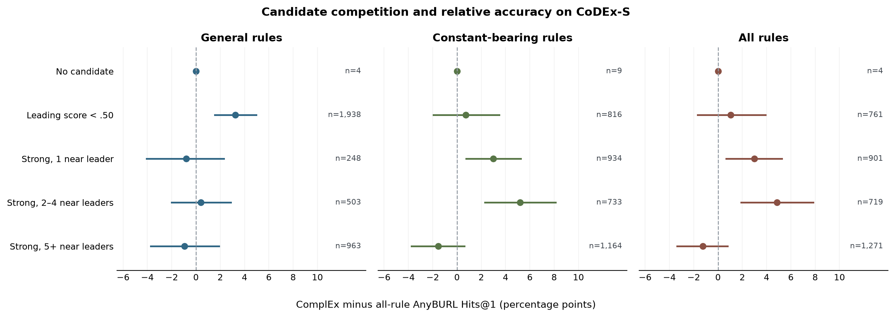

# When do embeddings and symbolic rules complete a knowledge graph better?

**AID 851 project report · 28 November 2026**

## Abstract

This study compares ComplEx embeddings with AnyBURL rules on CoDEx-S to identify when each model succeeds, why the models disagree, and whether the stronger model can be chosen before the correct answer is known. Over 3,656 directional test queries, mean filtered Hits@1 across three ComplEx seeds was 35.63%, and the frozen AnyBURL catalog scored 34.08%. AnyBURL generated the correct answer in 99.78% of queries, making ranking the main source of its errors. Strong symmetry and two-hop rule evidence accompanied an AnyBURL advantage in some query groups. ComplEx recovered 224 of 1,767 strongly supported AnyBURL errors and was more likely to recover them when the correct and wrong candidates had similar rule scores. That comparison used the held-out answer. In the answer-blind experiment, the selector with rule features and the selector with graph controls alone both scored 22.98%. The study therefore identifies concrete conditions and mechanisms of complementarity on CoDEx-S, with no demonstrated accuracy gain from adding the tested rule features to advance model choice.

## 1. Problem definition

A knowledge graph represents a fact as a triple `(head, relation, tail)`. Link prediction asks a model to rank candidate entities for a missing head or tail, as in `(Guinea-Bissau, diplomatic relation, ?)`. Triple classification asks a separate question: how well can a model distinguish held-out positive facts from plausible claims verified as false?

The project asks three questions:

1. When does explicit relational evidence give AnyBURL an advantage over ComplEx?
2. When do misleading or competing rules leave room for ComplEx to recover an AnyBURL error?
3. Can the better model be identified for a query using only evidence available before its answer is revealed?

These questions require different kinds of evidence. A rule grounding can show which training facts generated a candidate. A controlled change to rule aggregation can show whether the ranking decision depends on how those rules are combined. Predicting the winner in advance requires train-only features, validation-based selection, and evaluation on separate facts. This study applies a fine-grained comparison of the kind introduced by Meilicke et al. to a different pair of models and a different benchmark. [Fine-grained evaluation of rule- and embedding-based systems](https://web.informatik.uni-mannheim.de/RuleN/meilicke18.pdf)

## 2. Dataset and evaluation

CoDEx derives its facts from Wikidata and provides official positive splits and verified hard negatives for classification. CoDEx-S was used for all reported model comparisons. CoDEx-M was downloaded and validated against the pinned source revision for future replication. [CoDEx paper](https://aclanthology.org/2020.emnlp-main.669/) · [CoDEx repository](https://github.com/tsafavi/codex) · [CoDEx-S split provenance](data/codex-s/source.json) · [CoDEx-M validation](artifacts/closeout-codex-m-validation.json)

| Dataset | Entities | Relations | Training positives | Validation positives | Test positives | Validation / test hard negatives | Role |
| --- | ---: | ---: | ---: | ---: | ---: | ---: | --- |
| CoDEx-S | 2,034 | 42 | 32,888 | 1,827 | 1,828 | 1,827 / 1,828 | All reported model experiments |
| CoDEx-M | 17,050 | 51 | 185,584 | 10,310 | 10,311 | 10,310 / 10,311 | Split validation |

- **Shared inputs.** Both backends received the same positive training graph, candidate vocabulary and masked queries. Each of the 1,828 test facts produced a head query and a tail query. Known test and validation answers stayed outside model inference and rule mining.
- **Filtered benchmark ranking.** The evaluator removed other known positive answers for a query while keeping the held-out target. Validation used training and validation positives for filtering. Test evaluation used all official positives. Verified negatives were used for classification and targeted error analysis.
- **Metrics and coverage.** Hits@1 and Hits@10 measure how often the target ranks in the first one or ten positions. Mean reciprocal rank (MRR) averages the inverse of the target rank. ComplEx scores the full entity vocabulary with average ranks for score ties. For AnyBURL, the final ranking audit verified exhaustive enumeration of candidates supported by the loaded rules, and abstentions count as misses. Unsupported entities have no comparable native full-universe rank, so exact MRR is reported only for ComplEx.
- **Answer-blind accuracy.** The model selector returns the selected model’s actual first candidate after removing training positives only. The selector receives no held-out answers or evaluator-filtered ranks. This endpoint is reported separately from filtered Hits@1 because benchmark filtering can promote an answer that was lower in the returned ranking.
- **Uncertainty.** Paired bootstrap intervals keep the two directions from each fact together. Where designs include independent retraining, mining, or removal draws, the corresponding analyses account for those additional sources of variation. A frozen rule catalog reused across neural seeds remains one mining realization. The intervals are conditional on the benchmark and exploratory comparisons use pointwise intervals.

[Evaluation protocol](docs/METHODOLOGY.md) · [Native candidate audit](artifacts/next-phase/report.md)

## 3. Models and experimental approach

**ComplEx** learns complex-valued vectors for entities and relations. For a candidate triple, it takes the real part of the sum of elementwise products of the head embedding, relation embedding, and complex conjugate of the tail embedding. The resulting score can capture asymmetric relations and can rank a candidate even if there is no explicit rule proof. The implementation used PyKEEN. The selected recipe used 256 complex coordinates, reciprocal relations, per-triple cross-entropy against all candidate entities, Adam at a learning rate of 0.003, and a maximum of 40 epochs. The recipe and each checkpoint were selected by validation MRR. The original 10-epoch pilot used sampled negatives and a different configuration. Its mean test MRR was 0.2046, compared with 0.4535 for the selected recipe. Changes in objective, reciprocals, dimension, regularization and budget make this a recipe comparison. The pilot’s weakness cannot be attributed to epoch count alone. [ComplEx paper](https://proceedings.mlr.press/v48/trouillon16.html) · [Pilot report](artifacts/cpu-pilot-report/report.md) · [Validation search and learning curves](artifacts/next-phase/report.md)

**AnyBURL** samples paths in the training graph and generalizes them into rules. The final unperturbed catalog came from a 60-second run of AnyBURL-23-1x. It contained 470,308 rules: 2,249 general rules with variable endpoints, 467,989 conditional rules with named entities, and 70 unconditional priors. PyClause applied the rules and recorded supporting training facts. The adjusted score was `family weight × support / (number of predictions + 5)` under the installed settings. Maxplus compares each candidate’s sorted rule-score sequence lexicographically, then uses training frequency and native entity-ID order for remaining ties. This makes individual rule contributions inspectable. It also means the highest scalar score alone can hide how later rules resolve a tie. The scores express learned training support and are uncalibrated at the candidate level. [AnyBURL paper](https://link.springer.com/article/10.1007/s00778-023-00800-5) · [PyClause paper](https://ijcai.org/proceedings/2024/991) · [Frozen inventory and audit](artifacts/next-phase/report.md)

**Comparison design.** The study began with shared baselines, split-integrity and backend checks, and query-level joins. It then combined four approaches:

| Approach | What it reveals | Main limitation |
| --- | --- | --- |
| Paired query and evidence analysis | Where the same queries are easy or hard for each model, and what rules actually fired | Relations, entity degree and local graph structure co-vary |
| Frozen rule ablation and reranking | How predictions respond to changing the rule inventory or how fixed evidence is scored | Effects depend on the learned catalog and tested scoring procedures |
| Graph deletion with fresh training and frozen-rule reapplication | How reduced training evidence changes both systems, and which observed rule proofs are lost | Deletion changes paths, local degree and candidate frequency together |
| Validation-trained model selection | Whether features available at inference improve actual top-answer choice | The features cover selected aspects of rule evidence and were tested within CoDEx-S |

Early AnyBURL pilots had restricted retrieval lists. The audit found queries for which increasing the retrieval cap exposed additional candidates. Final frozen evaluations therefore set the cap above the entity universe, disabled early search pruning, and checked that rankings matched with a still larger cap on masked validation queries. This corrected how coverage and ranking could be interpreted. The pipeline also retains vocabulary maps, split hashes, run configurations, independent mining identifiers and checked rule witnesses. [Audit and baseline protocol](artifacts/next-phase/report.md) · [Implementation and verification status](docs/STATUS.md)

## 4. Baseline results and rule contributions

All values below use benchmark-filtered test ranks. The main query-level diagnostics use seed 2, selected by validation MRR. Aggregate baseline results also report all three seeds.

| Model or rule inventory | Hits@1 | Hits@10 | Exact MRR |
| --- | ---: | ---: | ---: |
| ComplEx, three-seed mean | 35.63% | 64.04% | 0.4535 |
| ComplEx, validation-selected seed 2 | 35.56% | 64.06% | 0.4528 |
| AnyBURL, all rules | 34.08% | 62.47% | — |
| AnyBURL, general rules only | 27.49% | 52.71% | — |
| AnyBURL, conditional constant-bearing rules only | 32.06% | 61.87% | — |
| Training relation-frequency baseline | 12.14% | — | — |

The three-seed mean ComplEx advantage over all rules was **+1.55 percentage points**, with a paired 95% interval of **+0.44 to +2.69**. The selected ComplEx and frozen AnyBURL both solved 1,020 queries. ComplEx alone solved 280, AnyBURL alone solved 226, and both missed 2,130. These exclusive successes measure the opportunity for model selection after scoring. They can only be identified with the held-out answers. [Baseline metrics and paired intervals](artifacts/next-phase/report.md) · [Seed-2 paired outcomes](artifacts/evidence-advantage/overall.csv)

Conditional constant-bearing rules added information beyond relation popularity. They reached **32.06% Hits@1** versus **12.14%** for a baseline that ranks candidates by their training frequency for the target relation and prediction direction. Adding constant-bearing rules to the fixed general subset corrected 386 predictions and turned 145 correct predictions into misses, a net **+6.59 percentage points**. Adding general rules to constants yielded **+2.02 points**. Adding unconditional priors to the union yielded the same Hits@1 in this catalog. These results support retaining both conditional rule families. [Frequency baseline](artifacts/evidence-advantage/frequency-baseline.csv) · [Family ablations](artifacts/next-phase/report.md)

The initial short-budget length sweep changed the learned inventory along with the maximum cyclic body length. For caps of one, two and three, retrieved-list Hits@1 was 33.78%, 32.90% and 27.76%, while constant-bearing rule counts fell from 111,292 to 558. The corrected experiment filtered each frozen catalog by general-rule length and reapplied the same constant-bearing rules. Across the original and two independent 60-second catalogs, raising the general length cap from one to three improved general-only Hits@1 by **14.72–15.34 points**. With constants held fixed, the gain was **0.08–0.19 points**, with all three paired intervals spanning zero. Longer general rules helped the general system substantially, and much of their net top-rank benefit overlapped with what constants already supplied. [Initial length pilot](artifacts/rule-length-pilot-report/report.md) · [Three-catalog replication](artifacts/closeout/rule-length-comparison.csv)

## 5. When explicit rules help

Queries were grouped by the strongest applicable general rule of each structural type among train-filtered candidates. A high score was at least 0.50. These groups were defined using the masked query and may overlap.

| Rule evidence present | Queries | ComplEx Hits@1 | AnyBURL Hits@1 | ComplEx minus AnyBURL, pp (95% CI) |
| --- | ---: | ---: | ---: | ---: |
| Strong symmetry | 572 | 75.52% | 78.67% | −3.15 [−5.97, −0.18] |
| Strong two-hop composition | 422 | 34.60% | 38.63% | −4.03 [−7.26, −0.74] |
| Strong three-hop composition | 1,426 | 38.64% | 39.62% | −0.98 [−3.11, +1.08] |
| Weak general evidence with multiple near leaders | 1,782 | 27.61% | 24.30% | +3.31 [+1.55, +5.06] |

Symmetry and two-hop evidence marked cohorts in which AnyBURL led. The same threshold produced empty strong inversion and subsumption groups. Earlier descriptions of degree, relation frequency and cardinality also found varying gaps. For example, the three-seed ComplEx advantage was 5.90 points in the middle known-entity degree group and 0.41 points in the high-degree group. Such groups differ in which relations and entities they contain, so their outcomes describe the benchmark rather than isolate a cause. [Logical structure results](artifacts/evidence-advantage/logical-structures.csv) · [Degree and relation diagnostics](artifacts/next-phase/report.md#structural-and-relational-scenarios)

In a separate retrospective comparison, **108 queries were solved only by AnyBURL and had a strong general rule directly supporting the correct answer**. Across all 1,042 queries with that support, AnyBURL scored 70.83% and ComplEx scored 68.62%. The +2.21-point AnyBURL advantage had an interval of −0.57 to +4.86. With weaker or absent general support for the correct answer, ComplEx led 22.38% to 19.43%. These categories require the answer and serve as explanations of observed outcomes. [Correct-answer support analysis](artifacts/rule-rescues/general-rule-comparisons.csv)

**Worked example.** For the head query `(?, sibling, Marlon Jackson)`, AnyBURL ranked the held-out answer Jackie Jackson first. A general rule combined the facts that La Toya Jackson was recorded as Jackie Jackson’s sibling and that Joe Jackson had both La Toya and Marlon as children. The rule’s adjusted score was 0.880, and general rules alone also put Jackie first. ComplEx ranked Marlon first. The rule and its checked training facts show the explicit evidence for AnyBURL’s answer. [Worked query and rule grounding](artifacts/rule-rescues/report.md#worked-examples)

## 6. When misleading or competing rules hurt

AnyBURL produced the correct candidate in **3,648 of 3,656** queries, but ranked it first in **1,246**. Of the 2,410 top-rank mistakes, 2,402 retained the correct candidate. In 2,158 of those, the leading rule for the wrong answer had a higher adjusted score than the leading rule for the correct answer. Later scores broke the initial tie in 243 more, and one full score sequence tied. The benchmark explicitly verifies 48 of these first-ranked alternatives as false. In 31 cases, a rule with adjusted score of at least 0.50 still led the false answer. This establishes actual misleading rule predictions within the benchmark. Other mismatches merely differ from the held-out target. [Ranking-error diagnosis](artifacts/rule-error-diagnosis/report.md)

Training support also mattered in the descriptive confidence analysis. For conditional constant-bearing rules with raw mining confidence of at least 0.80, the family’s train-only top answer was correct on 3.34% of 299 queries when the leading rule had support of at most 10, and 25.91% of 1,320 queries when it had support above 50. The groups differ in their queries and rules. The contrast shows why a high mining confidence needs context about the amount of supporting evidence. [Confidence and support by rule family](artifacts/evidence-advantage/confidence-support.csv)

The two rule families supplied another signal of query difficulty. When their train-only top answers agreed (985 queries), filtered Hits@1 was 65.69% for all-rule AnyBURL and 64.06% for ComplEx. When they disagreed (2,662 queries), the corresponding scores were 22.50% and 25.13%, a ComplEx lead of **2.63 points** [1.20, 4.09]. Candidate competition alone was less conclusive. Among queries with strong all-rule support, the matched change in the ComplEx advantage between five-or-more near leaders and one near leader was **+1.51 points** [−6.03, +11.49]. Matching used relation, direction, known-entity degree and training-answer multiplicity. [Family agreement](artifacts/evidence-advantage/family-conflict.csv) · [Matched candidate competition](artifacts/evidence-advantage/matched-competition.csv)

A ranking intervention held rules and candidates fixed while varying confidence weights and aggregation. Noisy-or pools evidence across all supporting rules and can give extra influence to correlated proofs. It recovered some mistakes, but introduced more new misses than it repaired.

| Ranking on the same candidates | Filtered Hits@1 | Native misses recovered | Native correct answers lost |
| --- | ---: | ---: | ---: |
| Original maxplus | 34.08% | — | — |
| Reweighted maxplus | 32.58% | 15 | 70 |
| Noisy-or with original rule confidences | 23.06% | 134 | 537 |
| Reweighting and noisy-or | 22.95% | 132 | 539 |

Reweighting improved the leading-score comparison between a known true answer and a selected verified false rival from 59.92% to 62.89%, while reducing full-ranking accuracy. Ranking first requires beating all eligible candidates. The tests demonstrate that misleading rules and ranking decisions can both contribute, with the relative contribution across individual failures still unresolved. [Fixed-candidate reranking comparisons](artifacts/rule-error-diagnosis/report.md)

Among the **1,767** errors with a strongly supported wrong answer, ComplEx recovered **224 (12.68%)**, repeated the same wrong answer **489** times, and missed with a different outcome **1,054** times. Of the 31 explicitly verified false top answers in that group, ComplEx solved 5, repeated 11, and missed differently on 15. It recovered **23.54%** of strongly supported errors when the correct and wrong candidates’ leading scores were within 0.05, versus **8.01%** with a wider gap. The adjusted rescue-rate contrast was **+19.25 points** [14.94, 22.74] after matching relation, direction and known-entity degree. The gap is observable after the correct answer is revealed. [Comparative rescue analysis](artifacts/rule-rescues/report.md)

**Worked examples.** A rule connecting membership in the International Finance Corporation to diplomatic relations with Taiwan had score 0.871 for Guinea-Bissau. The reverse diplomatic-relation edge supported the benchmark’s answer, the People’s Republic of China, at 0.867. The benchmark labels Taiwan false for this query, and ComplEx ranked the benchmark answer first. In the Carl Orff citizenship query, maxplus ranked the United States first, backed by an occupation-based rule. Noisy-or ranked the correct answer, German Empire, first with the same individual rules and candidates. The first example exposes a misleading learned implication. The second shows that the combination of available evidence can determine which answer wins. Neither example reveals the internal mechanism of the embedding prediction. [Guinea-Bissau case](artifacts/rule-rescues/report.md#worked-examples) · [Carl Orff case](artifacts/rule-error-diagnosis/report.md#concrete-queries)

## 7. Can we choose the better model before seeing the answer?

The baseline selector used relation, prediction direction, known-entity degree, training relation frequency, and observed answer multiplicity. The evidence-aware selector added rule confidence, support, candidate competition, rule-family agreement, and applicable rule structures. Both multinomial logistic selectors were fitted on validation disagreements and evaluated on initially masked test queries. A final simple policy used AnyBURL’s first-versus-second score gap after training-only filtering. The cutoff was 0.05, and validation selected ComplEx in both groups.

| Method | Test accuracy of the returned answer |
| --- | ---: |
| Always AnyBURL | 21.39% |
| Always ComplEx | 22.68% |
| Top-two score-gap policy | 22.68% |
| Graph controls selector | 22.98% |
| Graph controls plus rule evidence | 22.98% |

Adding rule evidence changed actual answer accuracy by **0.00 percentage points** compared with graph controls alone, with a paired 95% interval of **−0.49 to +0.52**. Each selector found 44 correct answers that the other missed. For 1,475 test queries whose masked input was absent from validation, the evidence-aware gain was **+0.20 points** [−0.62, +1.03]. Rule features lowered three-class Brier loss from 0.268 to 0.262, indicating better probability scores by that measure, while winner AUC on disagreements with one correct model changed from 0.603 to 0.591. Among all 2,341 train-only disagreements, both models missed 1,914, which limits what switching between their outputs can recover.

The top-two gap is computable in advance and compares whatever candidates the rules rank first and second. It can therefore be small even when the correct answer is far down the ranking. The close-versus-wide contrast in the ComplEx advantage was **−0.49 points** [−6.17, +5.47] for this answer-blind gap. The observed retrospective rescue pattern does not establish a reliable pre-answer decision rule. [Final answer-blind report](artifacts/answer-blind-closeout/report.md) · [Locked per-query choices](artifacts/answer-blind-closeout/locked-test-choices.csv)

## 8. Robustness and graph interventions

### Verified hard negatives

For triple classification, the test sample contained 1,828 positives and 1,828 verified hard negatives. Scores were calibrated on validation, and AnyBURL abstentions were counted explicitly. All-rule AnyBURL outperformed the selected ComplEx checkpoint on this task, with **AUROC 0.8360 vs 0.7703**, **average precision 0.8657 vs 0.7519**, and **overall accuracy 76.89% vs 70.19%**. The result concerns discrimination on this balanced hard-negative benchmark. It complements the link-ranking results by testing a different notion of reliability. [Classification metrics](artifacts/next-phase/classification-metrics.csv)

### Training-edge removal

The five-condition study compared the original graph with four 90%-retention variants: uniform random removal, relation-stratified random removal, removal targeting the local neighborhoods of selected entities, and a random control with exactly matched relation counts. There were three fresh ComplEx fits and two fresh AnyBURL inventories per condition, plus frozen applications of the original general and constant-bearing catalogs. Across the four reduced graphs, ComplEx lost **2.74–3.23 percentage points** in Hits@1 and fresh all-rule AnyBURL lost **2.24–2.86 points**. All intervals for changes in the relative gap included zero. With the rules frozen, targeted deletion reduced general-rule Hits@1 by **1.72 points** and constant-bearing Hits@1 by **0.55 points**, with the same correct-answer generation rates. The frozen analysis isolates the change in the graph seen by these catalogs, including changes in native frequency tie breaking. [Five-condition retraining and frozen application](artifacts/phase5/replicated-report/report.md)

Three new paired graph draws repeated the targeted versus relation-matched comparison. Across 18 fresh ComplEx fits and 12 fresh rule inventories, the change in the ComplEx–AnyBURL gap was **+0.51 points** [−0.65, +1.71]. Targeted removal erased **4.01 points less** of the mean original general-rule groundings than its matched control [−4.91, −3.17]. Only one of 10,938 originally supported fact-by-arm-by-draw observations lost every general-rule grounding. These repeated observations reuse the same facts. The result shows why deleting edges around selected entities was an unreliable proxy for removing the rules’ usable evidence. [Three matched graph draws](artifacts/removal-replication/report/report.md)

### Direct proof deletion and noise feasibility

Two training-only pilots targeted edges by rule-body incidence and estimated marginal grounding loss. Each design used three draws with controls matched on relation and endpoint degree bins. All six contrasts fell below the predeclared five-point gain in grounding loss for targeted deletion. A subsequent audit targeted the last available proofs within a frozen two-hop general catalog. The contrasts were **+2.26, +6.29 and +3.31 points**, all below the eight-point gate. A wider general catalog and the constant-bearing catalog each retained support on every audit case that exhausted the selected two-hop proofs. These were feasibility results, so benchmark retraining was reserved for designs that passed their gates. Separately, 17 of 18 configured noise proposals collided with held-out facts or verified negatives and were rejected at the split-integrity check. No noise-robustness scores were produced. [Direct rule-body pilots](artifacts/evidence-intervention/report.md) · [Last-proof audit](artifacts/closeout/last-proof/verified-summary.csv) · [Noise design audit](artifacts/closeout/noise-design-audit.csv)

## 9. Advantages, limitations and conclusions

ComplEx provides full candidate rankings and can recover facts from statistical relationships distributed across the graph. Its stronger recipe also shows how sensitive a comparison can be to training choices. The scalar score alone supplies no factual witness for an individual answer. AnyBURL supplies explicit rules and checkable training facts, making it possible to diagnose both sound support and misleading generalizations. Its performance depends on which rules were mined, how they are scored, and how competing proofs are combined. Both models gained from retaining training graph information, and neither was immune to common errors.

The study is bounded by one repeatedly examined benchmark, one principal embedding architecture, and finite training and mining budgets. Larger retention sweeps, trained CoDEx-M comparisons, and a successful last-proof intervention remain outside the completed results. Candidate-level confidence summaries, matched comparisons and rule interventions answer different questions. A witnessed rule can explain why a candidate was generated, and a fixed-candidate rerank can test the sensitivity of that rank. Explaining the embedding’s internal decision would require different evidence. Benchmark positives are incomplete, so independently verified negatives carry particular weight when calling an alternative false.

The clearest answers to the three questions are:

1. **Rules benefit from explicit support.** Strong symmetry and two-hop evidence marked AnyBURL advantages in particular CoDEx-S groups. Verified general-rule groundings explained some cases that only AnyBURL solved.
2. **Embeddings sometimes recover misleading rule predictions.** AnyBURL’s main problem was ranking a generated answer first. ComplEx recovered a minority of strong-rule misses, with higher rescue rates when the correct and wrong rule scores were close in hindsight.
3. **Advance model choice remains unresolved.** The top-two gap did not provide a switching policy that improved on ComplEx. The richer evidence features yielded the same answer accuracy as graph controls alone. The work supports a retrospective account of complementary strengths, with independent evidence still needed for a reliable model selector.

## Reproducibility and source artifacts

Configurations, saved masked-query outputs, rule inventories, groundings and execution status are indexed in the project. The verified suite recorded 110 passing tests and 38 passing subtests, including native-backend and official split checks. The checks validate the pipeline and its contracts. Statistical generalization is addressed by the experimental designs and their limits. [Verified evidence index](artifacts/closeout/verified-evidence.json) · [Test record](artifacts/closeout/tests.xml) · [Repository overview](README.md)

| To inspect | Saved evidence |
| --- | --- |
| Baselines, training curves, rules and hard negatives | [Audited baseline report](artifacts/next-phase/report.md) |
| Rule-family conflict, score support and 20 worked queries | [Query evidence report](artifacts/evidence-advantage/report.md) · [Case studies](artifacts/evidence-advantage/case-studies.md) |
| Relative successes and controlled reranking | [Reranking report](artifacts/rule-error-diagnosis/report.md) · [Rescue outcomes](artifacts/rule-rescues/query-level-outcomes.csv) |
| Graph intervention provenance and uncertainty | [Replicated retraining report](artifacts/phase5/replicated-report/report.md) · [Matched deletion report](artifacts/removal-replication/report/report.md) |
| Answer-blind test decisions and results | [Decision protocol](artifacts/answer-blind-closeout/decision-protocol.json) · [Paired test results](artifacts/answer-blind-closeout/test-comparisons.csv) |
