# AID 851: embedding–rule comparison

This report is generated from saved artifacts. Missing runs remain missing; smoke checks are not benchmark findings.

Training budgets and selection history must be read with the results. Development/CPU-pilot runs use shorter budgets and do not establish final model-family superiority.

## Execution status

| run | status | mode | error |
| --- | --- | --- | --- |
| runs/codex-s-cpu-pilot-refined/seed-0 | complete | development | unavailable |
| runs/codex-s-cpu-pilot-refined/seed-1 | complete | development | unavailable |
| runs/codex-s-cpu-pilot-refined/seed-2 | complete | development | unavailable |


**Fixed symbolic baseline:** saved rule models are reused across neural seeds. Bootstrap intervals estimate neural-training and query variation conditional on those rule models; rule-mining variability is not estimated. Repeated symbolic training runtimes refer to the original mining job and must not be summed as new training work.


## Overall baselines

| run | mode | backend | n_queries | hits1 | hits10 | mrr_exact | coverage | covered_hits1 | hits_metric_status | training_seconds | inference_seconds |
| --- | --- | --- | --- | --- | --- | --- | --- | --- | --- | --- | --- |
| runs/codex-s-cpu-pilot-refined/seed-0 | development | embedding | 3656 | 0.1214 | 0.3534 | 0.2000 | 1.0000 | 0.1214 | exact | 22.4247 | 1.7588 |
| runs/codex-s-cpu-pilot-refined/seed-0 | development | rules | 3656 | 0.3373 | 0.5949 | unavailable | 0.9989 | 0.3376 | retrieved-list only; censored | 12.7143 | 32.9498 |
| runs/codex-s-cpu-pilot-refined/seed-1 | development | embedding | 3656 | 0.1261 | 0.3479 | 0.2007 | 1.0000 | 0.1261 | exact | 16.9569 | 2.0120 |
| runs/codex-s-cpu-pilot-refined/seed-1 | development | rules | 3656 | 0.3373 | 0.5949 | unavailable | 0.9989 | 0.3376 | retrieved-list only; censored | 12.7143 | 33.2667 |
| runs/codex-s-cpu-pilot-refined/seed-2 | development | embedding | 3656 | 0.1392 | 0.3583 | 0.2132 | 1.0000 | 0.1392 | exact | 17.6042 | 1.8339 |
| runs/codex-s-cpu-pilot-refined/seed-2 | development | rules | 3656 | 0.3373 | 0.5949 | unavailable | 0.9989 | 0.3376 | retrieved-list only; censored | 12.7143 | 33.5896 |


Exact MRR is shown only for complete entity rankings. Rule Hits and reciprocal-rank proxies from retrieval lists remain censored; they cannot establish full-ranking superiority. Scores are not probabilities.


## Scenario performance and complementarity


### Experiment A


Cohort 0; runs: runs/codex-s-cpu-pilot-refined/seed-0, runs/codex-s-cpu-pilot-refined/seed-1, runs/codex-s-cpu-pilot-refined/seed-2.

| group | value | n_queries | n_triples | n_seeds | embedding_hits1 | rule_hits1 | rule_coverage | difference | ci_low | ci_high | metric_status |
| --- | --- | --- | --- | --- | --- | --- | --- | --- | --- | --- | --- |
| rule_covered | False | 12 | 3 | 3 | 0.0000 | 0.0000 | 0.0000 | 0.0000 | 0.0000 | 0.0000 | retrieved-list proxy |
| rule_covered | True | 10956 | 1827 | 3 | 0.1291 | 0.3376 | 1.0000 | -0.2086 | -0.2266 | -0.1907 | retrieved-list proxy |
| rule_evidence_kind | mixed | 10941 | 1825 | 3 | 0.1292 | 0.3381 | 1.0000 | -0.2088 | -0.2273 | -0.1924 | retrieved-list proxy |
| rule_evidence_kind | relational_path | 15 | 5 | 3 | 0.0000 | 0.0000 | 1.0000 | 0.0000 | 0.0000 | 0.0000 | retrieved-list proxy |
| rule_evidence_kind | unknown | 12 | 3 | 3 | 0.0000 | 0.0000 | 0.0000 | 0.0000 | 0.0000 | 0.0000 | retrieved-list proxy |
| rule_truth_diagnostic | no_rule_applies | 12 | 3 | 3 | 0.0000 | 0.0000 | 0.0000 | 0.0000 | 0.0000 | 0.0000 | retrieved-list proxy |
| rule_truth_diagnostic | rule_generates_truth | 2742 | 661 | 3 | 0.0620 | 0.1324 | 1.0000 | -0.0704 | -0.0979 | -0.0471 | retrieved-list proxy |
| rule_truth_diagnostic | strong_rule_supports_truth | 5817 | 1154 | 3 | 0.2058 | 0.5735 | 1.0000 | -0.3677 | -0.3969 | -0.3401 | retrieved-list proxy |
| rule_truth_diagnostic | truth_not_returned_support_unknown | 2397 | 789 | 3 | 0.0196 | 0.0000 | 1.0000 | 0.0196 | 0.0125 | 0.0273 | retrieved-list proxy |


Oracle complementarity (diagnostic only):

```json
{
  "n_queries": 10968,
  "k": 1,
  "counts": {
    "both_correct": 994,
    "only_embeddings": 420,
    "only_rules": 2705,
    "both_incorrect": 6849
  },
  "proportions": {
    "both_correct": 0.09062727935813275,
    "only_embeddings": 0.038293216630196934,
    "only_rules": 0.24662654996353026,
    "both_incorrect": 0.62445295404814
  },
  "oracle_union_success": 0.37554704595185995,
  "error_jaccard": 0.6866853819931823,
  "oracle_status": "diagnostic upper bound for recorded successes; not deployable",
  "ranking_status": "rule retrieved-list outcomes, potentially censored"
}
```


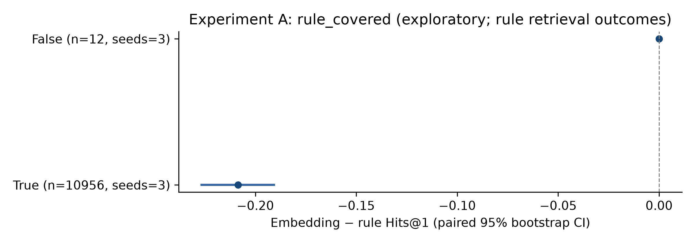


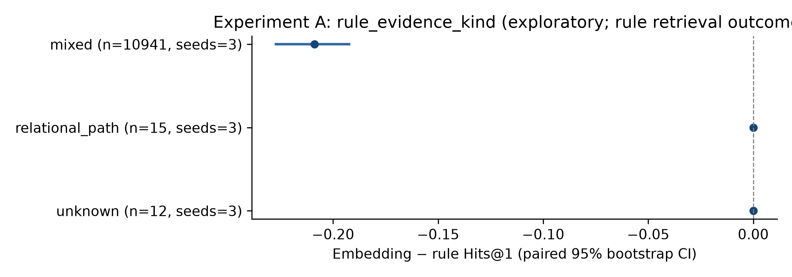


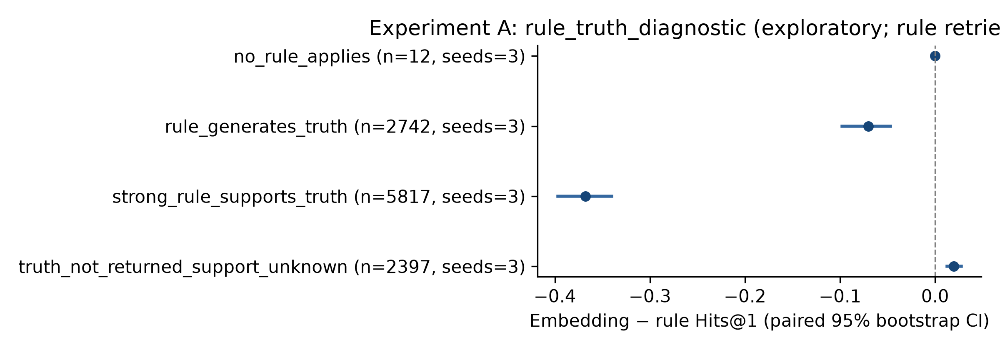


### Experiment B


**Controlled intervention unexecuted.** The following strata are baseline diagnostics only; they do not measure the effect of removal, length restrictions, or noise. Hard-negative classification, when present, is reported separately below.


Cohort 0; runs: runs/codex-s-cpu-pilot-refined/seed-0, runs/codex-s-cpu-pilot-refined/seed-1, runs/codex-s-cpu-pilot-refined/seed-2.

| group | value | n_queries | n_triples | n_seeds | embedding_hits1 | rule_hits1 | rule_coverage | difference | ci_low | ci_high | metric_status |
| --- | --- | --- | --- | --- | --- | --- | --- | --- | --- | --- | --- |
| known_degree_group | high | 7128 | 1716 | 3 | 0.1463 | 0.3350 | 0.9987 | -0.1887 | -0.2105 | -0.1680 | retrieved-list proxy |
| known_degree_group | low | 2535 | 809 | 3 | 0.0907 | 0.3479 | 0.9988 | -0.2572 | -0.2921 | -0.2205 | retrieved-list proxy |
| known_degree_group | medium | 1305 | 414 | 3 | 0.1080 | 0.3287 | 1.0000 | -0.2207 | -0.2726 | -0.1766 | retrieved-list proxy |
| target_degree_group | high | 7128 | 1716 | 3 | 0.1828 | 0.4949 | 0.9987 | -0.3121 | -0.3367 | -0.2879 | retrieved-list proxy |
| target_degree_group | low | 2535 | 809 | 3 | 0.0237 | 0.0391 | 1.0000 | -0.0154 | -0.0297 | -0.0016 | retrieved-list proxy |
| target_degree_group | medium | 1305 | 414 | 3 | 0.0391 | 0.0552 | 0.9977 | -0.0161 | -0.0422 | 0.0077 | retrieved-list proxy |
| known_entity_targeted | False | 10968 | 1828 | 3 | 0.1289 | 0.3373 | 0.9989 | -0.2083 | -0.2260 | -0.1901 | retrieved-list proxy |


Oracle complementarity (diagnostic only):

```json
{
  "n_queries": 10968,
  "k": 1,
  "counts": {
    "both_correct": 994,
    "only_embeddings": 420,
    "only_rules": 2705,
    "both_incorrect": 6849
  },
  "proportions": {
    "both_correct": 0.09062727935813275,
    "only_embeddings": 0.038293216630196934,
    "only_rules": 0.24662654996353026,
    "both_incorrect": 0.62445295404814
  },
  "oracle_union_success": 0.37554704595185995,
  "error_jaccard": 0.6866853819931823,
  "oracle_status": "diagnostic upper bound for recorded successes; not deployable",
  "ranking_status": "rule retrieved-list outcomes, potentially censored"
}
```


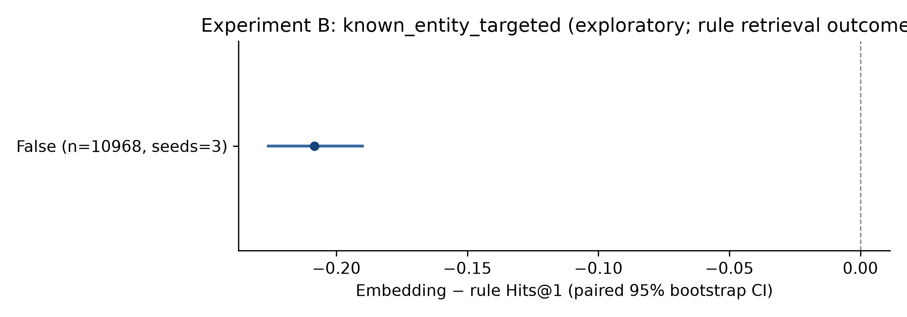


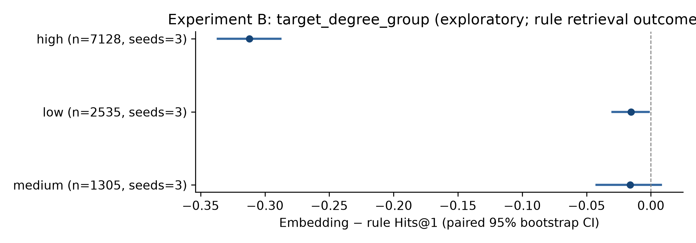


### Experiment C


Cohort 0; runs: runs/codex-s-cpu-pilot-refined/seed-0, runs/codex-s-cpu-pilot-refined/seed-1, runs/codex-s-cpu-pilot-refined/seed-2.

| group | value | n_queries | n_triples | n_seeds | embedding_hits1 | rule_hits1 | rule_coverage | difference | ci_low | ci_high | metric_status |
| --- | --- | --- | --- | --- | --- | --- | --- | --- | --- | --- | --- |
| relation | P101 | 120 | 20 | 3 | 0.0500 | 0.4000 | 1.0000 | -0.3500 | -0.4419 | -0.2500 | retrieved-list proxy |
| relation | P102 | 48 | 8 | 3 | 0.1458 | 0.4375 | 1.0000 | -0.2917 | -0.4583 | -0.1042 | retrieved-list proxy |
| relation | P1050 | 12 | 2 | 3 | 0.0833 | 0.7500 | 1.0000 | -0.6667 | -1.0000 | -0.5000 | retrieved-list proxy |
| relation | P106 | 3558 | 593 | 3 | 0.0453 | 0.1585 | 1.0000 | -0.1133 | -0.1355 | -0.0908 | retrieved-list proxy |
| relation | P108 | 78 | 13 | 3 | 0.0385 | 0.1154 | 1.0000 | -0.0769 | -0.1923 | 0.0128 | retrieved-list proxy |
| relation | P112 | 12 | 2 | 3 | 0.0000 | 0.0000 | 0.5000 | 0.0000 | 0.0000 | 0.0000 | retrieved-list proxy |
| relation | P119 | 24 | 4 | 3 | 0.1250 | 0.1250 | 1.0000 | 0.0000 | -0.2500 | 0.2500 | retrieved-list proxy |
| relation | P1303 | 426 | 71 | 3 | 0.0845 | 0.3873 | 1.0000 | -0.3028 | -0.3732 | -0.2254 | retrieved-list proxy |
| relation | P135 | 18 | 3 | 3 | 0.0000 | 0.5000 | 1.0000 | -0.5000 | -1.0000 | 0.0000 | retrieved-list proxy |
| relation | P136 | 612 | 102 | 3 | 0.0735 | 0.1422 | 1.0000 | -0.0686 | -0.1209 | -0.0179 | retrieved-list proxy |
| relation | P138 | 6 | 1 | 3 | 0.0000 | 0.0000 | 0.0000 | 0.0000 | 0.0000 | 0.0000 | retrieved-list proxy |
| relation | P140 | 120 | 20 | 3 | 0.0083 | 0.2000 | 1.0000 | -0.1917 | -0.2917 | -0.0917 | retrieved-list proxy |
| relation | P1412 | 468 | 78 | 3 | 0.0726 | 0.4423 | 1.0000 | -0.3697 | -0.4338 | -0.3055 | retrieved-list proxy |
| relation | P161 | 6 | 1 | 3 | 0.0000 | 0.5000 | 1.0000 | -0.5000 | -0.5000 | -0.5000 | retrieved-list proxy |
| relation | P17 | 18 | 3 | 3 | 0.1111 | 0.3333 | 1.0000 | -0.2222 | -0.5000 | 0.0000 | retrieved-list proxy |
| relation | P172 | 114 | 19 | 3 | 0.1579 | 0.2895 | 1.0000 | -0.1316 | -0.2544 | 0.0178 | retrieved-list proxy |
| relation | P19 | 120 | 20 | 3 | 0.0167 | 0.1250 | 1.0000 | -0.1083 | -0.2250 | -0.0167 | retrieved-list proxy |
| relation | P20 | 132 | 22 | 3 | 0.1288 | 0.2955 | 1.0000 | -0.1667 | -0.2955 | -0.0225 | retrieved-list proxy |
| relation | P2348 | 18 | 3 | 3 | 0.0556 | 0.5000 | 1.0000 | -0.4444 | -0.5000 | -0.2778 | retrieved-list proxy |
| relation | P26 | 18 | 3 | 3 | 0.4444 | 1.0000 | 1.0000 | -0.5556 | -1.0000 | -0.3333 | retrieved-list proxy |
| relation | P264 | 324 | 54 | 3 | 0.0340 | 0.1111 | 1.0000 | -0.0772 | -0.1451 | -0.0093 | retrieved-list proxy |
| relation | P27 | 630 | 105 | 3 | 0.0905 | 0.3000 | 1.0000 | -0.2095 | -0.2858 | -0.1333 | retrieved-list proxy |
| relation | P30 | 60 | 10 | 3 | 0.2500 | 0.6000 | 1.0000 | -0.3500 | -0.6333 | -0.0333 | retrieved-list proxy |
| relation | P3373 | 30 | 5 | 3 | 0.2333 | 0.6000 | 1.0000 | -0.3667 | -0.8000 | -0.0325 | retrieved-list proxy |
| relation | P35 | 12 | 2 | 3 | 0.0833 | 0.7500 | 1.0000 | -0.6667 | -1.0000 | -0.5000 | retrieved-list proxy |
| relation | P361 | 36 | 6 | 3 | 0.4444 | 0.5000 | 1.0000 | -0.0556 | -0.2778 | 0.1111 | retrieved-list proxy |
| relation | P37 | 84 | 14 | 3 | 0.2143 | 0.6429 | 1.0000 | -0.4286 | -0.6429 | -0.2143 | retrieved-list proxy |
| relation | P451 | 6 | 1 | 3 | 0.0000 | 1.0000 | 1.0000 | -1.0000 | -1.0000 | -1.0000 | retrieved-list proxy |
| relation | P463 | 1620 | 270 | 3 | 0.2753 | 0.4074 | 1.0000 | -0.1321 | -0.1815 | -0.0796 | retrieved-list proxy |
| relation | P509 | 72 | 12 | 3 | 0.0000 | 0.1667 | 1.0000 | -0.1667 | -0.3750 | 0.0000 | retrieved-list proxy |
| relation | P530 | 1722 | 287 | 3 | 0.2718 | 0.7735 | 1.0000 | -0.5017 | -0.5575 | -0.4413 | retrieved-list proxy |
| relation | P551 | 102 | 17 | 3 | 0.0686 | 0.2353 | 1.0000 | -0.1667 | -0.2941 | -0.0294 | retrieved-list proxy |
| relation | P69 | 120 | 20 | 3 | 0.1083 | 0.1250 | 1.0000 | -0.0167 | -0.1250 | 0.0835 | retrieved-list proxy |
| relation | P737 | 204 | 34 | 3 | 0.0294 | 0.0882 | 1.0000 | -0.0588 | -0.1324 | 0.0147 | retrieved-list proxy |
| relation | P740 | 6 | 1 | 3 | 0.0000 | 0.0000 | 1.0000 | 0.0000 | 0.0000 | 0.0000 | retrieved-list proxy |
| relation | P749 | 12 | 2 | 3 | 0.3333 | 0.2500 | 1.0000 | 0.0833 | -0.3333 | 0.3333 | retrieved-list proxy |
| cardinality | many-to-many | 8496 | 1416 | 3 | 0.1389 | 0.3390 | 1.0000 | -0.2001 | -0.2221 | -0.1803 | retrieved-list proxy |
| cardinality | many-to-one | 2424 | 404 | 3 | 0.0932 | 0.3267 | 1.0000 | -0.2335 | -0.2715 | -0.1968 | retrieved-list proxy |
| cardinality | one-to-many | 6 | 1 | 3 | 0.0000 | 0.5000 | 1.0000 | -0.5000 | -0.5000 | -0.5000 | retrieved-list proxy |
| cardinality | one-to-one | 42 | 7 | 3 | 0.1905 | 0.5714 | 0.7143 | -0.3810 | -0.7143 | -0.1190 | retrieved-list proxy |
| relation_frequency_group | high | 10116 | 1686 | 3 | 0.1290 | 0.3348 | 1.0000 | -0.2058 | -0.2251 | -0.1885 | retrieved-list proxy |
| relation_frequency_group | low | 84 | 14 | 3 | 0.0833 | 0.3929 | 0.8571 | -0.3095 | -0.5000 | -0.1307 | retrieved-list proxy |
| relation_frequency_group | medium | 768 | 128 | 3 | 0.1328 | 0.3633 | 1.0000 | -0.2305 | -0.2982 | -0.1562 | retrieved-list proxy |
| frequency_degree_stratum | high/high | 6657 | 1594 | 3 | 0.1471 | 0.3348 | 1.0000 | -0.1878 | -0.2100 | -0.1664 | retrieved-list proxy |
| frequency_degree_stratum | high/low | 2277 | 731 | 3 | 0.0927 | 0.3491 | 1.0000 | -0.2565 | -0.2943 | -0.2180 | retrieved-list proxy |
| frequency_degree_stratum | high/medium | 1182 | 375 | 3 | 0.0973 | 0.3071 | 1.0000 | -0.2098 | -0.2595 | -0.1616 | retrieved-list proxy |
| frequency_degree_stratum | low/high | 45 | 11 | 3 | 0.1111 | 0.2667 | 0.8000 | -0.1556 | -0.4286 | 0.0556 | retrieved-list proxy |
| frequency_degree_stratum | low/low | 21 | 6 | 3 | 0.0476 | 0.5714 | 0.8571 | -0.5238 | -0.8571 | -0.1111 | retrieved-list proxy |
| frequency_degree_stratum | low/medium | 18 | 6 | 3 | 0.0556 | 0.5000 | 1.0000 | -0.4444 | -0.8333 | 0.0000 | retrieved-list proxy |
| frequency_degree_stratum | medium/high | 426 | 111 | 3 | 0.1385 | 0.3451 | 1.0000 | -0.2066 | -0.2939 | -0.1250 | retrieved-list proxy |
| frequency_degree_stratum | medium/low | 237 | 72 | 3 | 0.0759 | 0.3165 | 1.0000 | -0.2405 | -0.3596 | -0.1298 | retrieved-list proxy |
| frequency_degree_stratum | medium/medium | 105 | 33 | 3 | 0.2381 | 0.5429 | 1.0000 | -0.3048 | -0.4858 | -0.1212 | retrieved-list proxy |


Oracle complementarity (diagnostic only):

```json
{
  "n_queries": 10968,
  "k": 1,
  "counts": {
    "both_correct": 994,
    "only_embeddings": 420,
    "only_rules": 2705,
    "both_incorrect": 6849
  },
  "proportions": {
    "both_correct": 0.09062727935813275,
    "only_embeddings": 0.038293216630196934,
    "only_rules": 0.24662654996353026,
    "both_incorrect": 0.62445295404814
  },
  "oracle_union_success": 0.37554704595185995,
  "error_jaccard": 0.6866853819931823,
  "oracle_status": "diagnostic upper bound for recorded successes; not deployable",
  "ranking_status": "rule retrieved-list outcomes, potentially censored"
}
```


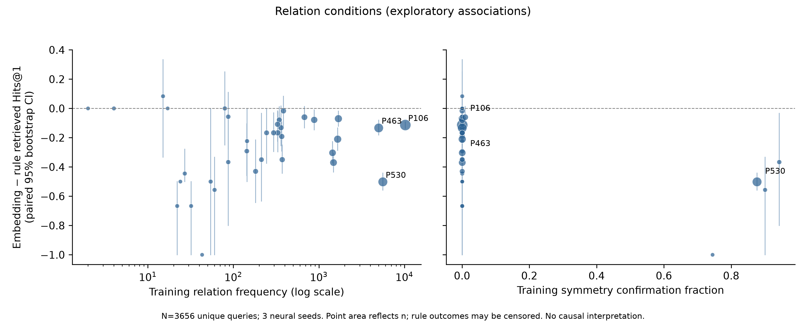


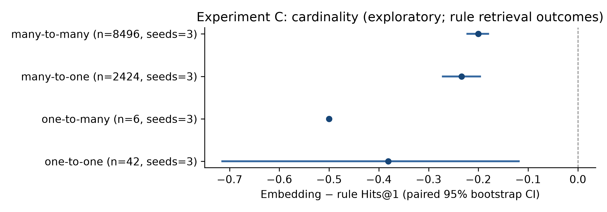


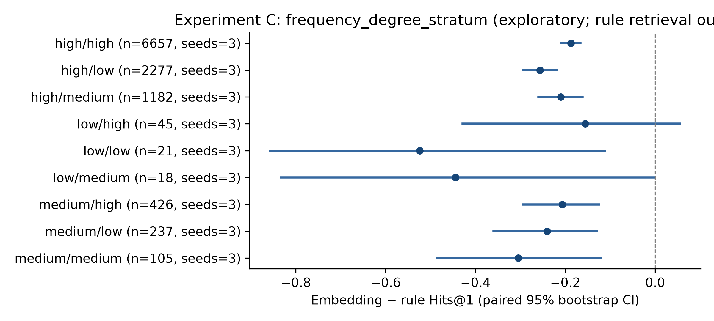


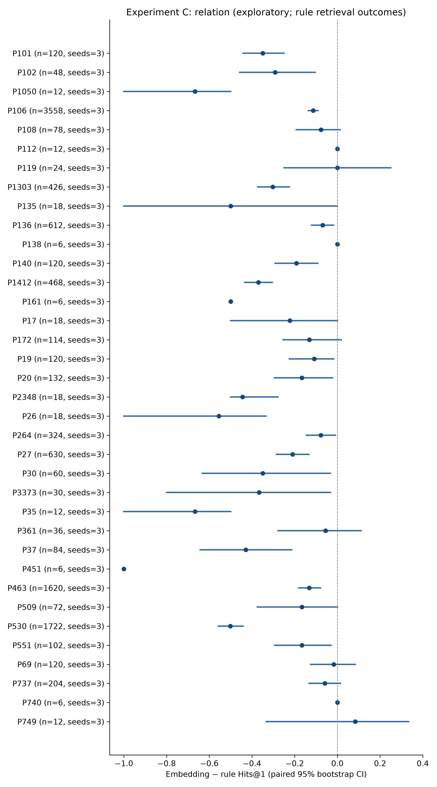


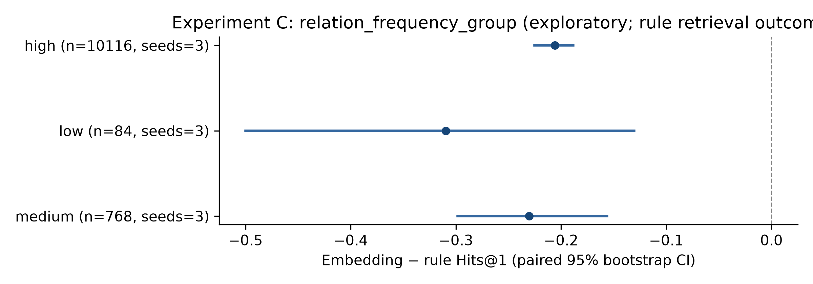


### Experiment D


**Controlled intervention unexecuted.** The following strata are baseline diagnostics only; they do not measure the effect of removal, length restrictions, or noise. Hard-negative classification, when present, is reported separately below.


Cohort 0; runs: runs/codex-s-cpu-pilot-refined/seed-0, runs/codex-s-cpu-pilot-refined/seed-1, runs/codex-s-cpu-pilot-refined/seed-2.

| group | value | n_queries | n_triples | n_seeds | embedding_hits1 | rule_hits1 | rule_coverage | difference | ci_low | ci_high | metric_status |
| --- | --- | --- | --- | --- | --- | --- | --- | --- | --- | --- | --- |
| rule_min_truth_length | 1 | 8523 | 1808 | 3 | 0.1604 | 0.4340 | 1.0000 | -0.2736 | -0.2966 | -0.2517 | retrieved-list proxy |
| rule_min_truth_length | 3 | 36 | 7 | 3 | 0.0000 | 0.0000 | 1.0000 | 0.0000 | 0.0000 | 0.0000 | retrieved-list proxy |
| rule_min_truth_length | None | 2409 | 790 | 3 | 0.0195 | 0.0000 | 0.9950 | 0.0195 | 0.0125 | 0.0274 | retrieved-list proxy |


Oracle complementarity (diagnostic only):

```json
{
  "n_queries": 10968,
  "k": 1,
  "counts": {
    "both_correct": 994,
    "only_embeddings": 420,
    "only_rules": 2705,
    "both_incorrect": 6849
  },
  "proportions": {
    "both_correct": 0.09062727935813275,
    "only_embeddings": 0.038293216630196934,
    "only_rules": 0.24662654996353026,
    "both_incorrect": 0.62445295404814
  },
  "oracle_union_success": 0.37554704595185995,
  "error_jaccard": 0.6866853819931823,
  "oracle_status": "diagnostic upper bound for recorded successes; not deployable",
  "ranking_status": "rule retrieved-list outcomes, potentially censored"
}
```


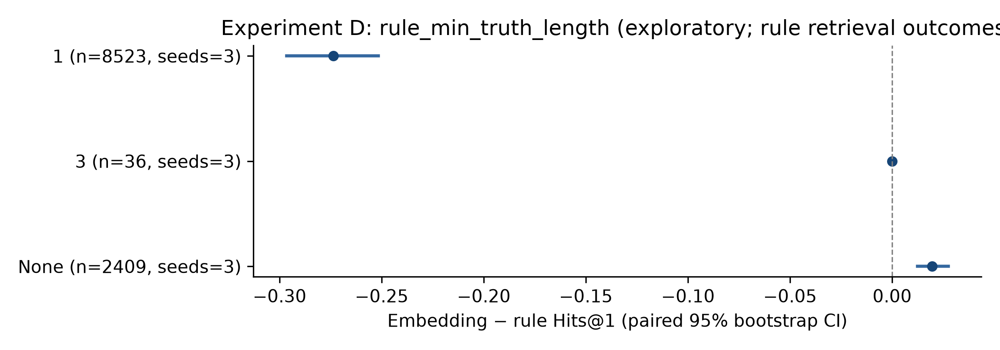


### Experiment E


**Controlled intervention unexecuted.** The following strata are baseline diagnostics only; they do not measure the effect of removal, length restrictions, or noise. Hard-negative classification, when present, is reported separately below.


Cohort 0; runs: runs/codex-s-cpu-pilot-refined/seed-0, runs/codex-s-cpu-pilot-refined/seed-1, runs/codex-s-cpu-pilot-refined/seed-2.

| group | value | n_queries | n_triples | n_seeds | embedding_hits1 | rule_hits1 | rule_coverage | difference | ci_low | ci_high | metric_status |
| --- | --- | --- | --- | --- | --- | --- | --- | --- | --- | --- | --- |
| known_degree_group | high | 7128 | 1716 | 3 | 0.1463 | 0.3350 | 0.9987 | -0.1887 | -0.2105 | -0.1680 | retrieved-list proxy |
| known_degree_group | low | 2535 | 809 | 3 | 0.0907 | 0.3479 | 0.9988 | -0.2572 | -0.2921 | -0.2205 | retrieved-list proxy |
| known_degree_group | medium | 1305 | 414 | 3 | 0.1080 | 0.3287 | 1.0000 | -0.2207 | -0.2726 | -0.1766 | retrieved-list proxy |


Oracle complementarity (diagnostic only):

```json
{
  "n_queries": 10968,
  "k": 1,
  "counts": {
    "both_correct": 994,
    "only_embeddings": 420,
    "only_rules": 2705,
    "both_incorrect": 6849
  },
  "proportions": {
    "both_correct": 0.09062727935813275,
    "only_embeddings": 0.038293216630196934,
    "only_rules": 0.24662654996353026,
    "both_incorrect": 0.62445295404814
  },
  "oracle_union_success": 0.37554704595185995,
  "error_jaccard": 0.6866853819931823,
  "oracle_status": "diagnostic upper bound for recorded successes; not deployable",
  "ranking_status": "rule retrieved-list outcomes, potentially censored"
}
```


### Experiment F


Cohort 0; runs: runs/codex-s-cpu-pilot-refined/seed-0, runs/codex-s-cpu-pilot-refined/seed-1, runs/codex-s-cpu-pilot-refined/seed-2.

| group | value | n_queries | n_triples | n_seeds | embedding_hits1 | rule_hits1 | rule_coverage | difference | ci_low | ci_high | metric_status |
| --- | --- | --- | --- | --- | --- | --- | --- | --- | --- | --- | --- |
| error_category_hits1 | both_correct | 994 | 497 | 3 | 1.0000 | 1.0000 | 1.0000 | 0.0000 | 0.0000 | 0.0000 | retrieved-list proxy |
| error_category_hits1 | both_incorrect | 6849 | 1526 | 3 | 0.0000 | 0.0000 | 0.9982 | 0.0000 | 0.0000 | 0.0000 | retrieved-list proxy |
| error_category_hits1 | only_embeddings | 420 | 293 | 3 | 1.0000 | 0.0000 | 1.0000 | 1.0000 | 1.0000 | 1.0000 | retrieved-list proxy |
| error_category_hits1 | only_rules | 2705 | 895 | 3 | 0.0000 | 1.0000 | 1.0000 | -1.0000 | -1.0000 | -1.0000 | retrieved-list proxy |
| known_degree_group | high | 7128 | 1716 | 3 | 0.1463 | 0.3350 | 0.9987 | -0.1887 | -0.2105 | -0.1680 | retrieved-list proxy |
| known_degree_group | low | 2535 | 809 | 3 | 0.0907 | 0.3479 | 0.9988 | -0.2572 | -0.2921 | -0.2205 | retrieved-list proxy |
| known_degree_group | medium | 1305 | 414 | 3 | 0.1080 | 0.3287 | 1.0000 | -0.2207 | -0.2726 | -0.1766 | retrieved-list proxy |
| cardinality | many-to-many | 8496 | 1416 | 3 | 0.1389 | 0.3390 | 1.0000 | -0.2001 | -0.2221 | -0.1803 | retrieved-list proxy |
| cardinality | many-to-one | 2424 | 404 | 3 | 0.0932 | 0.3267 | 1.0000 | -0.2335 | -0.2715 | -0.1968 | retrieved-list proxy |
| cardinality | one-to-many | 6 | 1 | 3 | 0.0000 | 0.5000 | 1.0000 | -0.5000 | -0.5000 | -0.5000 | retrieved-list proxy |
| cardinality | one-to-one | 42 | 7 | 3 | 0.1905 | 0.5714 | 0.7143 | -0.3810 | -0.7143 | -0.1190 | retrieved-list proxy |


Oracle complementarity (diagnostic only):

```json
{
  "n_queries": 10968,
  "k": 1,
  "counts": {
    "both_correct": 994,
    "only_embeddings": 420,
    "only_rules": 2705,
    "both_incorrect": 6849
  },
  "proportions": {
    "both_correct": 0.09062727935813275,
    "only_embeddings": 0.038293216630196934,
    "only_rules": 0.24662654996353026,
    "both_incorrect": 0.62445295404814
  },
  "oracle_union_success": 0.37554704595185995,
  "error_jaccard": 0.6866853819931823,
  "oracle_status": "diagnostic upper bound for recorded successes; not deployable",
  "ranking_status": "rule retrieved-list outcomes, potentially censored"
}
```


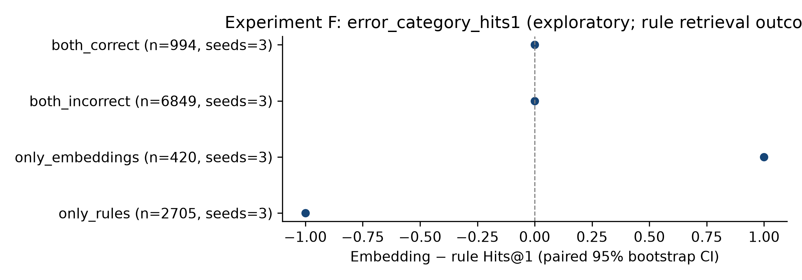


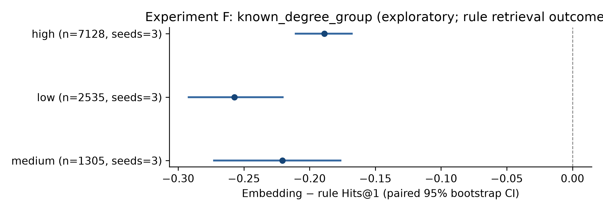


## Robustness and hard negatives

No observations available.


| run | backend | n_test | coverage | auroc_raw | average_precision_raw | accuracy_on_covered | overall_accuracy_uncovered_miss |
| --- | --- | --- | --- | --- | --- | --- | --- |
| runs/codex-s-cpu-pilot-refined/seed-0 | embedding | 3656 | 1.0000 | 0.7085 | 0.7459 | 0.6611 | 0.6611 |
| runs/codex-s-cpu-pilot-refined/seed-0 | rules | 3656 | 0.9710 | 0.8239 | 0.8572 | 0.7569 | 0.7350 |
| runs/codex-s-cpu-pilot-refined/seed-1 | embedding | 3656 | 1.0000 | 0.6914 | 0.7340 | 0.6496 | 0.6496 |
| runs/codex-s-cpu-pilot-refined/seed-1 | rules | 3656 | 0.9710 | 0.8239 | 0.8572 | 0.7569 | 0.7350 |
| runs/codex-s-cpu-pilot-refined/seed-2 | embedding | 3656 | 1.0000 | 0.6923 | 0.7332 | 0.6477 | 0.6477 |
| runs/codex-s-cpu-pilot-refined/seed-2 | rules | 3656 | 0.9710 | 0.8239 | 0.8572 | 0.7569 | 0.7350 |


Paired changes against matched unperturbed controls:


No observations available.


## Learned rule inventory and complexity

| run | max_cyclic_length | kind | body_length | n_rules | mean_raw_confidence | mean_support |
| --- | --- | --- | --- | --- | --- | --- |
| runs/codex-s-cpu-pilot-refined/seed-0 | 3 | constant | 1 | 103289 | 0.3770 | 13.3189 |
| runs/codex-s-cpu-pilot-refined/seed-0 | 3 | relational_path | 1 | 66 | 0.1144 | 29.5000 |
| runs/codex-s-cpu-pilot-refined/seed-0 | 3 | relational_path | 3 | 1413 | 0.1918 | 69.6532 |
| runs/codex-s-cpu-pilot-refined/seed-1 | 3 | constant | 1 | 103289 | 0.3770 | 13.3189 |
| runs/codex-s-cpu-pilot-refined/seed-1 | 3 | relational_path | 1 | 66 | 0.1144 | 29.5000 |
| runs/codex-s-cpu-pilot-refined/seed-1 | 3 | relational_path | 3 | 1413 | 0.1918 | 69.6532 |
| runs/codex-s-cpu-pilot-refined/seed-2 | 3 | constant | 1 | 103289 | 0.3770 | 13.3189 |
| runs/codex-s-cpu-pilot-refined/seed-2 | 3 | relational_path | 1 | 66 | 0.1144 | 29.5000 |
| runs/codex-s-cpu-pilot-refined/seed-2 | 3 | relational_path | 3 | 1413 | 0.1918 | 69.6532 |


## Representative cases


### seed-0 / test:1006:tail / both_correct

Query: `(Q948, P463, ?)`. Correct answer: `Q1043527`. Degrees: head=52, tail=163; relation frequency=4985; cardinality=many-to-many.


```json
{
  "embedding_rank": 1.0,
  "embedding_top": [
    [
      "Q1043527",
      3.558680534362793
    ],
    [
      "Q294278",
      2.141491413116455
    ],
    [
      "Q3348506",
      1.235876441001892
    ],
    [
      "Q816706",
      0.48733675479888916
    ],
    [
      "Q2029901",
      -1.1162153482437134
    ],
    [
      "Q76641",
      -2.073991060256958
    ],
    [
      "Q49355",
      -2.2062065601348877
    ],
    [
      "Q187199",
      -2.482532501220703
    ],
    [
      "Q7785",
      -2.610800266265869
    ],
    [
      "Q235946",
      -2.813746452331543
    ]
  ],
  "rule_retrieved_rank": 1,
  "rule_top": [
    [
      "Q1043527",
      0.8588235294117647
    ],
    [
      "Q294278",
      0.7222222222222222
    ],
    [
      "Q7785",
      0.623175965665236
    ],
    [
      "Q3348506",
      0.6
    ],
    [
      "Q663492",
      0.5925925925925926
    ],
    [
      "Q19771",
      0.5642105263157895
    ],
    [
      "Q81299",
      0.5642105263157895
    ],
    [
      "Q8908",
      0.5642105263157895
    ],
    [
      "Q1480793",
      0.5642105263157895
    ],
    [
      "Q1072120",
      0.5642105263157895
    ]
  ],
  "rule_truth_diagnostic": "strong_rule_supports_truth",
  "rules_and_training_groundings": {
    "Q1043527": [
      {
        "confidence": 0.8848484848484849,
        "expression": "P463(X,Q1043527) <= P463(X,Q656801)",
        "groundings": [
          [
            [
              "Q948",
              "P463",
              "Q656801"
            ]
          ]
        ],
        "kind": "constant",
        "length": 1,
        "predictions": 165,
        "support": 146
      },
      {
        "confidence": 0.875,
        "expression": "P463(X,Q1043527) <= P530(X,Q148)",
        "groundings": [
          [
            [
              "Q948",
              "P530",
              "Q148"
            ]
          ]
        ],
        "kind": "constant",
        "length": 1,
        "predictions": 128,
        "support": 112
      },
      {
        "confidence": 0.8589743589743589,
        "expression": "P463(X,Q1043527) <= P463(X,Q827525)",
        "groundings": [
          [
            [
              "Q948",
              "P463",
              "Q827525"
            ]
          ]
        ],
        "kind": "constant",
        "length": 1,
        "predictions": 156,
        "support": 134
      }
    ],
    "Q294278": [
      {
        "confidence": 0.7959183673469388,
        "expression": "P463(X,Q294278) <= P463(X,Q7159)",
        "groundings": [
          [
            [
              "Q948",
              "P463",
              "Q7159"
            ]
          ]
        ],
        "kind": "constant",
        "length": 1,
        "predictions": 49,
        "support": 39
      },
      {
        "confidence": 0.6258620689655172,
        "expression": "P463(X,Y) <= P463(X,A), P361(B,A), P463(B,Y)",
        "groundings": [
          [
            [
              "Q948",
              "P463",
              "Q7159"
            ],
            [
              "Q1037",
              "P361",
              "Q7159"
            ],
            [
              "Q1037",
              "P463",
              "Q294278"
            ]
          ]
        ],
        "kind": "relational_path",
        "length": 3,
        "predictions": 1160,
        "support": 726
      },
      {
        "confidence": 0.75,
        "expression": "P463(Q948,Y) <= P463(Q977,Y)",
        "groundings": [
          [
            [
              "Q977",
              "P463",
              "Q294278"
            ]
          ]
        ],
        "kind": "constant",
        "length": 1,
        "predictions": 20,
        "support": 15
      }
    ],
    "Q7785": [
      {
        "confidence": 0.6258620689655172,
        "expression": "P463(X,Y) <= P463(X,A), P361(B,A), P463(B,Y)",
        "groundings": [
          [
            [
              "Q948",
              "P463",
              "Q7159"
            ],
            [
              "Q1037",
              "P361",
              "Q7159"
            ],
            [
              "Q1037",
              "P463",
              "Q7785"
            ]
          ]
        ],
        "kind": "relational_path",
        "length": 3,
        "predictions": 1160,
        "support": 726
      },
      {
        "confidence": 0.7142857142857143,
        "expression": "P463(Q948,Y) <= P463(Q854,Y)",
        "groundings": [
          [
            [
              "Q854",
              "P463",
              "Q7785"
            ]
          ]
        ],
        "kind": "constant",
        "length": 1,
        "predictions": 14,
        "support": 10
      },
      {
        "confidence": 0.6666666666666666,
        "expression": "P463(Q948,Y) <= P463(Q902,Y)",
        "groundings": [
          [
            [
              "Q902",
              "P463",
              "Q7785"
            ]
          ]
        ],
        "kind": "constant",
        "length": 1,
        "predictions": 18,
        "support": 12
      }
    ]
  },
  "groundings_sampling": "first 2 query IDs per error category; top 3 candidates, first 3 rules and first grounding each; illustrative, not exhaustive"
}
```


### seed-0 / test:1008:tail / both_correct

Query: `(Q32, P530, ?)`. Correct answer: `Q148`. Degrees: head=55, tail=282; relation frequency=5563; cardinality=many-to-many.


```json
{
  "embedding_rank": 1.0,
  "embedding_top": [
    [
      "Q148",
      4.6036858558654785
    ],
    [
      "Q668",
      3.967444658279419
    ],
    [
      "Q16",
      3.3721671104431152
    ],
    [
      "Q252",
      1.8660411834716797
    ],
    [
      "Q403",
      1.7868335247039795
    ],
    [
      "Q217557",
      1.3338600397109985
    ],
    [
      "Q36",
      0.9358766078948975
    ],
    [
      "Q213",
      0.666076123714447
    ],
    [
      "Q801",
      0.25978022813796997
    ],
    [
      "Q17",
      0.21375608444213867
    ]
  ],
  "rule_retrieved_rank": 1,
  "rule_top": [
    [
      "Q148",
      0.8638132295719845
    ],
    [
      "Q35",
      0.7714285714285715
    ],
    [
      "Q252",
      0.7435897435897436
    ],
    [
      "Q41",
      0.725
    ],
    [
      "Q212",
      0.7021276595744681
    ],
    [
      "Q17",
      0.6923076923076923
    ],
    [
      "Q145",
      0.6857142857142857
    ],
    [
      "Q408",
      0.6857142857142857
    ],
    [
      "Q16",
      0.6808510638297872
    ],
    [
      "Q668",
      0.6666666666666666
    ]
  ],
  "rule_truth_diagnostic": "strong_rule_supports_truth",
  "rules_and_training_groundings": {
    "Q148": [
      {
        "confidence": 0.8666232921275211,
        "expression": "P530(X,Y) <= P530(Y,X)",
        "groundings": [
          [
            [
              "Q148",
              "P530",
              "Q32"
            ]
          ]
        ],
        "kind": "relational_path",
        "length": 1,
        "predictions": 1537,
        "support": 1332
      },
      {
        "confidence": 0.8863636363636364,
        "expression": "P530(X,Q148) <= P530(Q148,X)",
        "groundings": [
          [
            [
              "Q148",
              "P530",
              "Q32"
            ]
          ]
        ],
        "kind": "constant",
        "length": 1,
        "predictions": 132,
        "support": 117
      },
      {
        "confidence": 0.8072289156626506,
        "expression": "P530(X,Q148) <= P530(Q142,X)",
        "groundings": [
          [
            [
              "Q142",
              "P530",
              "Q32"
            ]
          ]
        ],
        "kind": "constant",
        "length": 1,
        "predictions": 83,
        "support": 67
      }
    ],
    "Q252": [
      {
        "confidence": 0.8529411764705882,
        "expression": "P530(X,Q252) <= P530(Q881,X)",
        "groundings": [
          [
            [
              "Q881",
              "P530",
              "Q32"
            ]
          ]
        ],
        "kind": "constant",
        "length": 1,
        "predictions": 34,
        "support": 29
      },
      {
        "confidence": 0.8064516129032258,
        "expression": "P530(X,Q252) <= P463(X,Q1072120)",
        "groundings": [
          [
            [
              "Q32",
              "P463",
              "Q1072120"
            ]
          ]
        ],
        "kind": "constant",
        "length": 1,
        "predictions": 31,
        "support": 25
      },
      {
        "confidence": 0.72,
        "expression": "P530(X,Q252) <= P530(X,Q31)",
        "groundings": [
          [
            [
              "Q32",
              "P530",
              "Q31"
            ]
          ]
        ],
        "kind": "constant",
        "length": 1,
        "predictions": 25,
        "support": 18
      }
    ],
    "Q35": [
      {
        "confidence": 0.9,
        "expression": "P530(X,Q35) <= P463(X,Q1072120)",
        "groundings": [
          [
            [
              "Q32",
              "P463",
              "Q1072120"
            ]
          ]
        ],
        "kind": "constant",
        "length": 1,
        "predictions": 30,
        "support": 27
      },
      {
        "confidence": 0.9,
        "expression": "P530(X,Q35) <= P463(X,Q7184)",
        "groundings": [
          [
            [
              "Q32",
              "P463",
              "Q7184"
            ]
          ]
        ],
        "kind": "constant",
        "length": 1,
        "predictions": 30,
        "support": 27
      },
      {
        "confidence": 0.8461538461538461,
        "expression": "P530(X,Q35) <= P463(X,Q8908)",
        "groundings": [
          [
            [
              "Q32",
              "P463",
              "Q8908"
            ]
          ]
        ],
        "kind": "constant",
        "length": 1,
        "predictions": 39,
        "support": 33
      }
    ]
  },
  "groundings_sampling": "first 2 query IDs per error category; top 3 candidates, first 3 rules and first grounding each; illustrative, not exhaustive"
}
```


### seed-0 / test:0:head / both_incorrect

Query: `(?, P27, Q142)`. Correct answer: `Q206832`. Degrees: head=13, tail=325; relation frequency=1648; cardinality=many-to-one.


```json
{
  "embedding_rank": 1589.0,
  "embedding_top": [
    [
      "Q192348",
      4.783308982849121
    ],
    [
      "Q192655",
      4.692512035369873
    ],
    [
      "Q102822",
      4.590732097625732
    ],
    [
      "Q25120",
      4.142179489135742
    ],
    [
      "Q201221",
      3.722254514694214
    ],
    [
      "Q1666",
      2.4692537784576416
    ],
    [
      "Q37327",
      2.1478257179260254
    ],
    [
      "Q188",
      1.7163164615631104
    ],
    [
      "Q436693",
      1.5520246028900146
    ],
    [
      "Q232052",
      1.420754075050354
    ]
  ],
  "rule_retrieved_rank": 3,
  "rule_top": [
    [
      "Q8772",
      0.7162162162162162
    ],
    [
      "Q37327",
      0.7162162162162162
    ],
    [
      "Q206832",
      0.7162162162162162
    ],
    [
      "Q30875",
      0.7162162162162162
    ],
    [
      "Q201221",
      0.7162162162162162
    ],
    [
      "Q44301",
      0.7162162162162162
    ],
    [
      "Q128297",
      0.7162162162162162
    ],
    [
      "Q156774",
      0.7162162162162162
    ],
    [
      "Q1290",
      0.7162162162162162
    ],
    [
      "Q239652",
      0.7162162162162162
    ]
  ],
  "rule_truth_diagnostic": "strong_rule_supports_truth",
  "rules_and_training_groundings": {
    "Q206832": [
      {
        "confidence": 0.7681159420289855,
        "expression": "P27(X,Q142) <= P20(X,Q90)",
        "groundings": [
          [
            [
              "Q206832",
              "P20",
              "Q90"
            ]
          ]
        ],
        "kind": "constant",
        "length": 1,
        "predictions": 69,
        "support": 53
      },
      {
        "confidence": 0.7777777777777778,
        "expression": "P27(X,Q142) <= P69(X,Q273626)",
        "groundings": [
          [
            [
              "Q206832",
              "P69",
              "Q273626"
            ]
          ]
        ],
        "kind": "constant",
        "length": 1,
        "predictions": 18,
        "support": 14
      },
      {
        "confidence": 0.7142857142857143,
        "expression": "P27(X,Q142) <= P119(X,Q311)",
        "groundings": [
          [
            [
              "Q206832",
              "P119",
              "Q311"
            ]
          ]
        ],
        "kind": "constant",
        "length": 1,
        "predictions": 21,
        "support": 15
      }
    ],
    "Q37327": [
      {
        "confidence": 0.7681159420289855,
        "expression": "P27(X,Q142) <= P20(X,Q90)",
        "groundings": [
          [
            [
              "Q37327",
              "P20",
              "Q90"
            ]
          ]
        ],
        "kind": "constant",
        "length": 1,
        "predictions": 69,
        "support": 53
      },
      {
        "confidence": 0.8125,
        "expression": "P27(X,Q142) <= P119(X,Q272208)",
        "groundings": [
          [
            [
              "Q37327",
              "P119",
              "Q272208"
            ]
          ]
        ],
        "kind": "constant",
        "length": 1,
        "predictions": 16,
        "support": 13
      },
      {
        "confidence": 0.5666666666666667,
        "expression": "P27(X,Y) <= P20(X,A), P159(B,A), P17(B,Y)",
        "groundings": [
          [
            [
              "Q37327",
              "P20",
              "Q90"
            ],
            [
              "Q161806",
              "P159",
              "Q90"
            ],
            [
              "Q161806",
              "P17",
              "Q142"
            ]
          ]
        ],
        "kind": "relational_path",
        "length": 3,
        "predictions": 210,
        "support": 119
      }
    ],
    "Q8772": [
      {
        "confidence": 0.7681159420289855,
        "expression": "P27(X,Q142) <= P20(X,Q90)",
        "groundings": [
          [
            [
              "Q8772",
              "P20",
              "Q90"
            ]
          ]
        ],
        "kind": "constant",
        "length": 1,
        "predictions": 69,
        "support": 53
      },
      {
        "confidence": 0.8461538461538461,
        "expression": "P27(X,Q142) <= P172(X,Q121842)",
        "groundings": [
          [
            [
              "Q8772",
              "P172",
              "Q121842"
            ]
          ]
        ],
        "kind": "constant",
        "length": 1,
        "predictions": 26,
        "support": 22
      },
      {
        "confidence": 0.8095238095238095,
        "expression": "P27(X,Q142) <= P463(X,Q161806)",
        "groundings": [
          [
            [
              "Q8772",
              "P463",
              "Q161806"
            ]
          ]
        ],
        "kind": "constant",
        "length": 1,
        "predictions": 21,
        "support": 17
      }
    ]
  },
  "groundings_sampling": "first 2 query IDs per error category; top 3 candidates, first 3 rules and first grounding each; illustrative, not exhaustive"
}
```


### seed-0 / test:1000:head / both_incorrect

Query: `(?, P106, Q28389)`. Correct answer: `Q704742`. Degrees: head=17, tail=313; relation frequency=10197; cardinality=many-to-many.


```json
{
  "embedding_rank": 21.0,
  "embedding_top": [
    [
      "Q55800",
      4.49147891998291
    ],
    [
      "Q35332",
      2.716156005859375
    ],
    [
      "Q231270",
      2.1333189010620117
    ],
    [
      "Q102813",
      1.6920583248138428
    ],
    [
      "Q12881",
      1.569166660308838
    ],
    [
      "Q202449",
      1.0341200828552246
    ],
    [
      "Q313185",
      0.9967000484466553
    ],
    [
      "Q171363",
      0.8089028596878052
    ],
    [
      "Q366012",
      0.6173388957977295
    ],
    [
      "Q36233",
      0.484419584274292
    ]
  ],
  "rule_retrieved_rank": 11,
  "rule_top": [
    [
      "Q202449",
      0.7297297297297297
    ],
    [
      "Q43432",
      0.7297297297297297
    ],
    [
      "Q190631",
      0.7297297297297297
    ],
    [
      "Q1112005",
      0.7297297297297297
    ],
    [
      "Q171905",
      0.7297297297297297
    ],
    [
      "Q1281738",
      0.7297297297297297
    ],
    [
      "Q128532",
      0.7297297297297297
    ],
    [
      "Q269890",
      0.7297297297297297
    ],
    [
      "Q25080",
      0.7297297297297297
    ],
    [
      "Q596717",
      0.7297297297297297
    ]
  ],
  "rule_truth_diagnostic": "strong_rule_supports_truth",
  "rules_and_training_groundings": {
    "Q190631": [
      {
        "confidence": 0.782608695652174,
        "expression": "P106(X,Q28389) <= P106(X,Q245068)",
        "groundings": [
          [
            [
              "Q190631",
              "P106",
              "Q245068"
            ]
          ]
        ],
        "kind": "constant",
        "length": 1,
        "predictions": 69,
        "support": 54
      },
      {
        "confidence": 0.5652173913043478,
        "expression": "P106(X,Q28389) <= P106(X,Q3282637)",
        "groundings": [
          [
            [
              "Q190631",
              "P106",
              "Q3282637"
            ]
          ]
        ],
        "kind": "constant",
        "length": 1,
        "predictions": 207,
        "support": 117
      },
      {
        "confidence": 0.46875,
        "expression": "P106(X,Q28389) <= P106(X,Q2259451)",
        "groundings": [
          [
            [
              "Q190631",
              "P106",
              "Q2259451"
            ]
          ]
        ],
        "kind": "constant",
        "length": 1,
        "predictions": 128,
        "support": 60
      }
    ],
    "Q202449": [
      {
        "confidence": 0.782608695652174,
        "expression": "P106(X,Q28389) <= P106(X,Q245068)",
        "groundings": [
          [
            [
              "Q202449",
              "P106",
              "Q245068"
            ]
          ]
        ],
        "kind": "constant",
        "length": 1,
        "predictions": 69,
        "support": 54
      },
      {
        "confidence": 0.8333333333333334,
        "expression": "P106(X,Q28389) <= P106(X,Q2059704)",
        "groundings": [
          [
            [
              "Q202449",
              "P106",
              "Q2059704"
            ]
          ]
        ],
        "kind": "constant",
        "length": 1,
        "predictions": 24,
        "support": 20
      },
      {
        "confidence": 0.42207792207792205,
        "expression": "P106(X,Q28389) <= P106(X,Q2405480)",
        "groundings": [
          [
            [
              "Q202449",
              "P106",
              "Q2405480"
            ]
          ]
        ],
        "kind": "constant",
        "length": 1,
        "predictions": 154,
        "support": 65
      }
    ],
    "Q43432": [
      {
        "confidence": 0.782608695652174,
        "expression": "P106(X,Q28389) <= P106(X,Q245068)",
        "groundings": [
          [
            [
              "Q43432",
              "P106",
              "Q245068"
            ]
          ]
        ],
        "kind": "constant",
        "length": 1,
        "predictions": 69,
        "support": 54
      },
      {
        "confidence": 0.8888888888888888,
        "expression": "P106(Q43432,Y) <= P106(Q349217,Y)",
        "groundings": [
          [
            [
              "Q349217",
              "P106",
              "Q28389"
            ]
          ]
        ],
        "kind": "constant",
        "length": 1,
        "predictions": 9,
        "support": 8
      },
      {
        "confidence": 0.5652173913043478,
        "expression": "P106(X,Q28389) <= P106(X,Q3282637)",
        "groundings": [
          [
            [
              "Q43432",
              "P106",
              "Q3282637"
            ]
          ]
        ],
        "kind": "constant",
        "length": 1,
        "predictions": 207,
        "support": 117
      }
    ]
  },
  "groundings_sampling": "first 2 query IDs per error category; top 3 candidates, first 3 rules and first grounding each; illustrative, not exhaustive"
}
```


### seed-0 / test:1016:tail / only_embeddings

Query: `(Q159, P530, ?)`. Correct answer: `Q27`. Degrees: head=345, tail=88; relation frequency=5563; cardinality=many-to-many.


```json
{
  "embedding_rank": 1.0,
  "embedding_top": [
    [
      "Q27",
      10.840195655822754
    ],
    [
      "Q33",
      5.606600761413574
    ],
    [
      "Q224",
      4.8044233322143555
    ],
    [
      "Q657",
      3.578648090362549
    ],
    [
      "Q846",
      3.4317169189453125
    ],
    [
      "Q230",
      3.345000743865967
    ],
    [
      "Q826",
      3.3026037216186523
    ],
    [
      "Q766",
      3.025904893875122
    ],
    [
      "Q851",
      2.946033477783203
    ],
    [
      "Q213",
      2.4057021141052246
    ]
  ],
  "rule_retrieved_rank": 2,
  "rule_top": [
    [
      "Q851",
      0.8638132295719845
    ],
    [
      "Q27",
      0.8638132295719845
    ],
    [
      "Q929",
      0.8638132295719845
    ],
    [
      "Q826",
      0.8638132295719845
    ]
  ],
  "rule_truth_diagnostic": "strong_rule_supports_truth",
  "rules_and_training_groundings": {
    "Q27": [
      {
        "confidence": 0.8666232921275211,
        "expression": "P530(X,Y) <= P530(Y,X)",
        "groundings": [
          [
            [
              "Q27",
              "P530",
              "Q159"
            ]
          ]
        ],
        "kind": "relational_path",
        "length": 1,
        "predictions": 1537,
        "support": 1332
      },
      {
        "confidence": 0.8787878787878788,
        "expression": "P530(Q159,Y) <= P530(Y,Q159)",
        "groundings": [
          [
            [
              "Q27",
              "P530",
              "Q159"
            ]
          ]
        ],
        "kind": "constant",
        "length": 1,
        "predictions": 132,
        "support": 116
      },
      {
        "confidence": 0.851063829787234,
        "expression": "P530(Q159,Y) <= P530(Y,Q258)",
        "groundings": [
          [
            [
              "Q27",
              "P530",
              "Q258"
            ]
          ]
        ],
        "kind": "constant",
        "length": 1,
        "predictions": 47,
        "support": 40
      }
    ],
    "Q851": [
      {
        "confidence": 0.8666232921275211,
        "expression": "P530(X,Y) <= P530(Y,X)",
        "groundings": [
          [
            [
              "Q851",
              "P530",
              "Q159"
            ]
          ]
        ],
        "kind": "relational_path",
        "length": 1,
        "predictions": 1537,
        "support": 1332
      },
      {
        "confidence": 0.8787878787878788,
        "expression": "P530(Q159,Y) <= P530(Y,Q159)",
        "groundings": [
          [
            [
              "Q851",
              "P530",
              "Q159"
            ]
          ]
        ],
        "kind": "constant",
        "length": 1,
        "predictions": 132,
        "support": 116
      },
      {
        "confidence": 0.8674698795180723,
        "expression": "P530(Q159,Y) <= P530(Y,Q403)",
        "groundings": [
          [
            [
              "Q851",
              "P530",
              "Q403"
            ]
          ]
        ],
        "kind": "constant",
        "length": 1,
        "predictions": 83,
        "support": 72
      }
    ],
    "Q929": [
      {
        "confidence": 0.8666232921275211,
        "expression": "P530(X,Y) <= P530(Y,X)",
        "groundings": [
          [
            [
              "Q929",
              "P530",
              "Q159"
            ]
          ]
        ],
        "kind": "relational_path",
        "length": 1,
        "predictions": 1537,
        "support": 1332
      },
      {
        "confidence": 0.8787878787878788,
        "expression": "P530(Q159,Y) <= P530(Y,Q159)",
        "groundings": [
          [
            [
              "Q929",
              "P530",
              "Q159"
            ]
          ]
        ],
        "kind": "constant",
        "length": 1,
        "predictions": 132,
        "support": 116
      },
      {
        "confidence": 0.851063829787234,
        "expression": "P530(Q159,Y) <= P530(Y,Q258)",
        "groundings": [
          [
            [
              "Q929",
              "P530",
              "Q258"
            ]
          ]
        ],
        "kind": "constant",
        "length": 1,
        "predictions": 47,
        "support": 40
      }
    ]
  },
  "groundings_sampling": "first 2 query IDs per error category; top 3 candidates, first 3 rules and first grounding each; illustrative, not exhaustive"
}
```


### seed-0 / test:1048:head / only_embeddings

Query: `(?, P106, Q639669)`. Correct answer: `Q182725`. Degrees: head=20, tail=440; relation frequency=10197; cardinality=many-to-many.


```json
{
  "embedding_rank": 1.0,
  "embedding_top": [
    [
      "Q182725",
      7.292051315307617
    ],
    [
      "Q233946",
      7.19187068939209
    ],
    [
      "Q192185",
      6.406472206115723
    ],
    [
      "Q181683",
      5.69234561920166
    ],
    [
      "Q36290",
      4.760072231292725
    ],
    [
      "Q362422",
      3.9727401733398438
    ],
    [
      "Q216563",
      3.9555821418762207
    ],
    [
      "Q354033",
      3.871415376663208
    ],
    [
      "Q5383",
      3.794674873352051
    ],
    [
      "Q229375",
      3.622377395629883
    ]
  ],
  "rule_retrieved_rank": 4,
  "rule_top": [
    [
      "Q251287",
      0.7407407407407407
    ],
    [
      "Q34424",
      0.7407407407407407
    ],
    [
      "Q303",
      0.7407407407407407
    ],
    [
      "Q182725",
      0.7407407407407407
    ],
    [
      "Q434745",
      0.7407407407407407
    ],
    [
      "Q216563",
      0.7407407407407407
    ],
    [
      "Q40912",
      0.7407407407407407
    ],
    [
      "Q151972",
      0.7407407407407407
    ],
    [
      "Q354033",
      0.6710526315789473
    ],
    [
      "Q180453",
      0.6710526315789473
    ]
  ],
  "rule_truth_diagnostic": "strong_rule_supports_truth",
  "rules_and_training_groundings": {
    "Q251287": [
      {
        "confidence": 0.8163265306122449,
        "expression": "P106(X,Q639669) <= P264(X,Q202585)",
        "groundings": [
          [
            [
              "Q251287",
              "P264",
              "Q202585"
            ]
          ]
        ],
        "kind": "constant",
        "length": 1,
        "predictions": 49,
        "support": 40
      },
      {
        "confidence": 0.7183098591549296,
        "expression": "P106(X,Q639669) <= P136(X,Q83440)",
        "groundings": [
          [
            [
              "Q251287",
              "P136",
              "Q83440"
            ]
          ]
        ],
        "kind": "constant",
        "length": 1,
        "predictions": 71,
        "support": 51
      },
      {
        "confidence": 0.6542056074766355,
        "expression": "P106(X,Q639669) <= P106(X,Q855091)",
        "groundings": [
          [
            [
              "Q251287",
              "P106",
              "Q855091"
            ]
          ]
        ],
        "kind": "constant",
        "length": 1,
        "predictions": 214,
        "support": 140
      }
    ],
    "Q303": [
      {
        "confidence": 0.8163265306122449,
        "expression": "P106(X,Q639669) <= P264(X,Q202585)",
        "groundings": [
          [
            [
              "Q303",
              "P264",
              "Q202585"
            ]
          ]
        ],
        "kind": "constant",
        "length": 1,
        "predictions": 49,
        "support": 40
      },
      {
        "confidence": 0.6542056074766355,
        "expression": "P106(X,Q639669) <= P106(X,Q855091)",
        "groundings": [
          [
            [
              "Q303",
              "P106",
              "Q855091"
            ]
          ]
        ],
        "kind": "constant",
        "length": 1,
        "predictions": 214,
        "support": 140
      },
      {
        "confidence": 0.6223404255319149,
        "expression": "P106(X,Q639669) <= P106(X,Q486748)",
        "groundings": [
          [
            [
              "Q303",
              "P106",
              "Q486748"
            ]
          ]
        ],
        "kind": "constant",
        "length": 1,
        "predictions": 188,
        "support": 117
      }
    ],
    "Q34424": [
      {
        "confidence": 0.8163265306122449,
        "expression": "P106(X,Q639669) <= P264(X,Q202585)",
        "groundings": [
          [
            [
              "Q34424",
              "P264",
              "Q202585"
            ]
          ]
        ],
        "kind": "constant",
        "length": 1,
        "predictions": 49,
        "support": 40
      },
      {
        "confidence": 0.7586206896551724,
        "expression": "P106(X,Q639669) <= P264(X,Q330629)",
        "groundings": [
          [
            [
              "Q34424",
              "P264",
              "Q330629"
            ]
          ]
        ],
        "kind": "constant",
        "length": 1,
        "predictions": 29,
        "support": 22
      },
      {
        "confidence": 0.6542056074766355,
        "expression": "P106(X,Q639669) <= P106(X,Q855091)",
        "groundings": [
          [
            [
              "Q34424",
              "P106",
              "Q855091"
            ]
          ]
        ],
        "kind": "constant",
        "length": 1,
        "predictions": 214,
        "support": 140
      }
    ]
  },
  "groundings_sampling": "first 2 query IDs per error category; top 3 candidates, first 3 rules and first grounding each; illustrative, not exhaustive"
}
```


### seed-0 / test:0:tail / only_rules

Query: `(Q206832, P27, ?)`. Correct answer: `Q142`. Degrees: head=13, tail=325; relation frequency=1648; cardinality=many-to-one.


```json
{
  "embedding_rank": 1840.0,
  "embedding_top": [
    [
      "Q29",
      1.9471755027770996
    ],
    [
      "Q414",
      1.607108473777771
    ],
    [
      "Q520549",
      0.28550612926483154
    ],
    [
      "Q488205",
      0.2699275016784668
    ],
    [
      "Q81096",
      0.14231616258621216
    ],
    [
      "Q164444",
      0.04235649108886719
    ],
    [
      "Q593644",
      -0.5250133275985718
    ],
    [
      "Q12202",
      -0.5959486961364746
    ],
    [
      "Q145",
      -0.6673564910888672
    ],
    [
      "Q185610",
      -1.0704070329666138
    ]
  ],
  "rule_retrieved_rank": 1,
  "rule_top": [
    [
      "Q142",
      0.7162162162162162
    ],
    [
      "Q30",
      0.38596491228070173
    ],
    [
      "Q145",
      0.38596491228070173
    ],
    [
      "Q39",
      0.38596491228070173
    ],
    [
      "Q34266",
      0.38596491228070173
    ],
    [
      "Q36",
      0.38596491228070173
    ],
    [
      "Q174193",
      0.38596491228070173
    ],
    [
      "Q35",
      0.38596491228070173
    ],
    [
      "Q38",
      0.37919463087248323
    ],
    [
      "Q29",
      0.37919463087248323
    ]
  ],
  "rule_truth_diagnostic": "strong_rule_supports_truth",
  "rules_and_training_groundings": {
    "Q142": [
      {
        "confidence": 0.7681159420289855,
        "expression": "P27(X,Q142) <= P20(X,Q90)",
        "groundings": [
          [
            [
              "Q206832",
              "P20",
              "Q90"
            ]
          ]
        ],
        "kind": "constant",
        "length": 1,
        "predictions": 69,
        "support": 53
      },
      {
        "confidence": 0.7777777777777778,
        "expression": "P27(X,Q142) <= P69(X,Q273626)",
        "groundings": [
          [
            [
              "Q206832",
              "P69",
              "Q273626"
            ]
          ]
        ],
        "kind": "constant",
        "length": 1,
        "predictions": 18,
        "support": 14
      },
      {
        "confidence": 0.7142857142857143,
        "expression": "P27(X,Q142) <= P119(X,Q311)",
        "groundings": [
          [
            [
              "Q206832",
              "P119",
              "Q311"
            ]
          ]
        ],
        "kind": "constant",
        "length": 1,
        "predictions": 21,
        "support": 15
      }
    ],
    "Q145": [
      {
        "confidence": 0.39759036144578314,
        "expression": "P27(X,Y) <= P119(X,A), P119(B,A), P27(B,Y)",
        "groundings": [
          [
            [
              "Q206832",
              "P119",
              "Q311"
            ],
            [
              "Q30875",
              "P119",
              "Q311"
            ],
            [
              "Q30875",
              "P27",
              "Q145"
            ]
          ]
        ],
        "kind": "relational_path",
        "length": 3,
        "predictions": 166,
        "support": 66
      },
      {
        "confidence": 0.3824027072758037,
        "expression": "P27(X,Y) <= P20(X,A), P19(B,A), P27(B,Y)",
        "groundings": [
          [
            [
              "Q206832",
              "P20",
              "Q90"
            ],
            [
              "Q944275",
              "P19",
              "Q90"
            ],
            [
              "Q944275",
              "P27",
              "Q145"
            ]
          ]
        ],
        "kind": "relational_path",
        "length": 3,
        "predictions": 591,
        "support": 226
      },
      {
        "confidence": 0.336676217765043,
        "expression": "P27(X,Y) <= P20(X,A), P20(B,A), P27(B,Y)",
        "groundings": [
          [
            [
              "Q206832",
              "P20",
              "Q90"
            ],
            [
              "Q30875",
              "P20",
              "Q90"
            ],
            [
              "Q30875",
              "P27",
              "Q145"
            ]
          ]
        ],
        "kind": "relational_path",
        "length": 3,
        "predictions": 698,
        "support": 235
      }
    ],
    "Q30": [
      {
        "confidence": 0.39759036144578314,
        "expression": "P27(X,Y) <= P119(X,A), P119(B,A), P27(B,Y)",
        "groundings": [
          [
            [
              "Q206832",
              "P119",
              "Q311"
            ],
            [
              "Q44301",
              "P119",
              "Q311"
            ],
            [
              "Q44301",
              "P27",
              "Q30"
            ]
          ]
        ],
        "kind": "relational_path",
        "length": 3,
        "predictions": 166,
        "support": 66
      },
      {
        "confidence": 0.3824027072758037,
        "expression": "P27(X,Y) <= P20(X,A), P19(B,A), P27(B,Y)",
        "groundings": [
          [
            [
              "Q206832",
              "P20",
              "Q90"
            ],
            [
              "Q230068",
              "P19",
              "Q90"
            ],
            [
              "Q230068",
              "P27",
              "Q30"
            ]
          ]
        ],
        "kind": "relational_path",
        "length": 3,
        "predictions": 591,
        "support": 226
      },
      {
        "confidence": 0.336676217765043,
        "expression": "P27(X,Y) <= P20(X,A), P20(B,A), P27(B,Y)",
        "groundings": [
          [
            [
              "Q206832",
              "P20",
              "Q90"
            ],
            [
              "Q44301",
              "P20",
              "Q90"
            ],
            [
              "Q44301",
              "P27",
              "Q30"
            ]
          ]
        ],
        "kind": "relational_path",
        "length": 3,
        "predictions": 698,
        "support": 235
      }
    ]
  },
  "groundings_sampling": "first 2 query IDs per error category; top 3 candidates, first 3 rules and first grounding each; illustrative, not exhaustive"
}
```


### seed-0 / test:1000:tail / only_rules

Query: `(Q704742, P106, ?)`. Correct answer: `Q28389`. Degrees: head=17, tail=313; relation frequency=10197; cardinality=many-to-many.


```json
{
  "embedding_rank": 3.0,
  "embedding_top": [
    [
      "Q488205",
      0.9999016523361206
    ],
    [
      "Q16323111",
      -0.6869783401489258
    ],
    [
      "Q28389",
      -0.8483566045761108
    ],
    [
      "Q84",
      -1.1035799980163574
    ],
    [
      "Q1860",
      -1.2106043100357056
    ],
    [
      "Q192348",
      -1.3356444835662842
    ],
    [
      "Q656801",
      -1.4302966594696045
    ],
    [
      "Q6527",
      -1.8285126686096191
    ],
    [
      "Q578109",
      -1.8370330333709717
    ],
    [
      "Q105756",
      -2.0450735092163086
    ]
  ],
  "rule_retrieved_rank": 1,
  "rule_top": [
    [
      "Q28389",
      0.7261146496815286
    ],
    [
      "Q488205",
      0.6478260869565218
    ],
    [
      "Q36834",
      0.5869565217391305
    ],
    [
      "Q753110",
      0.5
    ],
    [
      "Q43845",
      0.4666666666666667
    ],
    [
      "Q2405480",
      0.38461538461538464
    ],
    [
      "Q855091",
      0.3739130434782609
    ],
    [
      "Q482980",
      0.35714285714285715
    ],
    [
      "Q948329",
      0.35714285714285715
    ],
    [
      "Q6625963",
      0.3359375
    ]
  ],
  "rule_truth_diagnostic": "strong_rule_supports_truth",
  "rules_and_training_groundings": {
    "Q28389": [
      {
        "confidence": 0.75,
        "expression": "P106(X,Q28389) <= P106(X,Q2526255)",
        "groundings": [
          [
            [
              "Q704742",
              "P106",
              "Q2526255"
            ]
          ]
        ],
        "kind": "constant",
        "length": 1,
        "predictions": 152,
        "support": 114
      },
      {
        "confidence": 0.8695652173913043,
        "expression": "P106(X,Q28389) <= P106(X,Q7042855)",
        "groundings": [
          [
            [
              "Q704742",
              "P106",
              "Q7042855"
            ]
          ]
        ],
        "kind": "constant",
        "length": 1,
        "predictions": 23,
        "support": 20
      },
      {
        "confidence": 0.5652173913043478,
        "expression": "P106(X,Q28389) <= P106(X,Q3282637)",
        "groundings": [
          [
            [
              "Q704742",
              "P106",
              "Q3282637"
            ]
          ]
        ],
        "kind": "constant",
        "length": 1,
        "predictions": 207,
        "support": 117
      }
    ],
    "Q36834": [
      {
        "confidence": 0.6,
        "expression": "P106(X,Q36834) <= P106(X,Q183945)",
        "groundings": [
          [
            [
              "Q704742",
              "P106",
              "Q183945"
            ]
          ]
        ],
        "kind": "constant",
        "length": 1,
        "predictions": 225,
        "support": 135
      },
      {
        "confidence": 0.5454545454545454,
        "expression": "P106(X,Q36834) <= P106(X,Q639669)",
        "groundings": [
          [
            [
              "Q704742",
              "P106",
              "Q639669"
            ]
          ]
        ],
        "kind": "constant",
        "length": 1,
        "predictions": 440,
        "support": 240
      },
      {
        "confidence": 0.511070110701107,
        "expression": "P106(X,Q36834) <= P106(X,Q177220)",
        "groundings": [
          [
            [
              "Q704742",
              "P106",
              "Q177220"
            ]
          ]
        ],
        "kind": "constant",
        "length": 1,
        "predictions": 542,
        "support": 277
      }
    ],
    "Q488205": [
      {
        "confidence": 0.6622222222222223,
        "expression": "P106(X,Q488205) <= P106(X,Q183945)",
        "groundings": [
          [
            [
              "Q704742",
              "P106",
              "Q183945"
            ]
          ]
        ],
        "kind": "constant",
        "length": 1,
        "predictions": 225,
        "support": 149
      },
      {
        "confidence": 0.5825771324863884,
        "expression": "P106(X,Q488205) <= P1303(X,Q17172850)",
        "groundings": [
          [
            [
              "Q704742",
              "P1303",
              "Q17172850"
            ]
          ]
        ],
        "kind": "constant",
        "length": 1,
        "predictions": 551,
        "support": 321
      },
      {
        "confidence": 0.6428571428571429,
        "expression": "P106(X,Q488205) <= P264(X,Q38903)",
        "groundings": [
          [
            [
              "Q704742",
              "P264",
              "Q38903"
            ]
          ]
        ],
        "kind": "constant",
        "length": 1,
        "predictions": 42,
        "support": 27
      }
    ]
  },
  "groundings_sampling": "first 2 query IDs per error category; top 3 candidates, first 3 rules and first grounding each; illustrative, not exhaustive"
}
```


### seed-1 / test:1006:tail / both_correct

Query: `(Q948, P463, ?)`. Correct answer: `Q1043527`. Degrees: head=52, tail=163; relation frequency=4985; cardinality=many-to-many.


```json
{
  "embedding_rank": 1.0,
  "embedding_top": [
    [
      "Q1043527",
      5.641170978546143
    ],
    [
      "Q3348506",
      4.406545639038086
    ],
    [
      "Q294278",
      3.5859572887420654
    ],
    [
      "Q2029901",
      0.9258536100387573
    ],
    [
      "Q8908",
      -0.22173070907592773
    ],
    [
      "Q663492",
      -0.48867201805114746
    ],
    [
      "Q1928989",
      -0.7341790199279785
    ],
    [
      "Q458",
      -0.7709677219390869
    ],
    [
      "Q183",
      -1.1253634691238403
    ],
    [
      "Q30",
      -1.2200675010681152
    ]
  ],
  "rule_retrieved_rank": 1,
  "rule_top": [
    [
      "Q1043527",
      0.8588235294117647
    ],
    [
      "Q294278",
      0.7222222222222222
    ],
    [
      "Q7785",
      0.623175965665236
    ],
    [
      "Q3348506",
      0.6
    ],
    [
      "Q663492",
      0.5925925925925926
    ],
    [
      "Q19771",
      0.5642105263157895
    ],
    [
      "Q81299",
      0.5642105263157895
    ],
    [
      "Q8908",
      0.5642105263157895
    ],
    [
      "Q1480793",
      0.5642105263157895
    ],
    [
      "Q1072120",
      0.5642105263157895
    ]
  ],
  "rule_truth_diagnostic": "strong_rule_supports_truth",
  "rules_and_training_groundings": {
    "Q1043527": [
      {
        "confidence": 0.8848484848484849,
        "expression": "P463(X,Q1043527) <= P463(X,Q656801)",
        "groundings": [
          [
            [
              "Q948",
              "P463",
              "Q656801"
            ]
          ]
        ],
        "kind": "constant",
        "length": 1,
        "predictions": 165,
        "support": 146
      },
      {
        "confidence": 0.875,
        "expression": "P463(X,Q1043527) <= P530(X,Q148)",
        "groundings": [
          [
            [
              "Q948",
              "P530",
              "Q148"
            ]
          ]
        ],
        "kind": "constant",
        "length": 1,
        "predictions": 128,
        "support": 112
      },
      {
        "confidence": 0.8589743589743589,
        "expression": "P463(X,Q1043527) <= P463(X,Q827525)",
        "groundings": [
          [
            [
              "Q948",
              "P463",
              "Q827525"
            ]
          ]
        ],
        "kind": "constant",
        "length": 1,
        "predictions": 156,
        "support": 134
      }
    ],
    "Q294278": [
      {
        "confidence": 0.7959183673469388,
        "expression": "P463(X,Q294278) <= P463(X,Q7159)",
        "groundings": [
          [
            [
              "Q948",
              "P463",
              "Q7159"
            ]
          ]
        ],
        "kind": "constant",
        "length": 1,
        "predictions": 49,
        "support": 39
      },
      {
        "confidence": 0.6258620689655172,
        "expression": "P463(X,Y) <= P463(X,A), P361(B,A), P463(B,Y)",
        "groundings": [
          [
            [
              "Q948",
              "P463",
              "Q7159"
            ],
            [
              "Q1037",
              "P361",
              "Q7159"
            ],
            [
              "Q1037",
              "P463",
              "Q294278"
            ]
          ]
        ],
        "kind": "relational_path",
        "length": 3,
        "predictions": 1160,
        "support": 726
      },
      {
        "confidence": 0.75,
        "expression": "P463(Q948,Y) <= P463(Q977,Y)",
        "groundings": [
          [
            [
              "Q977",
              "P463",
              "Q294278"
            ]
          ]
        ],
        "kind": "constant",
        "length": 1,
        "predictions": 20,
        "support": 15
      }
    ],
    "Q7785": [
      {
        "confidence": 0.6258620689655172,
        "expression": "P463(X,Y) <= P463(X,A), P361(B,A), P463(B,Y)",
        "groundings": [
          [
            [
              "Q948",
              "P463",
              "Q7159"
            ],
            [
              "Q1037",
              "P361",
              "Q7159"
            ],
            [
              "Q1037",
              "P463",
              "Q7785"
            ]
          ]
        ],
        "kind": "relational_path",
        "length": 3,
        "predictions": 1160,
        "support": 726
      },
      {
        "confidence": 0.7142857142857143,
        "expression": "P463(Q948,Y) <= P463(Q854,Y)",
        "groundings": [
          [
            [
              "Q854",
              "P463",
              "Q7785"
            ]
          ]
        ],
        "kind": "constant",
        "length": 1,
        "predictions": 14,
        "support": 10
      },
      {
        "confidence": 0.6666666666666666,
        "expression": "P463(Q948,Y) <= P463(Q902,Y)",
        "groundings": [
          [
            [
              "Q902",
              "P463",
              "Q7785"
            ]
          ]
        ],
        "kind": "constant",
        "length": 1,
        "predictions": 18,
        "support": 12
      }
    ]
  },
  "groundings_sampling": "first 2 query IDs per error category; top 3 candidates, first 3 rules and first grounding each; illustrative, not exhaustive"
}
```


### seed-1 / test:1012:head / both_correct

Query: `(?, P530, Q912)`. Correct answer: `Q148`. Degrees: head=282, tail=45; relation frequency=5563; cardinality=many-to-many.


```json
{
  "embedding_rank": 1.0,
  "embedding_top": [
    [
      "Q148",
      4.282130241394043
    ],
    [
      "Q96",
      2.6083178520202637
    ],
    [
      "Q217160",
      0.9477505087852478
    ],
    [
      "Q258",
      0.726006269454956
    ],
    [
      "Q162005",
      0.275865375995636
    ],
    [
      "Q230",
      -0.2914808988571167
    ],
    [
      "Q842490",
      -0.34480416774749756
    ],
    [
      "Q958",
      -0.42391252517700195
    ],
    [
      "Q928",
      -0.8586442470550537
    ],
    [
      "Q28",
      -0.8648865222930908
    ]
  ],
  "rule_retrieved_rank": 1,
  "rule_top": [
    [
      "Q148",
      0.8796992481203008
    ],
    [
      "Q408",
      0.7160493827160493
    ],
    [
      "Q96",
      0.6896551724137931
    ],
    [
      "Q17",
      0.65625
    ],
    [
      "Q142",
      0.6451612903225806
    ],
    [
      "Q28",
      0.6436781609195402
    ],
    [
      "Q35",
      0.6206896551724138
    ],
    [
      "Q145",
      0.5977011494252874
    ],
    [
      "Q212",
      0.59375
    ],
    [
      "Q851",
      0.5806451612903226
    ]
  ],
  "rule_truth_diagnostic": "strong_rule_supports_truth",
  "rules_and_training_groundings": {
    "Q148": [
      {
        "confidence": 0.9140625,
        "expression": "P530(Q148,Y) <= P530(Y,Q148)",
        "groundings": [
          [
            [
              "Q912",
              "P530",
              "Q148"
            ]
          ]
        ],
        "kind": "constant",
        "length": 1,
        "predictions": 128,
        "support": 117
      },
      {
        "confidence": 0.8666232921275211,
        "expression": "P530(X,Y) <= P530(Y,X)",
        "groundings": [
          [
            [
              "Q912",
              "P530",
              "Q148"
            ]
          ]
        ],
        "kind": "relational_path",
        "length": 1,
        "predictions": 1537,
        "support": 1332
      },
      {
        "confidence": 0.7340425531914894,
        "expression": "P530(Q148,Y) <= P530(Y,Q902)",
        "groundings": [
          [
            [
              "Q912",
              "P530",
              "Q902"
            ]
          ]
        ],
        "kind": "constant",
        "length": 1,
        "predictions": 94,
        "support": 69
      }
    ],
    "Q408": [
      {
        "confidence": 0.7631578947368421,
        "expression": "P530(Q408,Y) <= P530(Y,Q16)",
        "groundings": [
          [
            [
              "Q912",
              "P530",
              "Q16"
            ]
          ]
        ],
        "kind": "constant",
        "length": 1,
        "predictions": 76,
        "support": 58
      },
      {
        "confidence": 0.7534246575342466,
        "expression": "P530(Q408,Y) <= P530(Y,Q801)",
        "groundings": [
          [
            [
              "Q912",
              "P530",
              "Q801"
            ]
          ]
        ],
        "kind": "constant",
        "length": 1,
        "predictions": 73,
        "support": 55
      },
      {
        "confidence": 0.7439024390243902,
        "expression": "P530(Q408,Y) <= P530(Q16,Y)",
        "groundings": [
          [
            [
              "Q16",
              "P530",
              "Q912"
            ]
          ]
        ],
        "kind": "constant",
        "length": 1,
        "predictions": 82,
        "support": 61
      }
    ],
    "Q96": [
      {
        "confidence": 0.7317073170731707,
        "expression": "P530(Q96,Y) <= P530(Q16,Y)",
        "groundings": [
          [
            [
              "Q16",
              "P530",
              "Q912"
            ]
          ]
        ],
        "kind": "constant",
        "length": 1,
        "predictions": 82,
        "support": 60
      },
      {
        "confidence": 0.6712328767123288,
        "expression": "P530(Q96,Y) <= P530(Y,Q801)",
        "groundings": [
          [
            [
              "Q912",
              "P530",
              "Q801"
            ]
          ]
        ],
        "kind": "constant",
        "length": 1,
        "predictions": 73,
        "support": 49
      },
      {
        "confidence": 0.6526315789473685,
        "expression": "P530(Q96,Y) <= P463(Y,Q5611262)",
        "groundings": [
          [
            [
              "Q912",
              "P463",
              "Q5611262"
            ]
          ]
        ],
        "kind": "constant",
        "length": 1,
        "predictions": 95,
        "support": 62
      }
    ]
  },
  "groundings_sampling": "first 2 query IDs per error category; top 3 candidates, first 3 rules and first grounding each; illustrative, not exhaustive"
}
```


### seed-1 / test:0:head / both_incorrect

Query: `(?, P27, Q142)`. Correct answer: `Q206832`. Degrees: head=13, tail=325; relation frequency=1648; cardinality=many-to-one.


```json
{
  "embedding_rank": 1490.0,
  "embedding_top": [
    [
      "Q192655",
      4.423784255981445
    ],
    [
      "Q8772",
      3.957388401031494
    ],
    [
      "Q152301",
      3.539001226425171
    ],
    [
      "Q185085",
      3.3226206302642822
    ],
    [
      "Q12807",
      2.5518460273742676
    ],
    [
      "Q5752",
      1.9099631309509277
    ],
    [
      "Q152824",
      1.6688395738601685
    ],
    [
      "Q336278",
      1.2441167831420898
    ],
    [
      "Q313581",
      1.060088038444519
    ],
    [
      "Q77144",
      1.0377686023712158
    ]
  ],
  "rule_retrieved_rank": 3,
  "rule_top": [
    [
      "Q8772",
      0.7162162162162162
    ],
    [
      "Q37327",
      0.7162162162162162
    ],
    [
      "Q206832",
      0.7162162162162162
    ],
    [
      "Q30875",
      0.7162162162162162
    ],
    [
      "Q201221",
      0.7162162162162162
    ],
    [
      "Q44301",
      0.7162162162162162
    ],
    [
      "Q128297",
      0.7162162162162162
    ],
    [
      "Q156774",
      0.7162162162162162
    ],
    [
      "Q1290",
      0.7162162162162162
    ],
    [
      "Q239652",
      0.7162162162162162
    ]
  ],
  "rule_truth_diagnostic": "strong_rule_supports_truth",
  "rules_and_training_groundings": {
    "Q206832": [
      {
        "confidence": 0.7681159420289855,
        "expression": "P27(X,Q142) <= P20(X,Q90)",
        "groundings": [
          [
            [
              "Q206832",
              "P20",
              "Q90"
            ]
          ]
        ],
        "kind": "constant",
        "length": 1,
        "predictions": 69,
        "support": 53
      },
      {
        "confidence": 0.7777777777777778,
        "expression": "P27(X,Q142) <= P69(X,Q273626)",
        "groundings": [
          [
            [
              "Q206832",
              "P69",
              "Q273626"
            ]
          ]
        ],
        "kind": "constant",
        "length": 1,
        "predictions": 18,
        "support": 14
      },
      {
        "confidence": 0.7142857142857143,
        "expression": "P27(X,Q142) <= P119(X,Q311)",
        "groundings": [
          [
            [
              "Q206832",
              "P119",
              "Q311"
            ]
          ]
        ],
        "kind": "constant",
        "length": 1,
        "predictions": 21,
        "support": 15
      }
    ],
    "Q37327": [
      {
        "confidence": 0.7681159420289855,
        "expression": "P27(X,Q142) <= P20(X,Q90)",
        "groundings": [
          [
            [
              "Q37327",
              "P20",
              "Q90"
            ]
          ]
        ],
        "kind": "constant",
        "length": 1,
        "predictions": 69,
        "support": 53
      },
      {
        "confidence": 0.8125,
        "expression": "P27(X,Q142) <= P119(X,Q272208)",
        "groundings": [
          [
            [
              "Q37327",
              "P119",
              "Q272208"
            ]
          ]
        ],
        "kind": "constant",
        "length": 1,
        "predictions": 16,
        "support": 13
      },
      {
        "confidence": 0.5666666666666667,
        "expression": "P27(X,Y) <= P20(X,A), P159(B,A), P17(B,Y)",
        "groundings": [
          [
            [
              "Q37327",
              "P20",
              "Q90"
            ],
            [
              "Q161806",
              "P159",
              "Q90"
            ],
            [
              "Q161806",
              "P17",
              "Q142"
            ]
          ]
        ],
        "kind": "relational_path",
        "length": 3,
        "predictions": 210,
        "support": 119
      }
    ],
    "Q8772": [
      {
        "confidence": 0.7681159420289855,
        "expression": "P27(X,Q142) <= P20(X,Q90)",
        "groundings": [
          [
            [
              "Q8772",
              "P20",
              "Q90"
            ]
          ]
        ],
        "kind": "constant",
        "length": 1,
        "predictions": 69,
        "support": 53
      },
      {
        "confidence": 0.8461538461538461,
        "expression": "P27(X,Q142) <= P172(X,Q121842)",
        "groundings": [
          [
            [
              "Q8772",
              "P172",
              "Q121842"
            ]
          ]
        ],
        "kind": "constant",
        "length": 1,
        "predictions": 26,
        "support": 22
      },
      {
        "confidence": 0.8095238095238095,
        "expression": "P27(X,Q142) <= P463(X,Q161806)",
        "groundings": [
          [
            [
              "Q8772",
              "P463",
              "Q161806"
            ]
          ]
        ],
        "kind": "constant",
        "length": 1,
        "predictions": 21,
        "support": 17
      }
    ]
  },
  "groundings_sampling": "first 2 query IDs per error category; top 3 candidates, first 3 rules and first grounding each; illustrative, not exhaustive"
}
```


### seed-1 / test:1000:head / both_incorrect

Query: `(?, P106, Q28389)`. Correct answer: `Q704742`. Degrees: head=17, tail=313; relation frequency=10197; cardinality=many-to-many.


```json
{
  "embedding_rank": 16.0,
  "embedding_top": [
    [
      "Q130857",
      3.9765384197235107
    ],
    [
      "Q130742",
      3.482257843017578
    ],
    [
      "Q9327",
      2.8708391189575195
    ],
    [
      "Q83396",
      2.2926039695739746
    ],
    [
      "Q729117",
      2.2371435165405273
    ],
    [
      "Q299965",
      2.0662879943847656
    ],
    [
      "Q46706",
      1.987403392791748
    ],
    [
      "Q174843",
      1.7879904508590698
    ],
    [
      "Q16409",
      1.7281904220581055
    ],
    [
      "Q105756",
      1.6795762777328491
    ]
  ],
  "rule_retrieved_rank": 11,
  "rule_top": [
    [
      "Q202449",
      0.7297297297297297
    ],
    [
      "Q43432",
      0.7297297297297297
    ],
    [
      "Q190631",
      0.7297297297297297
    ],
    [
      "Q1112005",
      0.7297297297297297
    ],
    [
      "Q171905",
      0.7297297297297297
    ],
    [
      "Q1281738",
      0.7297297297297297
    ],
    [
      "Q128532",
      0.7297297297297297
    ],
    [
      "Q269890",
      0.7297297297297297
    ],
    [
      "Q25080",
      0.7297297297297297
    ],
    [
      "Q596717",
      0.7297297297297297
    ]
  ],
  "rule_truth_diagnostic": "strong_rule_supports_truth",
  "rules_and_training_groundings": {
    "Q190631": [
      {
        "confidence": 0.782608695652174,
        "expression": "P106(X,Q28389) <= P106(X,Q245068)",
        "groundings": [
          [
            [
              "Q190631",
              "P106",
              "Q245068"
            ]
          ]
        ],
        "kind": "constant",
        "length": 1,
        "predictions": 69,
        "support": 54
      },
      {
        "confidence": 0.5652173913043478,
        "expression": "P106(X,Q28389) <= P106(X,Q3282637)",
        "groundings": [
          [
            [
              "Q190631",
              "P106",
              "Q3282637"
            ]
          ]
        ],
        "kind": "constant",
        "length": 1,
        "predictions": 207,
        "support": 117
      },
      {
        "confidence": 0.46875,
        "expression": "P106(X,Q28389) <= P106(X,Q2259451)",
        "groundings": [
          [
            [
              "Q190631",
              "P106",
              "Q2259451"
            ]
          ]
        ],
        "kind": "constant",
        "length": 1,
        "predictions": 128,
        "support": 60
      }
    ],
    "Q202449": [
      {
        "confidence": 0.782608695652174,
        "expression": "P106(X,Q28389) <= P106(X,Q245068)",
        "groundings": [
          [
            [
              "Q202449",
              "P106",
              "Q245068"
            ]
          ]
        ],
        "kind": "constant",
        "length": 1,
        "predictions": 69,
        "support": 54
      },
      {
        "confidence": 0.8333333333333334,
        "expression": "P106(X,Q28389) <= P106(X,Q2059704)",
        "groundings": [
          [
            [
              "Q202449",
              "P106",
              "Q2059704"
            ]
          ]
        ],
        "kind": "constant",
        "length": 1,
        "predictions": 24,
        "support": 20
      },
      {
        "confidence": 0.42207792207792205,
        "expression": "P106(X,Q28389) <= P106(X,Q2405480)",
        "groundings": [
          [
            [
              "Q202449",
              "P106",
              "Q2405480"
            ]
          ]
        ],
        "kind": "constant",
        "length": 1,
        "predictions": 154,
        "support": 65
      }
    ],
    "Q43432": [
      {
        "confidence": 0.782608695652174,
        "expression": "P106(X,Q28389) <= P106(X,Q245068)",
        "groundings": [
          [
            [
              "Q43432",
              "P106",
              "Q245068"
            ]
          ]
        ],
        "kind": "constant",
        "length": 1,
        "predictions": 69,
        "support": 54
      },
      {
        "confidence": 0.8888888888888888,
        "expression": "P106(Q43432,Y) <= P106(Q349217,Y)",
        "groundings": [
          [
            [
              "Q349217",
              "P106",
              "Q28389"
            ]
          ]
        ],
        "kind": "constant",
        "length": 1,
        "predictions": 9,
        "support": 8
      },
      {
        "confidence": 0.5652173913043478,
        "expression": "P106(X,Q28389) <= P106(X,Q3282637)",
        "groundings": [
          [
            [
              "Q43432",
              "P106",
              "Q3282637"
            ]
          ]
        ],
        "kind": "constant",
        "length": 1,
        "predictions": 207,
        "support": 117
      }
    ]
  },
  "groundings_sampling": "first 2 query IDs per error category; top 3 candidates, first 3 rules and first grounding each; illustrative, not exhaustive"
}
```


### seed-1 / test:1004:head / only_embeddings

Query: `(?, P463, Q496967)`. Correct answer: `Q678`. Degrees: head=28, tail=32; relation frequency=4985; cardinality=many-to-many.


```json
{
  "embedding_rank": 1.0,
  "embedding_top": [
    [
      "Q678",
      6.454961776733398
    ],
    [
      "Q1013",
      5.609928607940674
    ],
    [
      "Q1050",
      4.436124324798584
    ],
    [
      "Q963",
      4.059460163116455
    ],
    [
      "Q20",
      3.5658140182495117
    ],
    [
      "Q1009",
      3.397601842880249
    ],
    [
      "Q967",
      3.0420637130737305
    ],
    [
      "Q1030",
      2.777092456817627
    ],
    [
      "Q750",
      2.3995752334594727
    ],
    [
      "Q664",
      1.925746202468872
    ]
  ],
  "rule_retrieved_rank": 47,
  "rule_top": [
    [
      "Q912",
      0.7272727272727273
    ],
    [
      "Q902",
      0.7142857142857143
    ],
    [
      "Q977",
      0.6822429906542056
    ],
    [
      "Q1006",
      0.6822429906542056
    ],
    [
      "Q1032",
      0.6822429906542056
    ],
    [
      "Q96",
      0.6822429906542056
    ],
    [
      "Q1036",
      0.6822429906542056
    ],
    [
      "Q668",
      0.6822429906542056
    ],
    [
      "Q953",
      0.6822429906542056
    ],
    [
      "Q1020",
      0.6822429906542056
    ]
  ],
  "rule_truth_diagnostic": "strong_rule_supports_truth",
  "rules_and_training_groundings": {
    "Q902": [
      {
        "confidence": 0.9375,
        "expression": "P463(Q902,Y) <= P463(Q683,Y)",
        "groundings": [
          [
            [
              "Q683",
              "P463",
              "Q496967"
            ]
          ]
        ],
        "kind": "constant",
        "length": 1,
        "predictions": 16,
        "support": 15
      },
      {
        "confidence": 0.6258620689655172,
        "expression": "P463(X,Y) <= P463(X,A), P361(B,A), P463(B,Y)",
        "groundings": [
          [
            [
              "Q902",
              "P463",
              "Q7785"
            ],
            [
              "Q781",
              "P361",
              "Q7785"
            ],
            [
              "Q781",
              "P463",
              "Q496967"
            ]
          ]
        ],
        "kind": "relational_path",
        "length": 3,
        "predictions": 1160,
        "support": 726
      },
      {
        "confidence": 0.8,
        "expression": "P463(Q902,Y) <= P463(Q686,Y)",
        "groundings": [
          [
            [
              "Q686",
              "P463",
              "Q496967"
            ]
          ]
        ],
        "kind": "constant",
        "length": 1,
        "predictions": 15,
        "support": 12
      }
    ],
    "Q912": [
      {
        "confidence": 0.9411764705882353,
        "expression": "P463(Q912,Y) <= P463(Q1011,Y)",
        "groundings": [
          [
            [
              "Q1011",
              "P463",
              "Q496967"
            ]
          ]
        ],
        "kind": "constant",
        "length": 1,
        "predictions": 17,
        "support": 16
      },
      {
        "confidence": 0.9285714285714286,
        "expression": "P463(Q912,Y) <= P463(Q1039,Y)",
        "groundings": [
          [
            [
              "Q1039",
              "P463",
              "Q496967"
            ]
          ]
        ],
        "kind": "constant",
        "length": 1,
        "predictions": 14,
        "support": 13
      },
      {
        "confidence": 0.6862514688601645,
        "expression": "P463(X,Y) <= P361(X,A), P361(B,A), P463(B,Y)",
        "groundings": [
          [
            [
              "Q912",
              "P361",
              "Q4412"
            ],
            [
              "Q1007",
              "P361",
              "Q4412"
            ],
            [
              "Q1007",
              "P463",
              "Q496967"
            ]
          ]
        ],
        "kind": "relational_path",
        "length": 3,
        "predictions": 851,
        "support": 584
      }
    ],
    "Q977": [
      {
        "confidence": 0.6862514688601645,
        "expression": "P463(X,Y) <= P361(X,A), P361(B,A), P463(B,Y)",
        "groundings": [
          [
            [
              "Q977",
              "P361",
              "Q27407"
            ],
            [
              "Q1042",
              "P361",
              "Q27407"
            ],
            [
              "Q1042",
              "P463",
              "Q496967"
            ]
          ]
        ],
        "kind": "relational_path",
        "length": 3,
        "predictions": 851,
        "support": 584
      },
      {
        "confidence": 0.8823529411764706,
        "expression": "P463(Q977,Y) <= P463(Q1011,Y)",
        "groundings": [
          [
            [
              "Q1011",
              "P463",
              "Q496967"
            ]
          ]
        ],
        "kind": "constant",
        "length": 1,
        "predictions": 17,
        "support": 15
      },
      {
        "confidence": 0.8461538461538461,
        "expression": "P463(Q977,Y) <= P463(Q685,Y)",
        "groundings": [
          [
            [
              "Q685",
              "P463",
              "Q496967"
            ]
          ]
        ],
        "kind": "constant",
        "length": 1,
        "predictions": 13,
        "support": 11
      }
    ]
  },
  "groundings_sampling": "first 2 query IDs per error category; top 3 candidates, first 3 rules and first grounding each; illustrative, not exhaustive"
}
```


### seed-1 / test:1004:tail / only_embeddings

Query: `(Q678, P463, ?)`. Correct answer: `Q496967`. Degrees: head=28, tail=32; relation frequency=4985; cardinality=many-to-many.


```json
{
  "embedding_rank": 1.0,
  "embedding_top": [
    [
      "Q496967",
      6.454961776733398
    ],
    [
      "Q1043527",
      3.6821019649505615
    ],
    [
      "Q3772571",
      0.5786103010177612
    ],
    [
      "Q123759",
      0.11929655075073242
    ],
    [
      "Q3369762",
      0.014724254608154297
    ],
    [
      "Q5611262",
      -0.5159846544265747
    ],
    [
      "Q1480793",
      -1.508675217628479
    ],
    [
      "Q340195",
      -1.578999638557434
    ],
    [
      "Q45177",
      -1.8295843601226807
    ],
    [
      "Q782942",
      -2.0218658447265625
    ]
  ],
  "rule_retrieved_rank": 2,
  "rule_top": [
    [
      "Q1043527",
      0.8686131386861314
    ],
    [
      "Q496967",
      0.65
    ],
    [
      "Q5611262",
      0.6
    ],
    [
      "Q134102",
      0.6
    ],
    [
      "Q123759",
      0.55
    ],
    [
      "Q170481",
      0.55
    ],
    [
      "Q384535",
      0.55
    ],
    [
      "Q340195",
      0.5342465753424658
    ],
    [
      "Q3369762",
      0.5294117647058824
    ],
    [
      "Q816706",
      0.5294117647058824
    ]
  ],
  "rule_truth_diagnostic": "strong_rule_supports_truth",
  "rules_and_training_groundings": {
    "Q1043527": [
      {
        "confidence": 0.9015151515151515,
        "expression": "P463(X,Q1043527) <= P463(X,Q899770)",
        "groundings": [
          [
            [
              "Q678",
              "P463",
              "Q899770"
            ]
          ]
        ],
        "kind": "constant",
        "length": 1,
        "predictions": 132,
        "support": 119
      },
      {
        "confidence": 0.8848484848484849,
        "expression": "P463(X,Q1043527) <= P463(X,Q656801)",
        "groundings": [
          [
            [
              "Q678",
              "P463",
              "Q656801"
            ]
          ]
        ],
        "kind": "constant",
        "length": 1,
        "predictions": 165,
        "support": 146
      },
      {
        "confidence": 0.875,
        "expression": "P463(X,Q1043527) <= P530(X,Q148)",
        "groundings": [
          [
            [
              "Q678",
              "P530",
              "Q148"
            ]
          ]
        ],
        "kind": "constant",
        "length": 1,
        "predictions": 128,
        "support": 112
      }
    ],
    "Q496967": [
      {
        "confidence": 0.8666666666666667,
        "expression": "P463(Q678,Y) <= P463(Q712,Y)",
        "groundings": [
          [
            [
              "Q712",
              "P463",
              "Q496967"
            ]
          ]
        ],
        "kind": "constant",
        "length": 1,
        "predictions": 15,
        "support": 13
      },
      {
        "confidence": 0.8181818181818182,
        "expression": "P463(Q678,Y) <= P463(Q702,Y)",
        "groundings": [
          [
            [
              "Q702",
              "P463",
              "Q496967"
            ]
          ]
        ],
        "kind": "constant",
        "length": 1,
        "predictions": 11,
        "support": 9
      },
      {
        "confidence": 0.7333333333333333,
        "expression": "P463(Q678,Y) <= P463(Q686,Y)",
        "groundings": [
          [
            [
              "Q686",
              "P463",
              "Q496967"
            ]
          ]
        ],
        "kind": "constant",
        "length": 1,
        "predictions": 15,
        "support": 11
      }
    ],
    "Q5611262": [
      {
        "confidence": 0.8,
        "expression": "P463(Q678,Y) <= P463(Q881,Y)",
        "groundings": [
          [
            [
              "Q881",
              "P463",
              "Q5611262"
            ]
          ]
        ],
        "kind": "constant",
        "length": 1,
        "predictions": 15,
        "support": 12
      },
      {
        "confidence": 0.6375,
        "expression": "P463(X,Q5611262) <= P463(X,Q233611)",
        "groundings": [
          [
            [
              "Q678",
              "P463",
              "Q233611"
            ]
          ]
        ],
        "kind": "constant",
        "length": 1,
        "predictions": 80,
        "support": 51
      },
      {
        "confidence": 0.7333333333333333,
        "expression": "P463(Q678,Y) <= P463(Q419,Y)",
        "groundings": [
          [
            [
              "Q419",
              "P463",
              "Q5611262"
            ]
          ]
        ],
        "kind": "constant",
        "length": 1,
        "predictions": 15,
        "support": 11
      }
    ]
  },
  "groundings_sampling": "first 2 query IDs per error category; top 3 candidates, first 3 rules and first grounding each; illustrative, not exhaustive"
}
```


### seed-1 / test:0:tail / only_rules

Query: `(Q206832, P27, ?)`. Correct answer: `Q142`. Degrees: head=13, tail=325; relation frequency=1648; cardinality=many-to-one.


```json
{
  "embedding_rank": 1098.0,
  "embedding_top": [
    [
      "Q29",
      -0.30571281909942627
    ],
    [
      "Q899770",
      -1.1471878290176392
    ],
    [
      "Q244234",
      -1.3515830039978027
    ],
    [
      "Q33999",
      -1.9381531476974487
    ],
    [
      "Q28",
      -2.2313156127929688
    ],
    [
      "Q3772571",
      -2.2474255561828613
    ],
    [
      "Q263730",
      -2.380552291870117
    ],
    [
      "Q12807",
      -2.3858954906463623
    ],
    [
      "Q151510",
      -2.470020294189453
    ],
    [
      "Q656801",
      -2.537795305252075
    ]
  ],
  "rule_retrieved_rank": 1,
  "rule_top": [
    [
      "Q142",
      0.7162162162162162
    ],
    [
      "Q30",
      0.38596491228070173
    ],
    [
      "Q145",
      0.38596491228070173
    ],
    [
      "Q39",
      0.38596491228070173
    ],
    [
      "Q34266",
      0.38596491228070173
    ],
    [
      "Q36",
      0.38596491228070173
    ],
    [
      "Q174193",
      0.38596491228070173
    ],
    [
      "Q35",
      0.38596491228070173
    ],
    [
      "Q38",
      0.37919463087248323
    ],
    [
      "Q29",
      0.37919463087248323
    ]
  ],
  "rule_truth_diagnostic": "strong_rule_supports_truth",
  "rules_and_training_groundings": {
    "Q142": [
      {
        "confidence": 0.7681159420289855,
        "expression": "P27(X,Q142) <= P20(X,Q90)",
        "groundings": [
          [
            [
              "Q206832",
              "P20",
              "Q90"
            ]
          ]
        ],
        "kind": "constant",
        "length": 1,
        "predictions": 69,
        "support": 53
      },
      {
        "confidence": 0.7777777777777778,
        "expression": "P27(X,Q142) <= P69(X,Q273626)",
        "groundings": [
          [
            [
              "Q206832",
              "P69",
              "Q273626"
            ]
          ]
        ],
        "kind": "constant",
        "length": 1,
        "predictions": 18,
        "support": 14
      },
      {
        "confidence": 0.7142857142857143,
        "expression": "P27(X,Q142) <= P119(X,Q311)",
        "groundings": [
          [
            [
              "Q206832",
              "P119",
              "Q311"
            ]
          ]
        ],
        "kind": "constant",
        "length": 1,
        "predictions": 21,
        "support": 15
      }
    ],
    "Q145": [
      {
        "confidence": 0.39759036144578314,
        "expression": "P27(X,Y) <= P119(X,A), P119(B,A), P27(B,Y)",
        "groundings": [
          [
            [
              "Q206832",
              "P119",
              "Q311"
            ],
            [
              "Q30875",
              "P119",
              "Q311"
            ],
            [
              "Q30875",
              "P27",
              "Q145"
            ]
          ]
        ],
        "kind": "relational_path",
        "length": 3,
        "predictions": 166,
        "support": 66
      },
      {
        "confidence": 0.3824027072758037,
        "expression": "P27(X,Y) <= P20(X,A), P19(B,A), P27(B,Y)",
        "groundings": [
          [
            [
              "Q206832",
              "P20",
              "Q90"
            ],
            [
              "Q944275",
              "P19",
              "Q90"
            ],
            [
              "Q944275",
              "P27",
              "Q145"
            ]
          ]
        ],
        "kind": "relational_path",
        "length": 3,
        "predictions": 591,
        "support": 226
      },
      {
        "confidence": 0.336676217765043,
        "expression": "P27(X,Y) <= P20(X,A), P20(B,A), P27(B,Y)",
        "groundings": [
          [
            [
              "Q206832",
              "P20",
              "Q90"
            ],
            [
              "Q30875",
              "P20",
              "Q90"
            ],
            [
              "Q30875",
              "P27",
              "Q145"
            ]
          ]
        ],
        "kind": "relational_path",
        "length": 3,
        "predictions": 698,
        "support": 235
      }
    ],
    "Q30": [
      {
        "confidence": 0.39759036144578314,
        "expression": "P27(X,Y) <= P119(X,A), P119(B,A), P27(B,Y)",
        "groundings": [
          [
            [
              "Q206832",
              "P119",
              "Q311"
            ],
            [
              "Q44301",
              "P119",
              "Q311"
            ],
            [
              "Q44301",
              "P27",
              "Q30"
            ]
          ]
        ],
        "kind": "relational_path",
        "length": 3,
        "predictions": 166,
        "support": 66
      },
      {
        "confidence": 0.3824027072758037,
        "expression": "P27(X,Y) <= P20(X,A), P19(B,A), P27(B,Y)",
        "groundings": [
          [
            [
              "Q206832",
              "P20",
              "Q90"
            ],
            [
              "Q230068",
              "P19",
              "Q90"
            ],
            [
              "Q230068",
              "P27",
              "Q30"
            ]
          ]
        ],
        "kind": "relational_path",
        "length": 3,
        "predictions": 591,
        "support": 226
      },
      {
        "confidence": 0.336676217765043,
        "expression": "P27(X,Y) <= P20(X,A), P20(B,A), P27(B,Y)",
        "groundings": [
          [
            [
              "Q206832",
              "P20",
              "Q90"
            ],
            [
              "Q44301",
              "P20",
              "Q90"
            ],
            [
              "Q44301",
              "P27",
              "Q30"
            ]
          ]
        ],
        "kind": "relational_path",
        "length": 3,
        "predictions": 698,
        "support": 235
      }
    ]
  },
  "groundings_sampling": "first 2 query IDs per error category; top 3 candidates, first 3 rules and first grounding each; illustrative, not exhaustive"
}
```


### seed-1 / test:1000:tail / only_rules

Query: `(Q704742, P106, ?)`. Correct answer: `Q28389`. Degrees: head=17, tail=313; relation frequency=10197; cardinality=many-to-many.


```json
{
  "embedding_rank": 4.0,
  "embedding_top": [
    [
      "Q753110",
      3.1541588306427
    ],
    [
      "Q130857",
      2.2619998455047607
    ],
    [
      "Q207628",
      1.4690173864364624
    ],
    [
      "Q28389",
      0.5960144996643066
    ],
    [
      "Q15981151",
      0.12245333194732666
    ],
    [
      "Q131524",
      -0.018802523612976074
    ],
    [
      "Q2405480",
      -0.04616326093673706
    ],
    [
      "Q6607",
      -0.4601694345474243
    ],
    [
      "Q46185",
      -0.49677228927612305
    ],
    [
      "Q543804",
      -0.8708946704864502
    ]
  ],
  "rule_retrieved_rank": 1,
  "rule_top": [
    [
      "Q28389",
      0.7261146496815286
    ],
    [
      "Q488205",
      0.6478260869565218
    ],
    [
      "Q36834",
      0.5869565217391305
    ],
    [
      "Q753110",
      0.5
    ],
    [
      "Q43845",
      0.4666666666666667
    ],
    [
      "Q2405480",
      0.38461538461538464
    ],
    [
      "Q855091",
      0.3739130434782609
    ],
    [
      "Q482980",
      0.35714285714285715
    ],
    [
      "Q948329",
      0.35714285714285715
    ],
    [
      "Q6625963",
      0.3359375
    ]
  ],
  "rule_truth_diagnostic": "strong_rule_supports_truth",
  "rules_and_training_groundings": {
    "Q28389": [
      {
        "confidence": 0.75,
        "expression": "P106(X,Q28389) <= P106(X,Q2526255)",
        "groundings": [
          [
            [
              "Q704742",
              "P106",
              "Q2526255"
            ]
          ]
        ],
        "kind": "constant",
        "length": 1,
        "predictions": 152,
        "support": 114
      },
      {
        "confidence": 0.8695652173913043,
        "expression": "P106(X,Q28389) <= P106(X,Q7042855)",
        "groundings": [
          [
            [
              "Q704742",
              "P106",
              "Q7042855"
            ]
          ]
        ],
        "kind": "constant",
        "length": 1,
        "predictions": 23,
        "support": 20
      },
      {
        "confidence": 0.5652173913043478,
        "expression": "P106(X,Q28389) <= P106(X,Q3282637)",
        "groundings": [
          [
            [
              "Q704742",
              "P106",
              "Q3282637"
            ]
          ]
        ],
        "kind": "constant",
        "length": 1,
        "predictions": 207,
        "support": 117
      }
    ],
    "Q36834": [
      {
        "confidence": 0.6,
        "expression": "P106(X,Q36834) <= P106(X,Q183945)",
        "groundings": [
          [
            [
              "Q704742",
              "P106",
              "Q183945"
            ]
          ]
        ],
        "kind": "constant",
        "length": 1,
        "predictions": 225,
        "support": 135
      },
      {
        "confidence": 0.5454545454545454,
        "expression": "P106(X,Q36834) <= P106(X,Q639669)",
        "groundings": [
          [
            [
              "Q704742",
              "P106",
              "Q639669"
            ]
          ]
        ],
        "kind": "constant",
        "length": 1,
        "predictions": 440,
        "support": 240
      },
      {
        "confidence": 0.511070110701107,
        "expression": "P106(X,Q36834) <= P106(X,Q177220)",
        "groundings": [
          [
            [
              "Q704742",
              "P106",
              "Q177220"
            ]
          ]
        ],
        "kind": "constant",
        "length": 1,
        "predictions": 542,
        "support": 277
      }
    ],
    "Q488205": [
      {
        "confidence": 0.6622222222222223,
        "expression": "P106(X,Q488205) <= P106(X,Q183945)",
        "groundings": [
          [
            [
              "Q704742",
              "P106",
              "Q183945"
            ]
          ]
        ],
        "kind": "constant",
        "length": 1,
        "predictions": 225,
        "support": 149
      },
      {
        "confidence": 0.5825771324863884,
        "expression": "P106(X,Q488205) <= P1303(X,Q17172850)",
        "groundings": [
          [
            [
              "Q704742",
              "P1303",
              "Q17172850"
            ]
          ]
        ],
        "kind": "constant",
        "length": 1,
        "predictions": 551,
        "support": 321
      },
      {
        "confidence": 0.6428571428571429,
        "expression": "P106(X,Q488205) <= P264(X,Q38903)",
        "groundings": [
          [
            [
              "Q704742",
              "P264",
              "Q38903"
            ]
          ]
        ],
        "kind": "constant",
        "length": 1,
        "predictions": 42,
        "support": 27
      }
    ]
  },
  "groundings_sampling": "first 2 query IDs per error category; top 3 candidates, first 3 rules and first grounding each; illustrative, not exhaustive"
}
```


### seed-2 / test:1006:tail / both_correct

Query: `(Q948, P463, ?)`. Correct answer: `Q1043527`. Degrees: head=52, tail=163; relation frequency=4985; cardinality=many-to-many.


```json
{
  "embedding_rank": 1.0,
  "embedding_top": [
    [
      "Q1043527",
      2.8660614490509033
    ],
    [
      "Q3348506",
      1.6990182399749756
    ],
    [
      "Q816706",
      0.40352964401245117
    ],
    [
      "Q294278",
      0.26282835006713867
    ],
    [
      "Q170481",
      -0.3847544193267822
    ],
    [
      "Q19771",
      -0.6764473915100098
    ],
    [
      "Q80424",
      -0.9644097089767456
    ],
    [
      "Q37073",
      -1.1429455280303955
    ],
    [
      "Q7204",
      -1.1430168151855469
    ],
    [
      "Q3282637",
      -1.3893232345581055
    ]
  ],
  "rule_retrieved_rank": 1,
  "rule_top": [
    [
      "Q1043527",
      0.8588235294117647
    ],
    [
      "Q294278",
      0.7222222222222222
    ],
    [
      "Q7785",
      0.623175965665236
    ],
    [
      "Q3348506",
      0.6
    ],
    [
      "Q663492",
      0.5925925925925926
    ],
    [
      "Q19771",
      0.5642105263157895
    ],
    [
      "Q81299",
      0.5642105263157895
    ],
    [
      "Q8908",
      0.5642105263157895
    ],
    [
      "Q1480793",
      0.5642105263157895
    ],
    [
      "Q1072120",
      0.5642105263157895
    ]
  ],
  "rule_truth_diagnostic": "strong_rule_supports_truth",
  "rules_and_training_groundings": {
    "Q1043527": [
      {
        "confidence": 0.8848484848484849,
        "expression": "P463(X,Q1043527) <= P463(X,Q656801)",
        "groundings": [
          [
            [
              "Q948",
              "P463",
              "Q656801"
            ]
          ]
        ],
        "kind": "constant",
        "length": 1,
        "predictions": 165,
        "support": 146
      },
      {
        "confidence": 0.875,
        "expression": "P463(X,Q1043527) <= P530(X,Q148)",
        "groundings": [
          [
            [
              "Q948",
              "P530",
              "Q148"
            ]
          ]
        ],
        "kind": "constant",
        "length": 1,
        "predictions": 128,
        "support": 112
      },
      {
        "confidence": 0.8589743589743589,
        "expression": "P463(X,Q1043527) <= P463(X,Q827525)",
        "groundings": [
          [
            [
              "Q948",
              "P463",
              "Q827525"
            ]
          ]
        ],
        "kind": "constant",
        "length": 1,
        "predictions": 156,
        "support": 134
      }
    ],
    "Q294278": [
      {
        "confidence": 0.7959183673469388,
        "expression": "P463(X,Q294278) <= P463(X,Q7159)",
        "groundings": [
          [
            [
              "Q948",
              "P463",
              "Q7159"
            ]
          ]
        ],
        "kind": "constant",
        "length": 1,
        "predictions": 49,
        "support": 39
      },
      {
        "confidence": 0.6258620689655172,
        "expression": "P463(X,Y) <= P463(X,A), P361(B,A), P463(B,Y)",
        "groundings": [
          [
            [
              "Q948",
              "P463",
              "Q7159"
            ],
            [
              "Q1037",
              "P361",
              "Q7159"
            ],
            [
              "Q1037",
              "P463",
              "Q294278"
            ]
          ]
        ],
        "kind": "relational_path",
        "length": 3,
        "predictions": 1160,
        "support": 726
      },
      {
        "confidence": 0.75,
        "expression": "P463(Q948,Y) <= P463(Q977,Y)",
        "groundings": [
          [
            [
              "Q977",
              "P463",
              "Q294278"
            ]
          ]
        ],
        "kind": "constant",
        "length": 1,
        "predictions": 20,
        "support": 15
      }
    ],
    "Q7785": [
      {
        "confidence": 0.6258620689655172,
        "expression": "P463(X,Y) <= P463(X,A), P361(B,A), P463(B,Y)",
        "groundings": [
          [
            [
              "Q948",
              "P463",
              "Q7159"
            ],
            [
              "Q1037",
              "P361",
              "Q7159"
            ],
            [
              "Q1037",
              "P463",
              "Q7785"
            ]
          ]
        ],
        "kind": "relational_path",
        "length": 3,
        "predictions": 1160,
        "support": 726
      },
      {
        "confidence": 0.7142857142857143,
        "expression": "P463(Q948,Y) <= P463(Q854,Y)",
        "groundings": [
          [
            [
              "Q854",
              "P463",
              "Q7785"
            ]
          ]
        ],
        "kind": "constant",
        "length": 1,
        "predictions": 14,
        "support": 10
      },
      {
        "confidence": 0.6666666666666666,
        "expression": "P463(Q948,Y) <= P463(Q902,Y)",
        "groundings": [
          [
            [
              "Q902",
              "P463",
              "Q7785"
            ]
          ]
        ],
        "kind": "constant",
        "length": 1,
        "predictions": 18,
        "support": 12
      }
    ]
  },
  "groundings_sampling": "first 2 query IDs per error category; top 3 candidates, first 3 rules and first grounding each; illustrative, not exhaustive"
}
```


### seed-2 / test:1012:head / both_correct

Query: `(?, P530, Q912)`. Correct answer: `Q148`. Degrees: head=282, tail=45; relation frequency=5563; cardinality=many-to-many.


```json
{
  "embedding_rank": 1.0,
  "embedding_top": [
    [
      "Q148",
      4.7667436599731445
    ],
    [
      "Q114",
      1.4290869235992432
    ],
    [
      "Q423",
      0.882300615310669
    ],
    [
      "Q408",
      0.7373752593994141
    ],
    [
      "Q17",
      0.010849475860595703
    ],
    [
      "Q929",
      -0.20197081565856934
    ],
    [
      "Q1011",
      -0.21393421292304993
    ],
    [
      "Q77",
      -0.4027695655822754
    ],
    [
      "Q47543",
      -0.47383904457092285
    ],
    [
      "Q155",
      -0.7349846363067627
    ]
  ],
  "rule_retrieved_rank": 1,
  "rule_top": [
    [
      "Q148",
      0.8796992481203008
    ],
    [
      "Q408",
      0.7160493827160493
    ],
    [
      "Q96",
      0.6896551724137931
    ],
    [
      "Q17",
      0.65625
    ],
    [
      "Q142",
      0.6451612903225806
    ],
    [
      "Q28",
      0.6436781609195402
    ],
    [
      "Q35",
      0.6206896551724138
    ],
    [
      "Q145",
      0.5977011494252874
    ],
    [
      "Q212",
      0.59375
    ],
    [
      "Q851",
      0.5806451612903226
    ]
  ],
  "rule_truth_diagnostic": "strong_rule_supports_truth",
  "rules_and_training_groundings": {
    "Q148": [
      {
        "confidence": 0.9140625,
        "expression": "P530(Q148,Y) <= P530(Y,Q148)",
        "groundings": [
          [
            [
              "Q912",
              "P530",
              "Q148"
            ]
          ]
        ],
        "kind": "constant",
        "length": 1,
        "predictions": 128,
        "support": 117
      },
      {
        "confidence": 0.8666232921275211,
        "expression": "P530(X,Y) <= P530(Y,X)",
        "groundings": [
          [
            [
              "Q912",
              "P530",
              "Q148"
            ]
          ]
        ],
        "kind": "relational_path",
        "length": 1,
        "predictions": 1537,
        "support": 1332
      },
      {
        "confidence": 0.7340425531914894,
        "expression": "P530(Q148,Y) <= P530(Y,Q902)",
        "groundings": [
          [
            [
              "Q912",
              "P530",
              "Q902"
            ]
          ]
        ],
        "kind": "constant",
        "length": 1,
        "predictions": 94,
        "support": 69
      }
    ],
    "Q408": [
      {
        "confidence": 0.7631578947368421,
        "expression": "P530(Q408,Y) <= P530(Y,Q16)",
        "groundings": [
          [
            [
              "Q912",
              "P530",
              "Q16"
            ]
          ]
        ],
        "kind": "constant",
        "length": 1,
        "predictions": 76,
        "support": 58
      },
      {
        "confidence": 0.7534246575342466,
        "expression": "P530(Q408,Y) <= P530(Y,Q801)",
        "groundings": [
          [
            [
              "Q912",
              "P530",
              "Q801"
            ]
          ]
        ],
        "kind": "constant",
        "length": 1,
        "predictions": 73,
        "support": 55
      },
      {
        "confidence": 0.7439024390243902,
        "expression": "P530(Q408,Y) <= P530(Q16,Y)",
        "groundings": [
          [
            [
              "Q16",
              "P530",
              "Q912"
            ]
          ]
        ],
        "kind": "constant",
        "length": 1,
        "predictions": 82,
        "support": 61
      }
    ],
    "Q96": [
      {
        "confidence": 0.7317073170731707,
        "expression": "P530(Q96,Y) <= P530(Q16,Y)",
        "groundings": [
          [
            [
              "Q16",
              "P530",
              "Q912"
            ]
          ]
        ],
        "kind": "constant",
        "length": 1,
        "predictions": 82,
        "support": 60
      },
      {
        "confidence": 0.6712328767123288,
        "expression": "P530(Q96,Y) <= P530(Y,Q801)",
        "groundings": [
          [
            [
              "Q912",
              "P530",
              "Q801"
            ]
          ]
        ],
        "kind": "constant",
        "length": 1,
        "predictions": 73,
        "support": 49
      },
      {
        "confidence": 0.6526315789473685,
        "expression": "P530(Q96,Y) <= P463(Y,Q5611262)",
        "groundings": [
          [
            [
              "Q912",
              "P463",
              "Q5611262"
            ]
          ]
        ],
        "kind": "constant",
        "length": 1,
        "predictions": 95,
        "support": 62
      }
    ]
  },
  "groundings_sampling": "first 2 query IDs per error category; top 3 candidates, first 3 rules and first grounding each; illustrative, not exhaustive"
}
```


### seed-2 / test:0:head / both_incorrect

Query: `(?, P27, Q142)`. Correct answer: `Q206832`. Degrees: head=13, tail=325; relation frequency=1648; cardinality=many-to-one.


```json
{
  "embedding_rank": 32.0,
  "embedding_top": [
    [
      "Q8772",
      8.456552505493164
    ],
    [
      "Q989",
      3.758920431137085
    ],
    [
      "Q128297",
      3.6175925731658936
    ],
    [
      "Q41309",
      3.371096611022949
    ],
    [
      "Q9047",
      2.74822998046875
    ],
    [
      "Q1860",
      2.2116990089416504
    ],
    [
      "Q10798782",
      1.9338345527648926
    ],
    [
      "Q6694",
      1.8404901027679443
    ],
    [
      "Q39803",
      1.835322618484497
    ],
    [
      "Q1276",
      1.6155920028686523
    ]
  ],
  "rule_retrieved_rank": 3,
  "rule_top": [
    [
      "Q8772",
      0.7162162162162162
    ],
    [
      "Q37327",
      0.7162162162162162
    ],
    [
      "Q206832",
      0.7162162162162162
    ],
    [
      "Q30875",
      0.7162162162162162
    ],
    [
      "Q201221",
      0.7162162162162162
    ],
    [
      "Q44301",
      0.7162162162162162
    ],
    [
      "Q128297",
      0.7162162162162162
    ],
    [
      "Q156774",
      0.7162162162162162
    ],
    [
      "Q1290",
      0.7162162162162162
    ],
    [
      "Q239652",
      0.7162162162162162
    ]
  ],
  "rule_truth_diagnostic": "strong_rule_supports_truth",
  "rules_and_training_groundings": {
    "Q206832": [
      {
        "confidence": 0.7681159420289855,
        "expression": "P27(X,Q142) <= P20(X,Q90)",
        "groundings": [
          [
            [
              "Q206832",
              "P20",
              "Q90"
            ]
          ]
        ],
        "kind": "constant",
        "length": 1,
        "predictions": 69,
        "support": 53
      },
      {
        "confidence": 0.7777777777777778,
        "expression": "P27(X,Q142) <= P69(X,Q273626)",
        "groundings": [
          [
            [
              "Q206832",
              "P69",
              "Q273626"
            ]
          ]
        ],
        "kind": "constant",
        "length": 1,
        "predictions": 18,
        "support": 14
      },
      {
        "confidence": 0.7142857142857143,
        "expression": "P27(X,Q142) <= P119(X,Q311)",
        "groundings": [
          [
            [
              "Q206832",
              "P119",
              "Q311"
            ]
          ]
        ],
        "kind": "constant",
        "length": 1,
        "predictions": 21,
        "support": 15
      }
    ],
    "Q37327": [
      {
        "confidence": 0.7681159420289855,
        "expression": "P27(X,Q142) <= P20(X,Q90)",
        "groundings": [
          [
            [
              "Q37327",
              "P20",
              "Q90"
            ]
          ]
        ],
        "kind": "constant",
        "length": 1,
        "predictions": 69,
        "support": 53
      },
      {
        "confidence": 0.8125,
        "expression": "P27(X,Q142) <= P119(X,Q272208)",
        "groundings": [
          [
            [
              "Q37327",
              "P119",
              "Q272208"
            ]
          ]
        ],
        "kind": "constant",
        "length": 1,
        "predictions": 16,
        "support": 13
      },
      {
        "confidence": 0.5666666666666667,
        "expression": "P27(X,Y) <= P20(X,A), P159(B,A), P17(B,Y)",
        "groundings": [
          [
            [
              "Q37327",
              "P20",
              "Q90"
            ],
            [
              "Q161806",
              "P159",
              "Q90"
            ],
            [
              "Q161806",
              "P17",
              "Q142"
            ]
          ]
        ],
        "kind": "relational_path",
        "length": 3,
        "predictions": 210,
        "support": 119
      }
    ],
    "Q8772": [
      {
        "confidence": 0.7681159420289855,
        "expression": "P27(X,Q142) <= P20(X,Q90)",
        "groundings": [
          [
            [
              "Q8772",
              "P20",
              "Q90"
            ]
          ]
        ],
        "kind": "constant",
        "length": 1,
        "predictions": 69,
        "support": 53
      },
      {
        "confidence": 0.8461538461538461,
        "expression": "P27(X,Q142) <= P172(X,Q121842)",
        "groundings": [
          [
            [
              "Q8772",
              "P172",
              "Q121842"
            ]
          ]
        ],
        "kind": "constant",
        "length": 1,
        "predictions": 26,
        "support": 22
      },
      {
        "confidence": 0.8095238095238095,
        "expression": "P27(X,Q142) <= P463(X,Q161806)",
        "groundings": [
          [
            [
              "Q8772",
              "P463",
              "Q161806"
            ]
          ]
        ],
        "kind": "constant",
        "length": 1,
        "predictions": 21,
        "support": 17
      }
    ]
  },
  "groundings_sampling": "first 2 query IDs per error category; top 3 candidates, first 3 rules and first grounding each; illustrative, not exhaustive"
}
```


### seed-2 / test:1000:head / both_incorrect

Query: `(?, P106, Q28389)`. Correct answer: `Q704742`. Degrees: head=17, tail=313; relation frequency=10197; cardinality=many-to-many.


```json
{
  "embedding_rank": 58.0,
  "embedding_top": [
    [
      "Q228787",
      3.6858201026916504
    ],
    [
      "Q6882",
      3.472273826599121
    ],
    [
      "Q313185",
      3.0031235218048096
    ],
    [
      "Q35332",
      2.5501699447631836
    ],
    [
      "Q22686",
      2.526676654815674
    ],
    [
      "Q36233",
      2.076812267303467
    ],
    [
      "Q1010602",
      1.692221999168396
    ],
    [
      "Q33977",
      1.616703748703003
    ],
    [
      "Q297816",
      1.5025770664215088
    ],
    [
      "Q119546",
      1.4656716585159302
    ]
  ],
  "rule_retrieved_rank": 11,
  "rule_top": [
    [
      "Q202449",
      0.7297297297297297
    ],
    [
      "Q43432",
      0.7297297297297297
    ],
    [
      "Q190631",
      0.7297297297297297
    ],
    [
      "Q1112005",
      0.7297297297297297
    ],
    [
      "Q171905",
      0.7297297297297297
    ],
    [
      "Q1281738",
      0.7297297297297297
    ],
    [
      "Q128532",
      0.7297297297297297
    ],
    [
      "Q269890",
      0.7297297297297297
    ],
    [
      "Q25080",
      0.7297297297297297
    ],
    [
      "Q596717",
      0.7297297297297297
    ]
  ],
  "rule_truth_diagnostic": "strong_rule_supports_truth",
  "rules_and_training_groundings": {
    "Q190631": [
      {
        "confidence": 0.782608695652174,
        "expression": "P106(X,Q28389) <= P106(X,Q245068)",
        "groundings": [
          [
            [
              "Q190631",
              "P106",
              "Q245068"
            ]
          ]
        ],
        "kind": "constant",
        "length": 1,
        "predictions": 69,
        "support": 54
      },
      {
        "confidence": 0.5652173913043478,
        "expression": "P106(X,Q28389) <= P106(X,Q3282637)",
        "groundings": [
          [
            [
              "Q190631",
              "P106",
              "Q3282637"
            ]
          ]
        ],
        "kind": "constant",
        "length": 1,
        "predictions": 207,
        "support": 117
      },
      {
        "confidence": 0.46875,
        "expression": "P106(X,Q28389) <= P106(X,Q2259451)",
        "groundings": [
          [
            [
              "Q190631",
              "P106",
              "Q2259451"
            ]
          ]
        ],
        "kind": "constant",
        "length": 1,
        "predictions": 128,
        "support": 60
      }
    ],
    "Q202449": [
      {
        "confidence": 0.782608695652174,
        "expression": "P106(X,Q28389) <= P106(X,Q245068)",
        "groundings": [
          [
            [
              "Q202449",
              "P106",
              "Q245068"
            ]
          ]
        ],
        "kind": "constant",
        "length": 1,
        "predictions": 69,
        "support": 54
      },
      {
        "confidence": 0.8333333333333334,
        "expression": "P106(X,Q28389) <= P106(X,Q2059704)",
        "groundings": [
          [
            [
              "Q202449",
              "P106",
              "Q2059704"
            ]
          ]
        ],
        "kind": "constant",
        "length": 1,
        "predictions": 24,
        "support": 20
      },
      {
        "confidence": 0.42207792207792205,
        "expression": "P106(X,Q28389) <= P106(X,Q2405480)",
        "groundings": [
          [
            [
              "Q202449",
              "P106",
              "Q2405480"
            ]
          ]
        ],
        "kind": "constant",
        "length": 1,
        "predictions": 154,
        "support": 65
      }
    ],
    "Q43432": [
      {
        "confidence": 0.782608695652174,
        "expression": "P106(X,Q28389) <= P106(X,Q245068)",
        "groundings": [
          [
            [
              "Q43432",
              "P106",
              "Q245068"
            ]
          ]
        ],
        "kind": "constant",
        "length": 1,
        "predictions": 69,
        "support": 54
      },
      {
        "confidence": 0.8888888888888888,
        "expression": "P106(Q43432,Y) <= P106(Q349217,Y)",
        "groundings": [
          [
            [
              "Q349217",
              "P106",
              "Q28389"
            ]
          ]
        ],
        "kind": "constant",
        "length": 1,
        "predictions": 9,
        "support": 8
      },
      {
        "confidence": 0.5652173913043478,
        "expression": "P106(X,Q28389) <= P106(X,Q3282637)",
        "groundings": [
          [
            [
              "Q43432",
              "P106",
              "Q3282637"
            ]
          ]
        ],
        "kind": "constant",
        "length": 1,
        "predictions": 207,
        "support": 117
      }
    ]
  },
  "groundings_sampling": "first 2 query IDs per error category; top 3 candidates, first 3 rules and first grounding each; illustrative, not exhaustive"
}
```


### seed-2 / test:1004:head / only_embeddings

Query: `(?, P463, Q496967)`. Correct answer: `Q678`. Degrees: head=28, tail=32; relation frequency=4985; cardinality=many-to-many.


```json
{
  "embedding_rank": 1.0,
  "embedding_top": [
    [
      "Q678",
      5.426992893218994
    ],
    [
      "Q792",
      3.7870306968688965
    ],
    [
      "Q1020",
      3.3823652267456055
    ],
    [
      "Q1050",
      2.863182783126831
    ],
    [
      "Q945",
      2.4995064735412598
    ],
    [
      "Q854",
      2.370408058166504
    ],
    [
      "Q1030",
      2.3614213466644287
    ],
    [
      "Q1019",
      2.2052977085113525
    ],
    [
      "Q974",
      1.7564857006072998
    ],
    [
      "Q1013",
      1.6315879821777344
    ]
  ],
  "rule_retrieved_rank": 47,
  "rule_top": [
    [
      "Q912",
      0.7272727272727273
    ],
    [
      "Q902",
      0.7142857142857143
    ],
    [
      "Q977",
      0.6822429906542056
    ],
    [
      "Q1006",
      0.6822429906542056
    ],
    [
      "Q1032",
      0.6822429906542056
    ],
    [
      "Q96",
      0.6822429906542056
    ],
    [
      "Q1036",
      0.6822429906542056
    ],
    [
      "Q668",
      0.6822429906542056
    ],
    [
      "Q953",
      0.6822429906542056
    ],
    [
      "Q1020",
      0.6822429906542056
    ]
  ],
  "rule_truth_diagnostic": "strong_rule_supports_truth",
  "rules_and_training_groundings": {
    "Q902": [
      {
        "confidence": 0.9375,
        "expression": "P463(Q902,Y) <= P463(Q683,Y)",
        "groundings": [
          [
            [
              "Q683",
              "P463",
              "Q496967"
            ]
          ]
        ],
        "kind": "constant",
        "length": 1,
        "predictions": 16,
        "support": 15
      },
      {
        "confidence": 0.6258620689655172,
        "expression": "P463(X,Y) <= P463(X,A), P361(B,A), P463(B,Y)",
        "groundings": [
          [
            [
              "Q902",
              "P463",
              "Q7785"
            ],
            [
              "Q781",
              "P361",
              "Q7785"
            ],
            [
              "Q781",
              "P463",
              "Q496967"
            ]
          ]
        ],
        "kind": "relational_path",
        "length": 3,
        "predictions": 1160,
        "support": 726
      },
      {
        "confidence": 0.8,
        "expression": "P463(Q902,Y) <= P463(Q686,Y)",
        "groundings": [
          [
            [
              "Q686",
              "P463",
              "Q496967"
            ]
          ]
        ],
        "kind": "constant",
        "length": 1,
        "predictions": 15,
        "support": 12
      }
    ],
    "Q912": [
      {
        "confidence": 0.9411764705882353,
        "expression": "P463(Q912,Y) <= P463(Q1011,Y)",
        "groundings": [
          [
            [
              "Q1011",
              "P463",
              "Q496967"
            ]
          ]
        ],
        "kind": "constant",
        "length": 1,
        "predictions": 17,
        "support": 16
      },
      {
        "confidence": 0.9285714285714286,
        "expression": "P463(Q912,Y) <= P463(Q1039,Y)",
        "groundings": [
          [
            [
              "Q1039",
              "P463",
              "Q496967"
            ]
          ]
        ],
        "kind": "constant",
        "length": 1,
        "predictions": 14,
        "support": 13
      },
      {
        "confidence": 0.6862514688601645,
        "expression": "P463(X,Y) <= P361(X,A), P361(B,A), P463(B,Y)",
        "groundings": [
          [
            [
              "Q912",
              "P361",
              "Q4412"
            ],
            [
              "Q1007",
              "P361",
              "Q4412"
            ],
            [
              "Q1007",
              "P463",
              "Q496967"
            ]
          ]
        ],
        "kind": "relational_path",
        "length": 3,
        "predictions": 851,
        "support": 584
      }
    ],
    "Q977": [
      {
        "confidence": 0.6862514688601645,
        "expression": "P463(X,Y) <= P361(X,A), P361(B,A), P463(B,Y)",
        "groundings": [
          [
            [
              "Q977",
              "P361",
              "Q27407"
            ],
            [
              "Q1042",
              "P361",
              "Q27407"
            ],
            [
              "Q1042",
              "P463",
              "Q496967"
            ]
          ]
        ],
        "kind": "relational_path",
        "length": 3,
        "predictions": 851,
        "support": 584
      },
      {
        "confidence": 0.8823529411764706,
        "expression": "P463(Q977,Y) <= P463(Q1011,Y)",
        "groundings": [
          [
            [
              "Q1011",
              "P463",
              "Q496967"
            ]
          ]
        ],
        "kind": "constant",
        "length": 1,
        "predictions": 17,
        "support": 15
      },
      {
        "confidence": 0.8461538461538461,
        "expression": "P463(Q977,Y) <= P463(Q685,Y)",
        "groundings": [
          [
            [
              "Q685",
              "P463",
              "Q496967"
            ]
          ]
        ],
        "kind": "constant",
        "length": 1,
        "predictions": 13,
        "support": 11
      }
    ]
  },
  "groundings_sampling": "first 2 query IDs per error category; top 3 candidates, first 3 rules and first grounding each; illustrative, not exhaustive"
}
```


### seed-2 / test:1004:tail / only_embeddings

Query: `(Q678, P463, ?)`. Correct answer: `Q496967`. Degrees: head=28, tail=32; relation frequency=4985; cardinality=many-to-many.


```json
{
  "embedding_rank": 1.0,
  "embedding_top": [
    [
      "Q496967",
      5.426992893218994
    ],
    [
      "Q384535",
      5.046459674835205
    ],
    [
      "Q47543",
      2.4788167476654053
    ],
    [
      "Q7159",
      1.928051471710205
    ],
    [
      "Q1043527",
      1.806718111038208
    ],
    [
      "Q5611262",
      1.6350282430648804
    ],
    [
      "Q123759",
      1.4150841236114502
    ],
    [
      "Q3369762",
      0.5047564506530762
    ],
    [
      "Q816706",
      0.02059769630432129
    ],
    [
      "Q134102",
      -0.9372035264968872
    ]
  ],
  "rule_retrieved_rank": 2,
  "rule_top": [
    [
      "Q1043527",
      0.8686131386861314
    ],
    [
      "Q496967",
      0.65
    ],
    [
      "Q5611262",
      0.6
    ],
    [
      "Q134102",
      0.6
    ],
    [
      "Q123759",
      0.55
    ],
    [
      "Q170481",
      0.55
    ],
    [
      "Q384535",
      0.55
    ],
    [
      "Q340195",
      0.5342465753424658
    ],
    [
      "Q3369762",
      0.5294117647058824
    ],
    [
      "Q816706",
      0.5294117647058824
    ]
  ],
  "rule_truth_diagnostic": "strong_rule_supports_truth",
  "rules_and_training_groundings": {
    "Q1043527": [
      {
        "confidence": 0.9015151515151515,
        "expression": "P463(X,Q1043527) <= P463(X,Q899770)",
        "groundings": [
          [
            [
              "Q678",
              "P463",
              "Q899770"
            ]
          ]
        ],
        "kind": "constant",
        "length": 1,
        "predictions": 132,
        "support": 119
      },
      {
        "confidence": 0.8848484848484849,
        "expression": "P463(X,Q1043527) <= P463(X,Q656801)",
        "groundings": [
          [
            [
              "Q678",
              "P463",
              "Q656801"
            ]
          ]
        ],
        "kind": "constant",
        "length": 1,
        "predictions": 165,
        "support": 146
      },
      {
        "confidence": 0.875,
        "expression": "P463(X,Q1043527) <= P530(X,Q148)",
        "groundings": [
          [
            [
              "Q678",
              "P530",
              "Q148"
            ]
          ]
        ],
        "kind": "constant",
        "length": 1,
        "predictions": 128,
        "support": 112
      }
    ],
    "Q496967": [
      {
        "confidence": 0.8666666666666667,
        "expression": "P463(Q678,Y) <= P463(Q712,Y)",
        "groundings": [
          [
            [
              "Q712",
              "P463",
              "Q496967"
            ]
          ]
        ],
        "kind": "constant",
        "length": 1,
        "predictions": 15,
        "support": 13
      },
      {
        "confidence": 0.8181818181818182,
        "expression": "P463(Q678,Y) <= P463(Q702,Y)",
        "groundings": [
          [
            [
              "Q702",
              "P463",
              "Q496967"
            ]
          ]
        ],
        "kind": "constant",
        "length": 1,
        "predictions": 11,
        "support": 9
      },
      {
        "confidence": 0.7333333333333333,
        "expression": "P463(Q678,Y) <= P463(Q686,Y)",
        "groundings": [
          [
            [
              "Q686",
              "P463",
              "Q496967"
            ]
          ]
        ],
        "kind": "constant",
        "length": 1,
        "predictions": 15,
        "support": 11
      }
    ],
    "Q5611262": [
      {
        "confidence": 0.8,
        "expression": "P463(Q678,Y) <= P463(Q881,Y)",
        "groundings": [
          [
            [
              "Q881",
              "P463",
              "Q5611262"
            ]
          ]
        ],
        "kind": "constant",
        "length": 1,
        "predictions": 15,
        "support": 12
      },
      {
        "confidence": 0.6375,
        "expression": "P463(X,Q5611262) <= P463(X,Q233611)",
        "groundings": [
          [
            [
              "Q678",
              "P463",
              "Q233611"
            ]
          ]
        ],
        "kind": "constant",
        "length": 1,
        "predictions": 80,
        "support": 51
      },
      {
        "confidence": 0.7333333333333333,
        "expression": "P463(Q678,Y) <= P463(Q419,Y)",
        "groundings": [
          [
            [
              "Q419",
              "P463",
              "Q5611262"
            ]
          ]
        ],
        "kind": "constant",
        "length": 1,
        "predictions": 15,
        "support": 11
      }
    ]
  },
  "groundings_sampling": "first 2 query IDs per error category; top 3 candidates, first 3 rules and first grounding each; illustrative, not exhaustive"
}
```


### seed-2 / test:0:tail / only_rules

Query: `(Q206832, P27, ?)`. Correct answer: `Q142`. Degrees: head=13, tail=325; relation frequency=1648; cardinality=many-to-one.


```json
{
  "embedding_rank": 12.0,
  "embedding_top": [
    [
      "Q16957",
      4.252058029174805
    ],
    [
      "Q29",
      3.699211835861206
    ],
    [
      "Q35",
      1.19380521774292
    ],
    [
      "Q39",
      0.9276745319366455
    ],
    [
      "Q28513",
      0.8305450677871704
    ],
    [
      "Q5611262",
      0.5508164167404175
    ],
    [
      "Q414",
      0.32131993770599365
    ],
    [
      "Q131964",
      0.15532219409942627
    ],
    [
      "Q114",
      -0.04558822512626648
    ],
    [
      "Q33946",
      -0.360870361328125
    ]
  ],
  "rule_retrieved_rank": 1,
  "rule_top": [
    [
      "Q142",
      0.7162162162162162
    ],
    [
      "Q30",
      0.38596491228070173
    ],
    [
      "Q145",
      0.38596491228070173
    ],
    [
      "Q39",
      0.38596491228070173
    ],
    [
      "Q34266",
      0.38596491228070173
    ],
    [
      "Q36",
      0.38596491228070173
    ],
    [
      "Q174193",
      0.38596491228070173
    ],
    [
      "Q35",
      0.38596491228070173
    ],
    [
      "Q38",
      0.37919463087248323
    ],
    [
      "Q29",
      0.37919463087248323
    ]
  ],
  "rule_truth_diagnostic": "strong_rule_supports_truth",
  "rules_and_training_groundings": {
    "Q142": [
      {
        "confidence": 0.7681159420289855,
        "expression": "P27(X,Q142) <= P20(X,Q90)",
        "groundings": [
          [
            [
              "Q206832",
              "P20",
              "Q90"
            ]
          ]
        ],
        "kind": "constant",
        "length": 1,
        "predictions": 69,
        "support": 53
      },
      {
        "confidence": 0.7777777777777778,
        "expression": "P27(X,Q142) <= P69(X,Q273626)",
        "groundings": [
          [
            [
              "Q206832",
              "P69",
              "Q273626"
            ]
          ]
        ],
        "kind": "constant",
        "length": 1,
        "predictions": 18,
        "support": 14
      },
      {
        "confidence": 0.7142857142857143,
        "expression": "P27(X,Q142) <= P119(X,Q311)",
        "groundings": [
          [
            [
              "Q206832",
              "P119",
              "Q311"
            ]
          ]
        ],
        "kind": "constant",
        "length": 1,
        "predictions": 21,
        "support": 15
      }
    ],
    "Q145": [
      {
        "confidence": 0.39759036144578314,
        "expression": "P27(X,Y) <= P119(X,A), P119(B,A), P27(B,Y)",
        "groundings": [
          [
            [
              "Q206832",
              "P119",
              "Q311"
            ],
            [
              "Q30875",
              "P119",
              "Q311"
            ],
            [
              "Q30875",
              "P27",
              "Q145"
            ]
          ]
        ],
        "kind": "relational_path",
        "length": 3,
        "predictions": 166,
        "support": 66
      },
      {
        "confidence": 0.3824027072758037,
        "expression": "P27(X,Y) <= P20(X,A), P19(B,A), P27(B,Y)",
        "groundings": [
          [
            [
              "Q206832",
              "P20",
              "Q90"
            ],
            [
              "Q944275",
              "P19",
              "Q90"
            ],
            [
              "Q944275",
              "P27",
              "Q145"
            ]
          ]
        ],
        "kind": "relational_path",
        "length": 3,
        "predictions": 591,
        "support": 226
      },
      {
        "confidence": 0.336676217765043,
        "expression": "P27(X,Y) <= P20(X,A), P20(B,A), P27(B,Y)",
        "groundings": [
          [
            [
              "Q206832",
              "P20",
              "Q90"
            ],
            [
              "Q30875",
              "P20",
              "Q90"
            ],
            [
              "Q30875",
              "P27",
              "Q145"
            ]
          ]
        ],
        "kind": "relational_path",
        "length": 3,
        "predictions": 698,
        "support": 235
      }
    ],
    "Q30": [
      {
        "confidence": 0.39759036144578314,
        "expression": "P27(X,Y) <= P119(X,A), P119(B,A), P27(B,Y)",
        "groundings": [
          [
            [
              "Q206832",
              "P119",
              "Q311"
            ],
            [
              "Q44301",
              "P119",
              "Q311"
            ],
            [
              "Q44301",
              "P27",
              "Q30"
            ]
          ]
        ],
        "kind": "relational_path",
        "length": 3,
        "predictions": 166,
        "support": 66
      },
      {
        "confidence": 0.3824027072758037,
        "expression": "P27(X,Y) <= P20(X,A), P19(B,A), P27(B,Y)",
        "groundings": [
          [
            [
              "Q206832",
              "P20",
              "Q90"
            ],
            [
              "Q230068",
              "P19",
              "Q90"
            ],
            [
              "Q230068",
              "P27",
              "Q30"
            ]
          ]
        ],
        "kind": "relational_path",
        "length": 3,
        "predictions": 591,
        "support": 226
      },
      {
        "confidence": 0.336676217765043,
        "expression": "P27(X,Y) <= P20(X,A), P20(B,A), P27(B,Y)",
        "groundings": [
          [
            [
              "Q206832",
              "P20",
              "Q90"
            ],
            [
              "Q44301",
              "P20",
              "Q90"
            ],
            [
              "Q44301",
              "P27",
              "Q30"
            ]
          ]
        ],
        "kind": "relational_path",
        "length": 3,
        "predictions": 698,
        "support": 235
      }
    ]
  },
  "groundings_sampling": "first 2 query IDs per error category; top 3 candidates, first 3 rules and first grounding each; illustrative, not exhaustive"
}
```


### seed-2 / test:1000:tail / only_rules

Query: `(Q704742, P106, ?)`. Correct answer: `Q28389`. Degrees: head=17, tail=313; relation frequency=10197; cardinality=many-to-many.


```json
{
  "embedding_rank": 10.0,
  "embedding_top": [
    [
      "Q130857",
      3.4693305492401123
    ],
    [
      "Q43845",
      -0.02556586265563965
    ],
    [
      "Q37073",
      -0.8316576480865479
    ],
    [
      "Q34266",
      -0.9995787143707275
    ],
    [
      "Q2405480",
      -1.5458636283874512
    ],
    [
      "Q753110",
      -1.6554237604141235
    ],
    [
      "Q9047",
      -1.8019533157348633
    ],
    [
      "Q8246794",
      -1.9265350103378296
    ],
    [
      "Q16323111",
      -2.292466163635254
    ],
    [
      "Q28389",
      -2.3197102546691895
    ]
  ],
  "rule_retrieved_rank": 1,
  "rule_top": [
    [
      "Q28389",
      0.7261146496815286
    ],
    [
      "Q488205",
      0.6478260869565218
    ],
    [
      "Q36834",
      0.5869565217391305
    ],
    [
      "Q753110",
      0.5
    ],
    [
      "Q43845",
      0.4666666666666667
    ],
    [
      "Q2405480",
      0.38461538461538464
    ],
    [
      "Q855091",
      0.3739130434782609
    ],
    [
      "Q482980",
      0.35714285714285715
    ],
    [
      "Q948329",
      0.35714285714285715
    ],
    [
      "Q6625963",
      0.3359375
    ]
  ],
  "rule_truth_diagnostic": "strong_rule_supports_truth",
  "rules_and_training_groundings": {
    "Q28389": [
      {
        "confidence": 0.75,
        "expression": "P106(X,Q28389) <= P106(X,Q2526255)",
        "groundings": [
          [
            [
              "Q704742",
              "P106",
              "Q2526255"
            ]
          ]
        ],
        "kind": "constant",
        "length": 1,
        "predictions": 152,
        "support": 114
      },
      {
        "confidence": 0.8695652173913043,
        "expression": "P106(X,Q28389) <= P106(X,Q7042855)",
        "groundings": [
          [
            [
              "Q704742",
              "P106",
              "Q7042855"
            ]
          ]
        ],
        "kind": "constant",
        "length": 1,
        "predictions": 23,
        "support": 20
      },
      {
        "confidence": 0.5652173913043478,
        "expression": "P106(X,Q28389) <= P106(X,Q3282637)",
        "groundings": [
          [
            [
              "Q704742",
              "P106",
              "Q3282637"
            ]
          ]
        ],
        "kind": "constant",
        "length": 1,
        "predictions": 207,
        "support": 117
      }
    ],
    "Q36834": [
      {
        "confidence": 0.6,
        "expression": "P106(X,Q36834) <= P106(X,Q183945)",
        "groundings": [
          [
            [
              "Q704742",
              "P106",
              "Q183945"
            ]
          ]
        ],
        "kind": "constant",
        "length": 1,
        "predictions": 225,
        "support": 135
      },
      {
        "confidence": 0.5454545454545454,
        "expression": "P106(X,Q36834) <= P106(X,Q639669)",
        "groundings": [
          [
            [
              "Q704742",
              "P106",
              "Q639669"
            ]
          ]
        ],
        "kind": "constant",
        "length": 1,
        "predictions": 440,
        "support": 240
      },
      {
        "confidence": 0.511070110701107,
        "expression": "P106(X,Q36834) <= P106(X,Q177220)",
        "groundings": [
          [
            [
              "Q704742",
              "P106",
              "Q177220"
            ]
          ]
        ],
        "kind": "constant",
        "length": 1,
        "predictions": 542,
        "support": 277
      }
    ],
    "Q488205": [
      {
        "confidence": 0.6622222222222223,
        "expression": "P106(X,Q488205) <= P106(X,Q183945)",
        "groundings": [
          [
            [
              "Q704742",
              "P106",
              "Q183945"
            ]
          ]
        ],
        "kind": "constant",
        "length": 1,
        "predictions": 225,
        "support": 149
      },
      {
        "confidence": 0.5825771324863884,
        "expression": "P106(X,Q488205) <= P1303(X,Q17172850)",
        "groundings": [
          [
            [
              "Q704742",
              "P1303",
              "Q17172850"
            ]
          ]
        ],
        "kind": "constant",
        "length": 1,
        "predictions": 551,
        "support": 321
      },
      {
        "confidence": 0.6428571428571429,
        "expression": "P106(X,Q488205) <= P264(X,Q38903)",
        "groundings": [
          [
            [
              "Q704742",
              "P264",
              "Q38903"
            ]
          ]
        ],
        "kind": "constant",
        "length": 1,
        "predictions": 42,
        "support": 27
      }
    ]
  },
  "groundings_sampling": "first 2 query IDs per error category; top 3 candidates, first 3 rules and first grounding each; illustrative, not exhaustive"
}
```


## Interpretation limits

Head/tail outcomes share triples; paired bootstrap clusters them together and resamples training seeds when available. A single-seed interval captures query variation only. Scenario groups and frequency/degree strata are exploratory correlations. Controlled removal/noise requires retraining both models, matching evaluation queries and budgets, and reporting changed graph statistics. Truth-dependent rule categories, path-to-truth counts, and oracle outcomes are evaluation diagnostics, never selection features. See `docs/METHODOLOGY.md` for hypotheses, literature grounding, intervention controls, and unverified capabilities.
