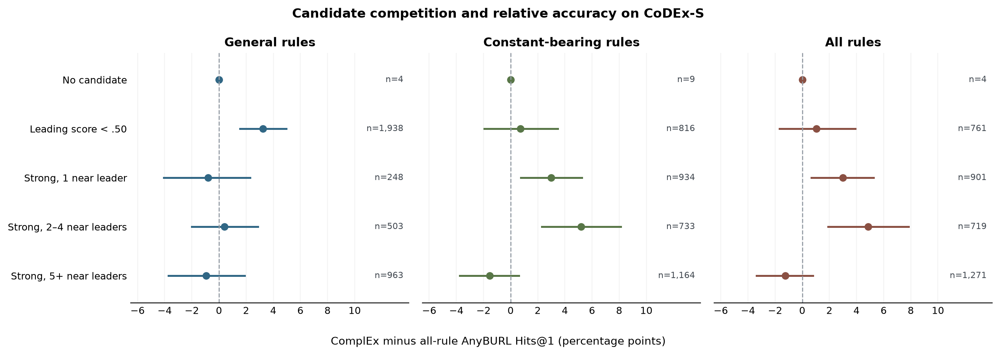

# When does rule evidence favor AnyBURL or ComplEx?

Exploratory follow-up on all 3,656 directional CoDEx-S test queries from 1,828 facts. The analysis uses the frozen 60-second AnyBURL inventory and ComplEx seed 2, selected by validation MRR in the original study.

**Candidate generation was nearly universal.** AnyBURL generated the correct entity in 3,648/3,656 queries (99.78%) and ranked it first in 1,246/3,656 (34.08%). ComplEx rescued 280 of the 2,402 generated-but-misranked cases (11.66%).

**Strong evidence looked different when candidates crowded the top.** With one near leader from all rules, the ComplEx–AnyBURL gap was +3.00 pp [+0.68, +5.25]. With five or more near leaders it was -1.26 pp [-3.36, +0.79]. After matching on relation, direction, degree and training answer count, the crowded-minus-decisive shift was +1.51 pp [-6.03, +11.49].

**Both selectors scored 22.98% train-only accuracy.** The evidence-aware selector gained +0.30 pp [-0.30, +0.93] over always using ComplEx. CoDEx-M confirmation remains open.

## Paired benchmark results

| Group | Queries | Facts | ComplEx | AnyBURL | General | Constants | General + constants | Relation frequency | Δ pp (95% CI) | Left only / right only | Both / neither |
| --- | --- | --- | --- | --- | --- | --- | --- | --- | --- | --- | --- |
| All queries | 3656 | 1828 | 35.56% | 34.08% | 27.49% | 32.06% | 34.08% | 12.14% | +1.48 [+0.27, +2.74] | 280 / 226 | 1020 / 2130 |

| Group | Queries | Facts | ComplEx | AnyBURL | General | Constants | General + constants | Relation frequency | Δ pp (95% CI) | Left only / right only | Both / neither |
| --- | --- | --- | --- | --- | --- | --- | --- | --- | --- | --- | --- |
| All queries, train-only tops | 3656 | 1828 | 22.68% | 21.39% | 17.01% | 20.65% | 21.39% | 10.07% | +1.29 [+0.11, +2.43] | 237 / 190 | 592 / 2637 |

Benchmark Hits@1 filters out other known positive answers. Evidence profiles and top-answer agreement remove training positives only. Every interval is a pointwise 95% paired bootstrap interval over facts (2,500 draws), keeping both prediction directions together. The three seeds use the same test facts. Intervals for groups with few facts can be uninformative, especially when all observed outcomes agree. The seed-by-seed sensitivity table gives separate results. [Seed sensitivity](seed-sensitivity.csv)

## 1. Why does AnyBURL misrank generated answers? (Q1–Q3)

| Group | Queries | Facts | ComplEx | AnyBURL | Δ pp (95% CI) | Left only / right only | Both / neither |
| --- | --- | --- | --- | --- | --- | --- | --- |
| Correct answer generated, ranked below first | 2402 | 1519 | 11.66% | 0.00% | +11.66 [+10.34, +13.01] | 280 / 0 | 0 / 2122 |
| no candidate | 0 | 0 | — | — | — | 0 / 0 | 0 / 0 |
| leading score below .50 | 620 | 390 | 8.55% | 0.00% | +8.55 [+6.38, +10.89] | 53 / 0 | 0 / 567 |
| strong, 1 near leader | 453 | 428 | 15.45% | 0.00% | +15.45 [+12.18, +19.03] | 70 / 0 | 0 / 383 |
| strong, 2–4 near leaders | 406 | 363 | 18.47% | 0.00% | +18.47 [+14.82, +22.30] | 75 / 0 | 0 / 331 |
| strong, 5+ near leaders | 923 | 913 | 8.88% | 0.00% | +8.88 [+6.99, +10.74] | 82 / 0 | 0 / 841 |

The first-ranked wrong candidate had a higher leading native score in 2,158 of 2,402 misranks (89.84%). Both models missed 2,122 queries in this cohort.

The next comparison uses each misrank’s held-out answer and its benchmark-filtered top wrong candidate. Mean differences are wrong minus correct. Rule patterns retain relation and argument structure while masking entity-constant identities and variable names. Grounding counts sum native nonempty-body instances across QA-attributed rules. Each counted edge appears in training. Pairs with an attribution mismatch are excluded from the grounding row. The two native interfaces agreed on nonempty-body rule attribution in 2,402 pairs.

| Candidate evidence | Pairs | Correct median | Wrong median | Mean difference (95% CI) | Wrong higher / tied / correct higher |
| --- | --- | --- | --- | --- | --- |
| native score | 2402 | 0.435 | 0.64 | +0.15 [+0.144, +0.156] | 2158 / 244 / 0 |
| max raw | 2402 | 0.636 | 0.816 | +0.168 [+0.159, +0.176] | 1982 / 156 / 264 |
| rule count | 2402 | 45 | 58 | +15.8 [+13.6, +17.9] | 1731 / 48 / 623 |
| pattern count | 2402 | 23 | 26 | +2.05 [+1.63, +2.42] | 1449 / 152 / 801 |
| grounding count | 2402 | 545 | 1.01e+03 | +563 [+474, +652] | 1781 / 2 / 619 |
| lead support | 2402 | 35.5 | 28 | -24.9 [-35.9, -13.9] | 1026 / 296 / 1080 |
| lead raw | 2402 | 0.572 | 0.783 | +0.189 [+0.18, +0.198] | 1978 / 249 / 175 |

| Native comparison | All misranks | ComplEx succeeds | Both miss |
| --- | --- | --- | --- |
| higher leading score | 2158/2402 (89.84%, 88.45%–91.05%) | 233/280 (83.21%, 78.51%–87.65%) | 1925/2122 (90.72%, 89.38%–91.95%) |
| later score breaks tie | 243/2402 (10.12%, 8.93%–11.50%) | 47/280 (16.79%, 12.35%–21.49%) | 196/2122 (9.24%, 8.01%–10.58%) |
| same prefix, more rules | 0/2402 (0.00%, 0.00%–0.00%) | 0/280 (0.00%, 0.00%–0.00%) | 0/2122 (0.00%, 0.00%–0.00%) |
| same confidence sequence | 1/2402 (0.04%, 0.00%–0.13%) | 0/280 (0.00%, 0.00%–0.00%) | 1/2122 (0.05%, 0.00%–0.14%) |

| Leading family | Correct candidate | First-ranked wrong candidate |
| --- | --- | --- |
| B | 585 (24.35%, 22.06%–26.76%) | 313 (13.03%, 11.69%–14.48%) |
| Uc | 1815 (75.56%, 73.15%–77.85%) | 2089 (86.97%, 85.52%–88.31%) |
| Ud | 2 (0.08%, 0.00%–0.25%) | 0 (0.00%, 0.00%–0.00%) |
| Z | 0 (0.00%, 0.00%–0.00%) | 0 (0.00%, 0.00%–0.00%) |

B is a general relational rule. Uc and Ud are conditional constant-bearing rules. Z is an unconditional prior. Identical confidence sequences leave the native frequency and ID tie order to discriminate. The strongest rule is the first under native adjusted confidence. The maximum raw confidence can belong to a different rule. [Evidence by rescue outcome](misrank-candidate-evidence.csv) · [Illustrated misranks](case-studies.md)



A strong leading native score is at least .50. A near leader is within .05 of the best scalar score. These cutoffs were fixed for this follow-up and are descriptive. Scalar scores describe the strength and spread of evidence. PyClause uses its native maxplus confidence sequence and training-frequency tie handling for ranking. [Complete plot data](evidence-groups.csv)

## 2. Do general and constant-bearing rules agree? (Q4–Q6)

The train-only family leaders differ on 2,662 queries. On those queries, constants score 20.66% and general rules 14.35%. ComplEx leads all rules by +2.63 pp [+1.20, +4.09].

| Group | Queries | Facts | ComplEx | AnyBURL | General | Constants | Δ pp (95% CI) | Left only / right only | Both / neither |
| --- | --- | --- | --- | --- | --- | --- | --- | --- | --- |
| agree | 985 | 857 | 64.06% | 65.69% | 63.25% | 63.15% | -1.62 [-3.97, +0.81] | 62 / 78 | 569 / 276 |
| disagree | 2662 | 1697 | 25.13% | 22.50% | 14.35% | 20.66% | +2.63 [+1.20, +4.09] | 218 / 148 | 451 / 1845 |
| general only | 5 | 5 | 0.00% | 0.00% | 0.00% | 0.00% | +0.00 [+0.00, +0.00] | 0 / 0 | 0 / 5 |
| constants only | 0 | 0 | — | — | — | — | — | 0 / 0 | 0 / 0 |
| neither | 4 | 3 | 0.00% | 0.00% | 0.00% | 0.00% | +0.00 [+0.00, +0.00] | 0 / 0 | 0 / 4 |

Where train-only family leaders differ, constants lead general rules by +6.31 pp [+4.47, +8.07].

| Group | Queries | Facts | General + constants | General | Δ pp (95% CI) | Left only / right only | Both / neither |
| --- | --- | --- | --- | --- | --- | --- | --- |
| All queries | 3656 | 1828 | 34.08% | 27.49% | +6.59 [+5.31, +7.82] | 386 / 145 | 860 / 2265 |
| Benchmark top changed | 2279 | 1479 | 16.94% | 6.36% | +10.57 [+8.56, +12.51] | 386 / 145 | 0 / 1748 |
| Of changes, family leaders agree | 142 | 138 | 29.58% | 12.68% | +16.90 [+6.40, +26.74] | 42 / 18 | 0 / 82 |
| Of changes, family leaders differ | 2137 | 1407 | 16.10% | 5.94% | +10.15 [+8.08, +12.15] | 344 / 127 | 0 / 1666 |
| Of changes, leading score below .50 | 506 | 360 | 9.49% | 5.93% | +3.56 [+0.19, +6.96] | 48 / 30 | 0 / 428 |
| Of changes, strong, 1 near leader | 472 | 455 | 35.38% | 8.47% | +26.91 [+21.40, +32.41] | 167 / 40 | 0 / 265 |
| Of changes, strong, 2–4 near leaders | 393 | 353 | 18.83% | 6.62% | +12.21 [+7.45, +17.30] | 74 / 26 | 0 / 293 |
| Of changes, strong, 5+ near leaders | 908 | 898 | 10.68% | 5.40% | +5.29 [+2.69, +7.83] | 97 / 49 | 0 / 762 |

Adding constants corrects 386 queries and overrides 145 correct general predictions, a net change of +6.59 pp [+5.31, +7.82]. The union excludes unconditional priors. The changed-prediction rows compare benchmark tops after evaluator filtering. [Examples of corrections and overrides](case-studies.md)

The popularity baseline ranks entities by their training occurrence on the predicted side of the target relation, with Wikidata-ID order for tied counts. Groups use train-only predictions. The table scores benchmark top answers.

| Group | Queries | Facts | Constants | Relation frequency | ComplEx | AnyBURL | Δ pp (95% CI) | Left only / right only | Both / neither |
| --- | --- | --- | --- | --- | --- | --- | --- | --- | --- |
| All queries | 3656 | 1828 | 32.06% | 12.14% | 35.56% | 34.08% | +19.91 [+18.30, +21.42] | 794 / 66 | 378 / 2418 |
| Train-only tops differ | 2731 | 1775 | 26.80% | 3.55% | 28.74% | 28.05% | +23.25 [+21.37, +25.10] | 695 / 60 | 37 / 1939 |
| Train-only tops coincide | 925 | 872 | 47.57% | 37.51% | 55.68% | 51.89% | +10.05 [+7.86, +12.28] | 99 / 6 | 341 / 479 |

Constants lead the frequency baseline by +19.91 pp [+18.30, +21.42] overall. Their lead is larger on queries where their train-only predictions differ. The benchmark filter can remove a shared train-only top candidate and expose different lower-ranked answers.

## 3. Which structures and levels of support matter? (Q7–Q8)

A real applied general rule can enter each applicable group. Groups overlap. Symmetry reverses the argument order of the same relation, inversion reverses a different relation, and subsumption preserves argument order across different relations. Two- and three-hop groups use general rule bodies of those lengths. The strongest applicable rule for a structure may support any train-filtered candidate.

| Group | Queries | Facts | ComplEx | AnyBURL | General | Δ pp (95% CI) | Left only / right only | Both / neither |
| --- | --- | --- | --- | --- | --- | --- | --- | --- |
| Any strong general structure | 1714 | 1131 | 44.75% | 45.27% | 40.55% | -0.53 [-2.37, +1.33] | 116 / 125 | 651 / 822 |
| symmetry ≥ .50 | 572 | 292 | 75.52% | 78.67% | 79.37% | -3.15 [-5.97, -0.18] | 29 / 47 | 403 / 93 |
| symmetry > 0 and < .50 | 38 | 27 | 7.89% | 5.26% | 7.89% | +2.63 [-7.14, +16.00] | 2 / 1 | 1 / 34 |
| inversion ≥ .50 | 0 | 0 | — | — | — | — | 0 / 0 | 0 / 0 |
| inversion > 0 and < .50 | 16 | 13 | 18.75% | 31.25% | 31.25% | -12.50 [-40.48, +14.66] | 1 / 3 | 2 / 10 |
| subsumption ≥ .50 | 0 | 0 | — | — | — | — | 0 / 0 | 0 / 0 |
| subsumption > 0 and < .50 | 1200 | 1048 | 42.00% | 38.92% | 24.92% | +3.08 [+0.89, +5.45] | 113 / 76 | 391 / 620 |
| two-hop composition ≥ .50 | 422 | 315 | 34.60% | 38.63% | 32.94% | -4.03 [-7.26, -0.74] | 18 / 35 | 128 / 241 |
| two-hop composition > 0 and < .50 | 2666 | 1662 | 34.10% | 32.82% | 28.21% | +1.28 [-0.11, +2.71] | 197 / 163 | 712 / 1594 |
| three-hop composition ≥ .50 | 1426 | 1050 | 38.64% | 39.62% | 33.87% | -0.98 [-3.11, +1.08] | 98 / 112 | 453 / 763 |
| three-hop composition > 0 and < .50 | 2219 | 1449 | 33.62% | 30.51% | 23.34% | +3.11 [+1.61, +4.67] | 182 / 113 | 564 / 1360 |
| Only weak general evidence, multiple near leaders | 1782 | 1211 | 27.61% | 24.30% | 15.38% | +3.31 [+1.55, +5.06] | 155 / 96 | 337 / 1194 |

Leading-rule reliability uses each family’s train-only top candidate, its strongest native rule’s raw confidence and training support, and exact held-out target accuracy under train-only top prediction. The two families have different native weights and may occupy different bins.

| Family | Raw confidence | Training support | Queries | Facts | Family | ComplEx | AnyBURL | ComplEx–AnyBURL pp (95% CI) |
| --- | --- | --- | --- | --- | --- | --- | --- | --- |
| general | ≥ .80 | ≤ 10 | 54 | 54 | 0.00% | 0.00% | 0.00% | +0.00 [+0.00, +0.00] |
| general | ≥ .80 | 11–50 | 83 | 81 | 3.61% | 4.82% | 3.61% | +1.20 [-2.65, +5.56] |
| general | ≥ .80 | > 50 | 575 | 293 | 25.57% | 25.57% | 26.78% | -1.22 [-4.75, +2.12] |
| general | < .80 | ≤ 10 | 192 | 163 | 14.58% | 11.46% | 17.19% | -5.73 [-10.26, -1.05] |
| general | < .80 | 11–50 | 981 | 832 | 8.97% | 11.42% | 10.50% | +0.92 [-0.83, +2.68] |
| general | < .80 | > 50 | 1767 | 1265 | 20.15% | 30.79% | 27.67% | +3.11 [+1.36, +4.90] |
| constants | ≥ .80 | ≤ 10 | 299 | 290 | 4.68% | 5.02% | 4.35% | +0.67 [-0.92, +2.47] |
| constants | ≥ .80 | 11–50 | 482 | 418 | 19.09% | 17.01% | 19.50% | -2.49 [-5.40, +0.40] |
| constants | ≥ .80 | > 50 | 1320 | 815 | 25.91% | 26.29% | 26.36% | -0.08 [-2.03, +1.77] |
| constants | < .80 | ≤ 10 | 579 | 395 | 13.47% | 15.72% | 16.41% | -0.69 [-3.76, +2.44] |
| constants | < .80 | 11–50 | 458 | 376 | 24.24% | 25.76% | 24.67% | +1.09 [-2.08, +4.61] |
| constants | < .80 | > 50 | 509 | 480 | 23.18% | 34.58% | 23.38% | +11.20 [+7.73, +14.79] |

The calibration CSV includes family-specific accuracy intervals and paired exclusive counts. [Calibration data](confidence-support.csv) · [Applied rules and training witnesses](case-studies.md)

## 4. Does the association survive graph controls? (Q9–Q10)

Within each family, the matched analysis compares strong queries with one near leader to strong queries with at least five near leaders. Strata match relation, direction, log₂ known-entity-degree bin, and log₂ training-answer multiplicity bin. Matching relation fixes training relation frequency. Strata are weighted by the smaller group size and contribute when both groups are observed in a bootstrap draw. Positive shifts favor ComplEx in crowded queries.

| Family | Matched strata | Decisive / crowded queries | Facts | Decisive gap pp | Crowded gap pp | Crowded minus decisive pp (95% CI) |
| --- | --- | --- | --- | --- | --- | --- |
| general | 10 | 64 / 220 | 274 | +0.78 | +4.37 | +3.60 [-5.62, +10.46] |
| constants | 26 | 564 / 212 | 689 | +3.69 | +4.27 | +0.58 [-6.57, +9.08] |
| all | 23 | 524 / 201 | 653 | +4.03 | +5.54 | +1.51 [-6.03, +11.49] |

The following relations have at least 100 directional test queries. The table shows two relations from each end of the observed gap. This is an exploratory comparison across selected relations.

| Group | Queries | Facts | ComplEx | AnyBURL | Δ pp (95% CI) | Left only / right only | Both / neither |
| --- | --- | --- | --- | --- | --- | --- | --- |
| languages spoken, written, or signed (P1412) | 156 | 78 | 40.38% | 46.15% | -5.77 [-10.32, -1.32] | 2 / 11 | 61 / 82 |
| diplomatic relation (P530) | 574 | 287 | 73.69% | 77.00% | -3.31 [-6.16, -0.35] | 29 / 48 | 394 / 103 |
| country of citizenship (P27) | 210 | 105 | 36.67% | 31.43% | +5.24 [-0.86, +11.45] | 25 / 14 | 52 / 119 |
| member of (P463) | 540 | 270 | 46.67% | 41.67% | +5.00 [+0.56, +9.55] | 81 / 54 | 171 / 234 |

| Relation | Family disagreements | Median near leaders | Most prevalent strong general structure |
| --- | --- | --- | --- |
| languages spoken, written, or signed (P1412) | 54 / 156 | 8.5 | two-hop composition |
| diplomatic relation (P530) | 267 / 574 | 6.0 | symmetry |
| country of citizenship (P27) | 137 / 210 | 2.0 | three-hop composition |
| member of (P463) | 411 / 540 | 3.0 | three-hop composition |

[Relation-level evidence profiles](relations.csv) · [Representative relational predictions](case-studies.md)

## 5. Can evidence predict which model to use? (Q11)

Two fixed L2-regularized multinomial logistic models learn on CoDEx-S validation disagreements. Both see relation, direction, degree, relation frequency and training answer multiplicity. The augmented model also sees strength, competition, family agreement, family support and logical structure. They estimate the probability that only AnyBURL succeeds, neither succeeds, or only ComplEx succeeds, using targets scored from train-only top answers. For disagreements the selector chooses the greater exclusive-success probability. The validation and test facts are disjoint and share 746 masked inputs.

| Selector | Validation disagreements | Test disagreements | Test exclusive wins | Test choices of AnyBURL | Exclusive-winner AUC (95% CI) | Three-class Brier |
| --- | --- | --- | --- | --- | --- | --- |
| controls | 2385 | 2341 | 427 | 655 | 0.603 [0.546, 0.659] | 0.268 |
| controls + rule evidence | 2385 | 2341 | 427 | 758 | 0.591 [0.534, 0.643] | 0.262 |

The paired evidence-minus-controls AUC interval is [-0.062, +0.037]. The paired evidence-minus-controls Brier interval is [-0.012, -0.001], with lower Brier preferred.

The train-only endpoint evaluates the actual candidates that the selector can output. The benchmark endpoint evaluates the selected model’s ranking after the benchmark evaluator filters other known answers.

| Group | Queries | Facts | Train-only left | Train-only right | Δ pp (95% CI) | Left only / right only | Both / neither |
| --- | --- | --- | --- | --- | --- | --- | --- |
| controls · all queries | 3656 | 1828 | 22.98% | 22.68% | +0.30 [-0.27, +0.85] | 53 / 42 | 787 / 2774 |
| controls · train-only top answers differ | 2341 | 1696 | 10.59% | 10.12% | +0.47 [-0.42, +1.33] | 53 / 42 | 195 / 2051 |
| controls · masked input absent from validation | 1475 | 1304 | 41.42% | 40.95% | +0.47 [-0.61, +1.55] | 36 / 29 | 575 / 835 |
| controls + rule evidence · all queries | 3656 | 1828 | 22.98% | 22.68% | +0.30 [-0.30, +0.93] | 71 / 60 | 769 / 2756 |
| controls + rule evidence · train-only top answers differ | 2341 | 1696 | 10.59% | 10.12% | +0.47 [-0.48, +1.44] | 71 / 60 | 177 / 2033 |
| controls + rule evidence · masked input absent from validation | 1475 | 1304 | 41.63% | 40.95% | +0.68 [-0.48, +1.81] | 41 / 31 | 573 / 830 |
| rule evidence vs controls · all queries | 3656 | 1828 | 22.98% | 22.98% | +0.00 [-0.49, +0.52] | 44 / 44 | 796 / 2772 |

| Group | Queries | Facts | Benchmark left | Benchmark right | Δ pp (95% CI) | Left only / right only | Both / neither |
| --- | --- | --- | --- | --- | --- | --- | --- |
| controls · all queries | 3656 | 1828 | 36.43% | 35.56% | +0.88 [+0.25, +1.53] | 81 / 49 | 1251 / 2275 |
| controls · train-only top answers differ | 2341 | 1696 | 23.67% | 22.30% | +1.37 [+0.39, +2.39] | 81 / 49 | 473 / 1738 |
| controls · masked input absent from validation | 1475 | 1304 | 45.90% | 45.42% | +0.47 [-0.61, +1.55] | 36 / 29 | 641 / 769 |
| controls + rule evidence · all queries | 3656 | 1828 | 36.11% | 35.56% | +0.55 [-0.08, +1.16] | 75 / 55 | 1245 / 2281 |
| controls + rule evidence · train-only top answers differ | 2341 | 1696 | 23.15% | 22.30% | +0.85 [-0.13, +1.82] | 75 / 55 | 467 / 1744 |
| controls + rule evidence · masked input absent from validation | 1475 | 1304 | 46.10% | 45.42% | +0.68 [-0.43, +1.77] | 39 / 29 | 641 / 766 |
| rule evidence vs controls · all queries | 3656 | 1828 | 36.11% | 36.43% | -0.33 [-0.82, +0.19] | 41 / 53 | 1279 / 2283 |

The two selector rows compare against always choosing ComplEx. The rule-evidence versus controls row compares the two selectors directly. [Per-query choices](selector-predictions.csv) · [Selector examples](case-studies.md)

## Scope and reproducibility

The comparisons are observational and their intervals describe sampling variation over facts in this benchmark. The frozen ablation isolates the change in rule inventory under the same ranking engine. Case studies are illustrative. CoDEx-S test outcomes have been examined repeatedly. An independent test of the frozen selector needs paired CoDEx-M outcomes from comparable model artifacts.

The benchmark’s relation labels and popularity motivation come from Safavi and Koutra. The applied-rule structural comparison follows the question studied by Meilicke et al., and the ranking preserves the installed AnyBURL/PyClause policy. [CoDEx paper](https://aclanthology.org/2020.emnlp-main.669/) · [Fine-grained rule and embedding evaluation](https://madoc.bib.uni-mannheim.de/45092/) · [AnyBURL methodology](https://link.springer.com/article/10.1007/s00778-023-00800-5)

Run the following commands from the project root using the installed backend environment. The analysis requires the saved frozen rankings, original training data and validation-selected checkpoint. Input hashes are in [provenance.json](provenance.json).

```bash
mkdir -p runs/evidence-advantage
revision=3132e426c2a6b643b70bad679905a3a6270be440
for kind in entities relations; do
  curl -fsSL "https://raw.githubusercontent.com/tsafavi/codex/$revision/data/$kind/en/$kind.json" \
    -o "runs/evidence-advantage/$kind.json"
done
for model in all general constants constants_general complex; do
  OMP_NUM_THREADS=1 .backend-venv/bin/python -m kgc.research.evidence_inference "$model"
done
OPENBLAS_NUM_THREADS=1 .backend-venv/bin/python -m kgc.research.evidence_advantage
```
