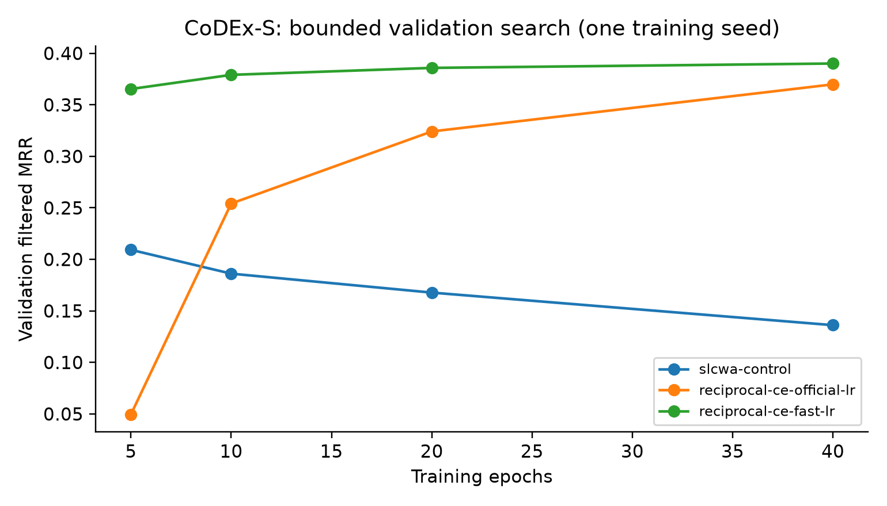
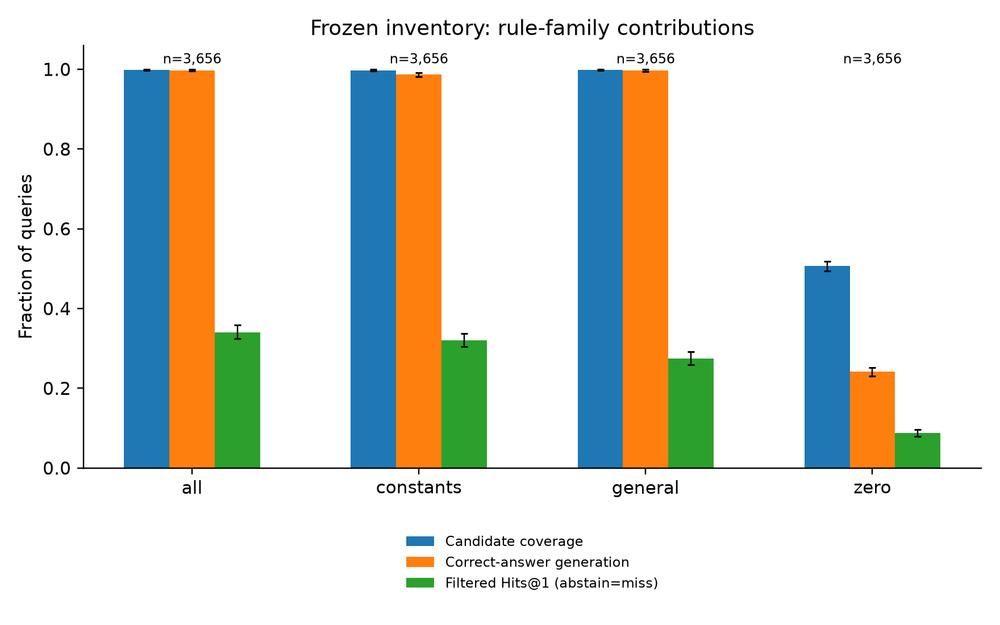
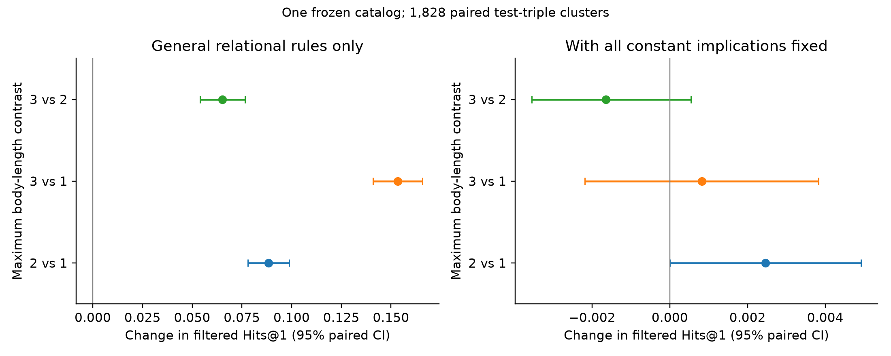

# AID 851 — audited embedding–rule comparison, next phase

This report is regenerated from saved outputs. Earlier pilot reports and checkpoints remain unchanged. The new studies are bounded development experiments, not a final benchmark reproduction. No hybrid or GAT work was added.

## Current answers and evidence labels

| question | evidence_class | answer |
| --- | --- | --- |
| Was the original ComplEx pilot undertrained? | Direct learning-curve observation; bounded validation-selected comparison | The stronger recipe reaches mean test MRR 0.4535 versus pilot 0.2046. Extra epochs alone did not repair the sLCWA control: validation MRR fell from 0.2093 at epoch 5 to 0.1362 at epoch 40. The original comparison used a weak recipe/budget; no single changed setting is identified as the cause. |
| How much rule success comes from constant implications? | Controlled frozen-rule-family subset evidence, one inventory | Standalone constant Hits@1 0.3206, general-rule Hits@1 0.2749, all-rules Hits@1 0.3408. Both families contribute; union contrasts and unique successes quantify contribution without equating rule count with importance. |
| Does greater available relational rule length help with fixed constants? | Controlled inference-time subset intervention, one inventory | Maximum length 3 minus 1 changes Hits@1 by +0.0008, paired 95% interval [-0.0022, +0.0038], with 17 gains and 14 losses. This holds constants fixed and does not re-mine. The interval includes zero; a clear net improvement is not established. Without constants, the corresponding relational-only change is +0.1534. Mining-budget effects and inventory stability remain unresolved. |
| Which cases are complementary? | Direct paired outcomes and exploratory graph associations | Across the three neural seeds, only general rules succeed on 0.0470 of directional observations, and only embeddings on 0.1284. Training-only degree/frequency/pattern associations and native groundings describe these cases; they do not identify causal mechanisms or provide a deployable oracle. |
| Which claims still need controlled interventions? | Unresolved uncertainty; prepared design | Connectivity, sparsity and noise mechanisms require both-model retraining with matched graph controls. Independent mining replication and CoDEx-M generalization remain pending. Frequency/degree-adjusted strata are descriptive, not causal identification. |

## Audit and corrected interpretation

The six completed prior runs have matching official file hashes, entity/relation maps and candidate universes. Models receive training positives and masked queries only. Validation filtering uses train+validation; final test filtering uses train+validation+test. Verified negatives are excluded from graph edges and ranking filters. Average-score neural tie ranks and native maxplus rule ordering remain distinct policies.

The executable audit is in `audit/audit.json`. PyClause applies smoothing and family weights: with 10 correct out of 20 predictions, raw confidence 0.5 becomes 0.4 for B/Uc, 0.04 for Ud and 0.004 for Z under the installed defaults. Scores are not probabilities. Maxplus uses a lexicographic sequence of supporting rule confidences; re-sorting by the first scalar score changes ranking semantics.

One native rule returned 150 supported candidates despite topk=10, but that overrun did NOT establish completeness. A two-rule counterexample returned only the first rule's candidates, and real queries returned different supports at K=100/1000. New runs explicitly set K above the entire entity universe (2,035 here), disable pruning/stopping, and compare against K=4,069 on eight masked validation queries. This changes retrieval completeness, not rule confidence or maxplus semantics. Certified Hits describe this exhaustive **loaded-rule candidate ranking with abstentions counted as misses**; they are not a ranking of unsupported zero-score entities. Exact full-universe rule MRR remains null. Old retrieved-list/censored labels are correct and are preserved. The preliminary inference from the single-rule probe was rejected and its correction retained.

Reflexive XX-family QA output disagreed with native triple scoring in executable synthetic probes; the failure depended on preceding native calls. Both synthetic observations are retained in the regression log. Completeness certification is disabled for inventories containing these families. This frozen catalog contains none. Z rules cannot use native PredictionHandler classification, so every NEW subset uses the same tail-query maxplus scalar for classification; calibration and threshold fitting remain validation-only. This versioned score policy is explicit and leaves legacy scores untouched.

Legacy `rule_covered` means nonempty pre-filter candidates, not correct-answer support. Legacy `relational_path` includes any variable-only syntax, not just native B rules; `mixed` means multiple coarse kinds appear among evidence for returned candidates. New subsets distinguish B, Uc, Ud, reflexive families and Z. Constant-bearing implications have nonempty bodies and are not unconditional entity-frequency priors. Every subset retains the native training-frequency tie policy: general-only removes constant implications and Z rules, but does not remove this implicit frequency-based tie breaker. Serialized text cannot establish grounded-cyclic mining provenance: structural proxies are cataloged separately and are not relabeled mining families.

Truth-generation, strong support for truth, target degree, paths to truth, error categories and the oracle require the held-out answer. They are diagnostic labels only. Paired uncertainty clusters both directions by original test triple and resamples neural training seeds. Repeating a fixed symbolic model across neural seeds does not create independent rule-mining replicates. Shared entities, relations and repeated masked inputs across different triples remain dependent; the triple bootstrap is a conditional benchmark uncertainty estimate, not a model of all graph dependence.

The query-level two-hop diagnostic counts distinct intermediate entities with relation labels collapsed. It is not a count of all typed paths. Training-only typed relation-composition statistics and native rule groundings are provided separately. Empty-inventory families are availability diagnostics, not estimates of trained-family quality.

## ComplEx training and selection

The [official CoDEx configuration](https://github.com/tsafavi/codex/blob/master/models/link-prediction/codex-s/complex/config.yaml) uses reciprocal relations, per-triple 1vsAll, a 512-real-coordinate representation, dropout, Adam at approximately 0.000339, a plateau scheduler and up to 400 epochs. Its regularization selector is empty despite stored regularization weights. The pilot used 128 complex coordinates, 2-negative sLCWA/Softplus, no reciprocals, PyKEEN's default regularizer, Adam 0.01 and ten epochs. These multiple changes prevent attributing the gap solely to epoch count.

The new recipe uses 256 PyKEEN complex coordinates, explicit inverse IDs and per-triple cross entropy against all original entities. PyKEEN grouped LCWA is not assumed equivalent to LibKGE per-triple 1vsAll. Training scores are tested against PyKEEN's ComplEx interaction. This is a documented port, not bitwise reproduction: real/imaginary dropout/initializer implementation, batch ordering/loss scaling and validation frequency differ. The [CoDEx paper, Tables 5 and 11](https://aclanthology.org/2020.emnlp-main.669.pdf) confirms CE, no regularization, reciprocals and reference MRR/Hits@1/Hits@10 of 0.465/0.372/0.646. These reference values are not measured here. The [setup script](https://github.com/tsafavi/codex/blob/master/libkge_setup.sh) pins historic LibKGE `a9ecd249ec2d205df59287f64553a1536add4a43`; its files could not be fetched. [Current defaults](https://github.com/uma-pi1/kge/blob/master/kge/config-default.yaml) expose extra test-filtered validation metrics and rounded mean tie ranks. Our validation excludes test filtering and uses unrounded realistic ties. Historic inherited defaults remain unverified.

The protocol `configs/next_phase_curves.json` fixes three recipes and a maximum of forty epochs. One real-data one-epoch CPU smoke preceded it and accessed validation only. The search uses full-validation filtered MRR; selection is saved before new test scoring. The selected recipe uses three seeds and per-seed validation checkpoint selection. The strongest saved checkpoint is chosen by validation, never by test score. Schedules/early stopping count validation checks, so they do not reproduce a 400-epoch schedule.

There are four validation checkpoints (epochs 5/10/20/40). Scheduler patience is seven checks, so no learning-rate decay was triggered within these runs. The epoch ceiling, rather than demonstrated convergence, limits the selected recipe. Checkpoint improvements use a fixed 0.0001 margin, retaining the earlier checkpoint for smaller changes. Objective, reciprocals, dimensionality, regularization, dropout and initialization change together across the sLCWA/CE recipes; isolating their individual mechanisms requires further controlled ablations.

Our batch size 1,024 counts directional examples in the augmented train set (65 optimizer steps per full epoch). LibKGE's paired 1vsAll batch counts 1,024 original triples and evaluates both directions per step (33 steps for this training split). Each epoch covers both directions in either setup, but gradient grouping, update count and loss scaling differ. Thus forty epochs here are not an exactly matched optimizer/computation budget or a bitwise reproduction of the published training loop.

Selected recipe: `reciprocal-ce-fast-lr`.

| seed | best_epoch | validation_MRR | mrr_exact | hits1 | hits10 | n_queries | training_seconds | inference_seconds |
| --- | --- | --- | --- | --- | --- | --- | --- | --- |
| 0 | 40 | 0.3901 | 0.4514 | 0.3556 | 0.6403 | 3656 | 278.6964 | 3.4514 |
| 1 | 20 | 0.3892 | 0.4564 | 0.3578 | 0.6403 | 3656 | 308.2318 | 3.2513 |
| 2 | 40 | 0.3916 | 0.4528 | 0.3556 | 0.6406 | 3656 | 266.9286 | 2.6237 |

Strongest checkpoint by validation: `runs/next-phase-neural/final/seed-2/best.pt`; seed 2, epoch 40. Hash, full configuration, original ID maps and load instructions are in `strongest-complex.json`.

Direct observation: selected-recipe test means are MRR 0.4535, Hits@1 0.3563, Hits@10 0.6404. Compare the old pilot mean MRR 0.2046 with these bounded, differently configured runs cautiously. The same-recipe sLCWA learning curve tests extra training; the recipe search changes several factors together. A higher score does not isolate which change caused improvement.

## Frozen rule-family and length ablations

Retrospective evaluator-only filtering sensitivity for the already-selected seed-0 checkpoint: validation MRR 0.3901 with train+validation filters, versus 0.4668 when test positives additionally filter alternative answers. The latter metric did not select recipes/checkpoints and is not a new tuning target. It quantifies a protocol difference without giving test triples to the model.

One 60-second native mining run produced 470308 rules: `{"B": 2249, "Uc": 444628, "Ud": 23361, "Z": 70}`. This exceeds the earlier ten-second budget but does not establish mining convergence. Only one learned inventory was sampled; independent mining stability remains unresolved. Native min-confidence/loading filters can further reduce effective inventories; both file and loaded counts are saved.

| condition | inventory_count | native_loaded_count | n_queries | coverage | correct_answer_generation_coverage | hits1 | hits10 | inference_seconds | hits_metric_status |
| --- | --- | --- | --- | --- | --- | --- | --- | --- | --- |
| B | 2249 | 2249 | 3656 | 0.9989 | 0.9973 | 0.2749 | 0.5271 | 19.6057 | certified supported-candidate Hits; abstain=miss |
| Uc | 444628 | 444628 | 3656 | 0.9964 | 0.9852 | 0.3203 | 0.6182 | 75.1438 | certified supported-candidate Hits; abstain=miss |
| Ud | 23361 | 23361 | 3656 | 0.9975 | 0.9869 | 0.1679 | 0.4029 | 10.3113 | certified supported-candidate Hits; abstain=miss |
| XXuc | 0 | 0 | 3656 | 0.0000 | 0.0000 | 0.0000 | 0.0000 | 3.7001 | certified supported-candidate Hits; abstain=miss |
| XXud | 0 | 0 | 3656 | 0.0000 | 0.0000 | 0.0000 | 0.0000 | 3.7001 | certified supported-candidate Hits; abstain=miss |
| Z | 70 | 70 | 3656 | 0.5066 | 0.2412 | 0.0873 | 0.2043 | 3.7421 | certified supported-candidate Hits; abstain=miss |
| all | 470308 | 470308 | 3656 | 0.9989 | 0.9978 | 0.3408 | 0.6247 | 96.3734 | certified supported-candidate Hits; abstain=miss |
| constants | 467989 | 467989 | 3656 | 0.9975 | 0.9869 | 0.3206 | 0.6187 | 96.2798 | certified supported-candidate Hits; abstain=miss |
| constants_general | 470238 | 470238 | 3656 | 0.9989 | 0.9978 | 0.3408 | 0.6247 | 132.0840 | certified supported-candidate Hits; abstain=miss |
| fixed_constants_general_le1 | 468057 | 468057 | 3656 | 0.9989 | 0.9907 | 0.3400 | 0.6245 | 110.9048 | certified supported-candidate Hits; abstain=miss |
| fixed_constants_general_le2 | 468708 | 468708 | 3656 | 0.9989 | 0.9973 | 0.3425 | 0.6283 | 123.8283 | certified supported-candidate Hits; abstain=miss |
| fixed_constants_general_le3 | 470238 | 470238 | 3656 | 0.9989 | 0.9978 | 0.3408 | 0.6247 | 132.0840 | certified supported-candidate Hits; abstain=miss |
| general | 2249 | 2249 | 3656 | 0.9989 | 0.9973 | 0.2749 | 0.5271 | 19.6057 | certified supported-candidate Hits; abstain=miss |
| general_le1 | 68 | 68 | 3656 | 0.5367 | 0.1537 | 0.1214 | 0.1518 | 2.8554 | certified supported-candidate Hits; abstain=miss |
| general_le2 | 719 | 719 | 3656 | 0.9576 | 0.5531 | 0.2098 | 0.3747 | 3.5741 | certified supported-candidate Hits; abstain=miss |
| general_le3 | 2249 | 2249 | 3656 | 0.9989 | 0.9973 | 0.2749 | 0.5271 | 19.6057 | certified supported-candidate Hits; abstain=miss |
| reflexive | 0 | 0 | 3656 | 0.0000 | 0.0000 | 0.0000 | 0.0000 | 3.7001 | certified supported-candidate Hits; abstain=miss |
| zero | 70 | 70 | 3656 | 0.5066 | 0.2412 | 0.0873 | 0.2043 | 3.7421 | certified supported-candidate Hits; abstain=miss |

Rule inventory confidence/support (raw mining statistics, not calibrated or type-adjusted scores):

| family | body_length | n_rules | mean_raw_confidence | median_raw_confidence | mean_support | median_support |
| --- | --- | --- | --- | --- | --- | --- |
| B | 1 | 68 | 0.1135 | 0.0393 | 31.9265 | 3.0000 |
| B | 2 | 651 | 0.2107 | 0.0984 | 21.3779 | 4.0000 |
| B | 3 | 1530 | 0.1928 | 0.1018 | 66.0157 | 20.0000 |
| Uc | 1 | 444628 | 0.4410 | 0.4167 | 6.7624 | 4.0000 |
| Ud | 1 | 23361 | 0.0801 | 0.0413 | 12.1560 | 4.0000 |
| Z | 0 | 70 | 0.0699 | 0.0307 | 217.3286 | 166.5000 |

The all-rules, constant-only, general-only, union and supported other-family conditions use identical official queries. Empty families have zero candidate coverage. Native smoothing, weights, maxplus aggregation and tie policy remain unchanged; there is no category-specific retuning or score normalization. Inventories and original-line indices are frozen and hashed.

| comparison | difference | ci_low | ci_high | n_query_gains | n_query_losses | n_top_entity_changes |
| --- | --- | --- | --- | --- | --- | --- |
| constants_general minus constants | 0.0202 | 0.0142 | 0.0268 | 92 | 18 | 375 |
| constants_general minus general | 0.0659 | 0.0539 | 0.0788 | 386 | 145 | 2279 |
| all minus constants_general | 0.0000 | 0.0000 | 0.0000 | 0 | 0 | 0 |
| constants minus general | 0.0457 | 0.0320 | 0.0602 | 401 | 234 | 2575 |

Adding general rules to fixed constants, adding constants to fixed general rules, and adding zero rules to their union are separate controlled subset interventions. Gains and losses count directional query outcomes, not independent graph samples. They measure net ranking effects under the original maxplus policy, rather than assigning additive credit to the winning rule family.

Standalone Hits@1 successes: both subsets correct 771; only constant implications correct 401; only general relational rules correct 234; neither correct 2250. These unique successes are relative to the other standalone subset, not additive causal credit in the combined maxplus ranking. Candidate-set Jaccard averaged 0.6431.

| condition | n_test | coverage | auroc_raw | average_precision_raw | accuracy_on_covered | overall_accuracy_uncovered_miss |
| --- | --- | --- | --- | --- | --- | --- |
| Uc | 3656 | 0.9305 | 0.8807 | 0.8909 | 0.7895 | 0.7347 |
| Ud | 3656 | 0.9450 | 0.8261 | 0.8268 | 0.7349 | 0.6945 |
| XXuc | 3656 | 0.0000 | 0.5000 | 0.5000 | n/a | 0.0000 |
| XXud | 3656 | 0.0000 | 0.5000 | 0.5000 | n/a | 0.0000 |
| all | 3656 | 0.9948 | 0.8360 | 0.8657 | 0.7729 | 0.7689 |
| constants | 3656 | 0.9450 | 0.8807 | 0.8910 | 0.7919 | 0.7484 |
| constants_general | 3656 | 0.9948 | 0.8360 | 0.8657 | 0.7729 | 0.7689 |
| fixed_constants_general_le1 | 3656 | 0.9480 | 0.8837 | 0.8937 | 0.7917 | 0.7505 |
| fixed_constants_general_le2 | 3656 | 0.9861 | 0.8811 | 0.8912 | 0.7928 | 0.7817 |
| fixed_constants_general_le3 | 3656 | 0.9948 | 0.8360 | 0.8657 | 0.7729 | 0.7689 |
| general | 3656 | 0.9937 | 0.7516 | 0.7792 | 0.7137 | 0.7092 |
| general_le1 | 3656 | 0.0790 | 0.5750 | 0.5767 | 0.9204 | 0.0728 |
| general_le2 | 3656 | 0.4825 | 0.6527 | 0.7215 | 0.7806 | 0.3766 |
| general_le3 | 3656 | 0.9937 | 0.7516 | 0.7792 | 0.7137 | 0.7092 |
| reflexive | 3656 | 0.0000 | 0.5000 | 0.5000 | n/a | 0.0000 |
| zero | 3656 | 0.3055 | 0.6478 | 0.6175 | 0.3671 | 0.1121 |
| ComplEx seed-0 | 3656 | 1.0000 | 0.7806 | 0.7619 | 0.7114 | 0.7114 |
| ComplEx seed-1 | 3656 | 1.0000 | 0.7897 | 0.7788 | 0.7196 | 0.7196 |
| ComplEx seed-2 | 3656 | 1.0000 | 0.7703 | 0.7519 | 0.7019 | 0.7019 |

Ranking uses 3,656 directional observations from 1,828 positive facts. Classification instead scores 1,828 positives plus 1,828 verified negatives once each. Neural classification averages forward/inverse raw scores; every rule subset uses the native tail-query maxplus scalar. Each backend is calibrated separately on validation. These conventions do not numerically reproduce CoDEx's relation-specific classification thresholds. Hard-negative AUROC/AP include documented zero scores for unsupported cases; these are abstentions, not learned negative judgments. Covered accuracy and total accuracy remain separate.

| comparison | difference | ci_low | ci_high | n_queries | n_triples | n_seeds |
| --- | --- | --- | --- | --- | --- | --- |
| general_le2 minus general_le1 | 0.0883 | 0.0780 | 0.0987 | 3656 | 1828 | 1 |
| general_le3 minus general_le1 | 0.1534 | 0.1409 | 0.1658 | 3656 | 1828 | 1 |
| general_le3 minus general_le2 | 0.0651 | 0.0539 | 0.0766 | 3656 | 1828 | 1 |
| fixed_constants_general_le2 minus fixed_constants_general_le1 | 0.0025 | 0.0000 | 0.0049 | 3656 | 1828 | 1 |
| fixed_constants_general_le3 minus fixed_constants_general_le1 | 0.0008 | -0.0022 | 0.0038 | 3656 | 1828 | 1 |
| fixed_constants_general_le3 minus fixed_constants_general_le2 | -0.0016 | -0.0036 | 0.0005 | 3656 | 1828 | 1 |

Directional query gains/losses (paired by original fact for uncertainty):

| comparison | n_hits1_gains | n_hits1_losses | n_hits10_gains | n_hits10_losses |
| --- | --- | --- | --- | --- |
| general_le2 minus general_le1 | 346 | 23 | 822 | 7 |
| general_le3 minus general_le1 | 586 | 25 | 1378 | 6 |
| general_le3 minus general_le2 | 318 | 80 | 662 | 105 |
| fixed_constants_general_le2 minus fixed_constants_general_le1 | 14 | 5 | 25 | 11 |
| fixed_constants_general_le3 minus fixed_constants_general_le1 | 17 | 14 | 29 | 28 |
| fixed_constants_general_le3 minus fixed_constants_general_le2 | 4 | 10 | 14 | 27 |

Secondary Hits@10 differences for the same paired triple bootstrap:

| comparison | difference_hits10 | ci_low_hits10 | ci_high_hits10 |
| --- | --- | --- | --- |
| general_le2 minus general_le1 | 0.2229 | 0.2076 | 0.2396 |
| general_le3 minus general_le1 | 0.3753 | 0.3608 | 0.3901 |
| general_le3 minus general_le2 | 0.1524 | 0.1389 | 0.1660 |
| fixed_constants_general_le2 minus fixed_constants_general_le1 | 0.0038 | 0.0005 | 0.0074 |
| fixed_constants_general_le3 minus fixed_constants_general_le1 | 0.0003 | -0.0038 | 0.0044 |
| fixed_constants_general_le3 minus fixed_constants_general_le2 | -0.0036 | -0.0071 | 0.0000 |

Family-plot error bars and length-effect intervals use paired triple-cluster bootstrap uncertainty conditional on one learned rule inventory. They do not quantify mining instability.

These are controlled **inference-time subset interventions**: no re-mining occurs between caps; every constant-bearing nonzero rule is held fixed across the fixed-constant length conditions. Rules are reapplied and scores recomputed for each subset. Intervals pair head/tail within 1,828 triples and condition on the one frozen catalog. Changed predictions, including losses as well as gains, are saved in `changed-predictions.csv`. This does not establish the effect of changing a mining length parameter or the stability of another mined inventory. The previous remine sweep remains exploratory and confounded by changing constant inventories.

## Complementarity, mechanisms and remaining evidence

Against `all`: neural-minus-rule Hits@1 difference 0.0155, paired 95% interval [0.0044, 0.0269], 3656 unique queries × 3 neural seeds. Oracle union 0.4166 is diagnostic only.

Against `general`: neural-minus-rule Hits@1 difference 0.0814, paired 95% interval [0.0675, 0.0944], 3656 unique queries × 3 neural seeds. Oracle union 0.4033 is diagnostic only.

Against `constants`: neural-minus-rule Hits@1 difference 0.0357, paired 95% interval [0.0238, 0.0481], 3656 unique queries × 3 neural seeds. Oracle union 0.4135 is diagnostic only.

### Structural and relational scenarios

The following exploratory means average the three neural seeds against one fixed rule inventory. Sample sizes count unique directional queries and original test facts, not the duplicated seed observations. Degree tertiles are computed across training entities, and frequency tertiles across training relations; their query groups therefore have unequal sizes.

| rule_subset | value | n_unique_queries | n_triples | embedding_hits1 | rule_hits1 | difference | ci_low | ci_high |
| --- | --- | --- | --- | --- | --- | --- | --- | --- |
| all | high | 2376 | 1716 | 0.3391 | 0.3350 | 0.0041 | -0.0102 | 0.0182 |
| all | low | 845 | 809 | 0.3862 | 0.3609 | 0.0252 | -0.0008 | 0.0524 |
| all | medium | 435 | 414 | 0.3923 | 0.3333 | 0.0590 | 0.0223 | 0.0952 |
| general | high | 2376 | 1716 | 0.3391 | 0.2862 | 0.0529 | 0.0378 | 0.0679 |
| general | low | 845 | 809 | 0.3862 | 0.2615 | 0.1247 | 0.0935 | 0.1577 |
| general | medium | 435 | 414 | 0.3923 | 0.2391 | 0.1533 | 0.1131 | 0.1945 |
| constants | high | 2376 | 1716 | 0.3391 | 0.3102 | 0.0289 | 0.0127 | 0.0452 |
| constants | low | 845 | 809 | 0.3862 | 0.3479 | 0.0383 | 0.0123 | 0.0661 |
| constants | medium | 435 | 414 | 0.3923 | 0.3241 | 0.0682 | 0.0316 | 0.1052 |

Relation-frequency groups, all rules:

| value | n_unique_queries | n_triples | embedding_hits1 | rule_hits1 | difference | ci_low | ci_high |
| --- | --- | --- | --- | --- | --- | --- | --- |
| high | 3372 | 1686 | 0.3573 | 0.3360 | 0.0213 | 0.0086 | 0.0324 |
| low | 28 | 14 | 0.2976 | 0.3929 | -0.0952 | -0.2262 | 0.0357 |
| medium | 256 | 128 | 0.3503 | 0.3984 | -0.0482 | -0.0990 | 0.0000 |

Relation cardinality, all rules:

| value | n_unique_queries | n_triples | embedding_hits1 | rule_hits1 | difference | ci_low | ci_high |
| --- | --- | --- | --- | --- | --- | --- | --- |
| many-to-many | 2832 | 1416 | 0.3585 | 0.3383 | 0.0202 | 0.0073 | 0.0325 |
| many-to-one | 808 | 404 | 0.3469 | 0.3453 | 0.0017 | -0.0231 | 0.0285 |
| one-to-many | 2 | 1 | 0.5000 | 0.5000 | 0.0000 | 0.0000 | 0.0000 |
| one-to-one | 14 | 7 | 0.4286 | 0.5714 | -0.1429 | -0.4286 | 0.0000 |

Direct observation: on medium-known-degree queries the neural-minus-all-rules difference is +0.0590 [+0.0223, +0.0952], compared with +0.0041 [-0.0102, +0.0182] on high-degree queries. This is an association under the recorded budgets, not an intervention on degree.

Tiny cardinality/frequency groups cannot establish a general rule-family advantage; a degenerate bootstrap interval in a one-fact group is not population-level certainty. Frequency-by-known-degree strata, all relation-specific outcomes, and train-only symmetry/inverse/subsumption/composition measures are provided in `scenario-diagnostics.csv` and `training-relation-properties.csv`. These descriptive controls do not remove all confounding, and intervals are exploratory rather than multiple-comparison-adjusted hypothesis tests.

Query-level joins, degree/cardinality scenario sample sizes, seed/triple intervals and category counts are in `neural-rule-diagnostics.csv` and `neural-rule-comparison.json`. General-rule-only successes and embedding-only successes identify cases for explanation, not a deployable selector. Representative training-checked groundings and rankings, when generated, are in `case-studies.json` and `cases.md`.

After a user-requested pause for laptop heat, the interrupted seed-2 run was archived and restarted from the same seed/configuration, because optimizer/RNG state was not checkpointed. This was not a warm continuation or a new validation search. Completed seeds and rule conditions were retained. Resumed work uses one CPU process/thread and explicit cooling breaks; resource metadata records them. Native inference wall time may include these breaks, and classification may reuse answer-blind raw candidate outputs. Timing differences across paced/unpaced or cached/uncached runs do not by themselves measure algorithmic speed.

| Research question | Current evidential status | Interpretation / next requirement |
| --- | --- | --- |
| Was the pilot undertrained? | Validation curves and bounded recipe comparison executed where shown above | Extra epochs and recipe quality are different explanations; rising curves do not prove convergence or isolate a single cause. |
| Do constant implications explain rule success? | Frozen family-subset interventions, counts and overlap above | Quantifies standalone and combined contributions conditional on one catalog; counts alone are not evidence of importance. |
| Does longer relational evidence help? | Fixed-inventory length interventions above | Tests inference-time availability with identical constants, not a change in mining search; independent catalogs pending. |
| What do general rules predict that embeddings miss, and vice versa? | Paired seed/query complementarity and structural diagnostics where present | Descriptive complementary cases; degree, frequency and relation properties may confound associations. |
| Does sparsity/connectivity explain the differences? | Training graphs and matched relation-count controls prepared | Retrain both systems on each graph before claiming an intervention effect; no perturbed-model result is asserted. |
| Do symmetry/inverse/subsumption/composition/cardinality predict reliability? | Train-only descriptive statistics and earlier pilot associations | Multivariable or matched interventions remain necessary for causal claims. |
| Do longer rules generalize better on hard negatives? | Same-query classification by frozen subset above | Validation calibration only; single inventory and zero-score convention qualify discrimination. |
| Does edge noise change relative robustness? | Original protocol implemented, unexecuted | Both-model retraining and replicated corruption controls required. |
| Are effects stable across mining samples, neural seeds and CoDEx-M? | Three neural seeds where complete; one rule inventory; CoDEx-S only | Independent mining repeats, stronger final budgets and CoDEx-M remain pending. |
| Can graph features select the more reliable model? | Unverified research hypothesis | No hybrid/selector trained; answer-dependent diagnostics cannot be deployment features. |

Direct observations are the saved metrics and curves. Controlled evidence comes only from frozen-subset interventions with fixed queries/inventory; it is conditional on those trained systems. Mechanistic claims about distributed representations, entity memorization or relational connectivity remain plausible explanations until tested with matched graph interventions. No universal logical laws or novelty are claimed.

## Phase 5 and execution boundary

`runs/next-phase-sparsity-prepared` contains original, global-random, relation-stratified random, targeted-local and exactly relation-count-matched targeted-control graphs at 90% retention, with seeds, masks, degree distributions, relation frequencies and available truth-path diagnostics. Target selection and masks use training information only; held-out path measurements are evaluation diagnostics. Official evaluation queries and candidate vocabulary are fixed. Both-model perturbed retraining smoke is pending, not reported as executed. A large perturbation matrix and a 400-epoch benchmark run were not launched.

## Research grounding

[Meilicke et al. (2018)](https://web.informatik.uni-mannheim.de/RuleN/meilicke18.pdf) motivate explanation-based fine-grained comparison; this is a conceptual replication using different systems/data. [CoDEx](https://aclanthology.org/2020.emnlp-main.669/) supplies the benchmark tasks, official splits and verified negatives; its published training/search and relation-specific classification thresholds are not reproduced exactly. [Anil et al. (2024)](https://aclanthology.org/2024.lrec-main.792/) motivate attention to rule evidence and unranked cases in an inductive setting; that setting is not reproduced here. Frozen-family/length subsets and relation-matched sparsity controls extend this project's analysis; no literature-wide novelty claim is made. The [PyClause defaults](https://github.com/symbolic-kg/PyClause/blob/master/clause/config-default.yaml) and [application source](https://github.com/symbolic-kg/PyClause/blob/master/src/c_clause/features/Application.cpp) ground the executable native-scoring/completeness audit. Historic LibKGE inheritance and mining convergence remain explicitly unverified.
