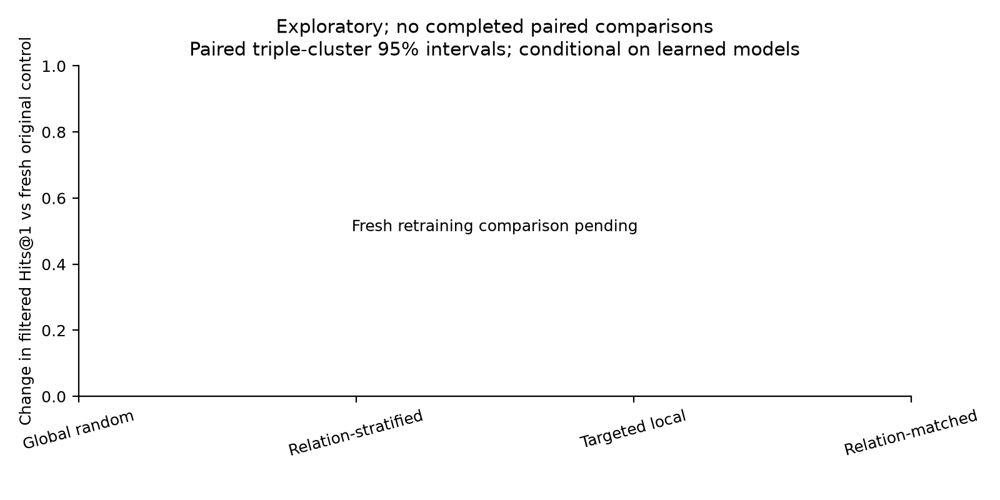
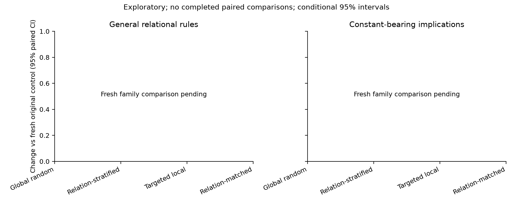
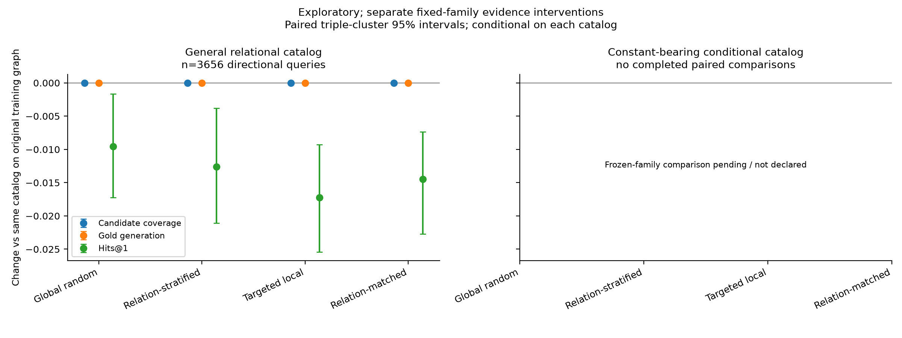

# Phase 5: controlled graph-structure comparison

Exploratory CoDEx-S follow-up. The test set has been inspected repeatedly. Fresh contemporaneous original-graph controls are retrained under the same recipe/budget; established earlier results remain preserved.

**Full-budget cohort resource-stopped and incomplete.** Controller stopped full-budget cohort after CPU reached 87 C during one-worker 60-second Java mining; additional metadata-loading checks reached 78–85 C. Remaining full-budget work not suitable for this machine now. Completed original-control checkpoints and mining output are retained, but incomplete rule application is not a rule baseline. No perturbed full-budget model is substituted with old weights or smoke results. A smaller corrected-index paired smoke has its own directory and report. See `runs/phase5-90/resource-stop.json` and `docs/PHASE5.md`.

The checksum-verified, 115-file handoff was prepared for a remote target, but the user has since marked the configured SSH target `work` off-limits. Do not connect to it, transfer files there or run experiments there. The archive remains local only; no new training or inference was started. No alternate compute target has been authorized. See `docs/WORK_EXECUTION.md`. The off-limits status does not change the completion statuses below.

The native loader explicitly registers the original training token order before loading modified positive edges. This preserves the candidate vocabulary and internal-ID tie order even when a relation loses every edge; removed and held-out facts are not inserted. The original implicit-index frozen attempt failed on absent relation P840 and is preserved under each condition's attempts directory. Confidence smoothing, weights, maxplus and frequency ties are unchanged.

## Execution

| condition | component | status |
| --- | --- | --- |
| original | neural-0 | complete |
| original | rules-0 | pending/incomplete |
| random_global | neural-0 | pending/incomplete |
| random_global | rules-0 | pending/incomplete |
| random_relation_stratified | neural-0 | pending/incomplete |
| random_relation_stratified | rules-0 | pending/incomplete |
| targeted_local | neural-0 | pending/incomplete |
| targeted_local | rules-0 | pending/incomplete |
| targeted_relation_matched_control | neural-0 | pending/incomplete |
| targeted_relation_matched_control | rules-0 | pending/incomplete |

## Frozen-family execution

| condition | family | status |
| --- | --- | --- |
| original | general | complete |
| original | constants | complete |
| random_global | general | complete |
| random_global | constants | pending/incomplete |
| random_relation_stratified | general | complete |
| random_relation_stratified | constants | pending/incomplete |
| targeted_local | general | complete |
| targeted_local | constants | pending/incomplete |
| targeted_relation_matched_control | general | complete |
| targeted_relation_matched_control | constants | pending/incomplete |

Frozen families are separate fixed-catalog evidence interventions on the same held-out queries. Their query rows are not additional independent observations or learning realizations. An extension manifest adds families without rewriting the base protocol.

## Overall paired inputs

| condition | backend | replicate | n_queries | hits_metric_status | hits1 | hits10 | mrr_exact | coverage | correct_answer_generation_coverage |
| --- | --- | --- | --- | --- | --- | --- | --- | --- | --- |
| original | ComplEx validation-best | 0 | 3656 | exact | 0.3556 | 0.6403 | 0.4514 | 1.0000 | n/a |
| original | ComplEx fixed-updates | 0 | 3656 | exact | 0.3548 | 0.6338 | 0.4508 | 1.0000 | n/a |
| original | ComplEx last-epoch | 0 | 3656 | exact | 0.3556 | 0.6403 | 0.4514 | 1.0000 | n/a |
| original | Frozen general | 0 | 3656 | exact | 0.2749 | 0.5271 | n/a | 0.9989 | 0.9973 |
| original | Frozen constants | 0 | 3656 | exact | 0.3206 | 0.6187 | n/a | 0.9975 | 0.9869 |
| random_global | Frozen general | 0 | 3656 | exact | 0.2653 | 0.5164 | n/a | 0.9989 | 0.9973 |
| random_relation_stratified | Frozen general | 0 | 3656 | exact | 0.2623 | 0.5153 | n/a | 0.9989 | 0.9973 |
| targeted_local | Frozen general | 0 | 3656 | exact | 0.2577 | 0.5175 | n/a | 0.9989 | 0.9973 |
| targeted_relation_matched_control | Frozen general | 0 | 3656 | exact | 0.2604 | 0.5109 | n/a | 0.9989 | 0.9973 |

Rule Hits use the native supported-candidate order, with abstentions counted as misses. They are not full-universe zero-score tie rankings. If any native family cannot be certified, that row and its paired differences remain retrieved-list outcomes; bootstrap intervals do not resolve censoring. Exact full-universe rule MRR is never reported.

## Intervention minus matched control

Negative differences indicate degradation.

| treatment | control | backend | difference | ci_low | ci_high | all_rankings_certified | n_unique_queries | n_triples |
| --- | --- | --- | --- | --- | --- | --- | --- | --- |
| random_global | original | frozen:general | -0.0096 | -0.0172 | -0.0016 | True | 3656 | 1828 |
| random_relation_stratified | original | frozen:general | -0.0126 | -0.0211 | -0.0038 | True | 3656 | 1828 |
| targeted_local | original | frozen:general | -0.0172 | -0.0254 | -0.0093 | True | 3656 | 1828 |
| targeted_relation_matched_control | original | frozen:general | -0.0145 | -0.0227 | -0.0074 | True | 3656 | 1828 |
| targeted_local | targeted_relation_matched_control | frozen:general | -0.0027 | -0.0129 | 0.0071 | True | 3656 | 1828 |

## Change in relative neural–rule gap

Positive values mean the neural-minus-rule Hits@1 gap increased; negative values mean it decreased. Neither sign alone establishes that either model improved.

| treatment | control | difference | ci_low | ci_high | rule_rankings_certified | n_neural_seeds | n_treatment_miners | n_control_miners |
| --- | --- | --- | --- | --- | --- | --- | --- | --- |

## Paired frozen-family gap

This separate diagnostic estimates [(general Hits@1 − constant Hits@1) in the treatment graph] − [the same family gap in the control graph]. Positive values favor general rules in relative sensitivity; either family may still degrade in absolute accuracy. Both families use the same paired held-out queries, clustered by original triple, with no independent model resampling. The sample size is the number of unique directional queries, not the sum of family rows. This is conditional evidence for these fixed subsets and graph draws, not catalog-population or perturbation-population replication, additive prediction credit, or the primary neural–rule comparison.

| treatment | control | difference | ci_low | ci_high | n_unique_queries | n_triples | n_fixed_family_subsets |
| --- | --- | --- | --- | --- | --- | --- | --- |

Uncomputed family contrasts remain explicitly pending or uncertified:

| treatment | control | status | reason |
| --- | --- | --- | --- |
| random_global | original | pending/not declared | Both frozen families and both graph conditions are required |
| random_relation_stratified | original | pending/not declared | Both frozen families and both graph conditions are required |
| targeted_local | original | pending/not declared | Both frozen families and both graph conditions are required |
| targeted_relation_matched_control | original | pending/not declared | Both frozen families and both graph conditions are required |
| targeted_local | targeted_relation_matched_control | pending/not declared | Both frozen families and both graph conditions are required |

## Resource and optimization controls

| condition | backend | replicate | training_seconds | training_cpu_seconds | best_epoch | completed_epochs | optimizer_updates | effective_training_facts |
| --- | --- | --- | --- | --- | --- | --- | --- | --- |
| original | ComplEx | 0 | 284.8218 | 278.6173 | 40 | 40 | 2600 | 32888 |
| original | AnyBURL | 0 | 62.4748 | 64.7151 | n/a | n/a | n/a | n/a |

The same 40-epoch ceiling/checkpoints and validation selection apply to each primary graph. Removal changes 65 to 58 optimizer updates per epoch. A predeclared checkpoint at 2,320 updates adds an equal-update diagnostic; last-epoch outputs separate validation stopping effects. Neither diagnostic is tuned on test outcomes. Smoke uses a one-epoch analogue. Training resource counters cover committed epochs, excluding cooling and validation; discarded partial-epoch work is not included. Native application wall times can include cooling and metadata loading.

## Rule inventory and application resources

| condition | backend | replicate | catalog_rule_count | native_loaded_count | application_cpu_seconds | application_seconds_including_loading_and_cooling |
| --- | --- | --- | --- | --- | --- | --- |
| original | Frozen general | 0 | 2249 | 2249 | 31.8659 | 98.1688 |
| original | Frozen constants | 0 | 467989 | 467989 | 158.1840 | 815.5373 |
| random_global | Frozen general | 0 | 2249 | 2249 | 26.5283 | 71.7954 |
| random_relation_stratified | Frozen general | 0 | 2249 | 2249 | 26.2108 | 68.3296 |
| targeted_local | Frozen general | 0 | 2249 | 2249 | 25.9595 | 71.1478 |
| targeted_relation_matched_control | Frozen general | 0 | 2249 | 2249 | 29.5828 | 72.0077 |

CPU and wall application times include loading/scoring; wall time also includes deliberate cooling. Mining wall budgets do not guarantee identical CPU use, sampling throughput or learned inventories. Parsing/catalog export has no separate end-to-end resource counter.

| condition | native_family | body_length | n_rules | application_complete | median_raw_confidence | median_raw_support |
| --- | --- | --- | --- | --- | --- | --- |
| original | B | 1 | 71 | False | 0.0339 | 3.0000 |
| original | B | 2 | 657 | False | 0.1053 | 4.0000 |
| original | B | 3 | 2907 | False | 0.0809 | 11.0000 |
| original | Uc | 1 | 294683 | False | 0.4138 | 4.0000 |
| original | Ud | 1 | 21959 | False | 0.0424 | 5.0000 |
| original | Z | 0 | 70 | False | 0.0307 | 166.5000 |

`rule-statistics.csv` stores full 0/25/50/75/100 percentiles, and `rule-inventory-summary.csv` exposes interquartile statistics. Inventories from completed mining may be shown even when application is incomplete; they carry no claimed prediction result. These are raw learned-rule confidence/support, not calibrated probabilities; native smoothing and family weights remain those recorded in each application. Inventory size alone is not predictive contribution.

## Hypotheses, controls and confounds

| hypothesis | intervention | control | measurement | confounds |
| --- | --- | --- | --- | --- |
| H1 | 90% removal | fresh original graph | paired accuracy/gap/coverage and fixed-update sensitivity | fewer examples, gradient updates, validation selection, mining stochasticity |
| H2 | same frozen B catalog applied to missing-edge graphs | same catalog on original | candidate/gold-support losses, witnessed groundings lost | native frequency ties and binding constraints; raw typed walks are a structural proxy |
| H3 | fresh constant-rule learning/application on each graph | fresh original constant rules | constant versus general coverage/quality and sampled anchored witnesses | changed inventories/confidence, entity-local frequencies; full frozen-constant evaluation deferred |
| H4 | targeted_local | targeted_relation_matched_control | paired outcomes, difference in embedding-rule gap and paths | single target/removal draw; degree/entity distributions intentionally differ; independent miner samples |
| H5 | same removal conditions | same test facts/original-graph strata | original known-node degree/frequency strata and target incidence | observational effect heterogeneity, graph dependence, repeated CoDEx-S inspection |

## Current evidential status

| question | status | boundary |
| --- | --- | --- |
| H1: differential sensitivity to removal | fresh-model matrix incomplete | declared 1 neural seeds and 1 miners per graph; singleton factors cannot estimate learning variability; fixed-update outputs address only one optimization confound |
| H2: general-rule body evidence | frozen-catalog intervention complete | candidate-pair support losses are measured; sampled groundings are separate; ranking also uses graph-frequency ties |
| H3: constant versus general rules | fresh family comparisons pending/incomplete; frozen general/constants comparisons pending/incomplete | frozen-family evidence availability is measured separately from fresh learning; fixed-catalog differences do not replace the fresh-learning comparison or give an additive causal decomposition |
| H4: targeted versus relation-matched removal | primary comparison pending; consult frozen evidence separately | exact relation totals matched; endpoint frequencies, degrees and paths jointly change; one removal draw |
| H5: query characteristics and robustness | fresh-model strata pending | strata use original train-observable features; no causal mediation or deployment selector established |

## Evidence intervention versus retraining

Frozen-family results reapply subsets of the established original catalog with original confidence/support on modified training facts. General rules are variable-only relational implications; the constant subset contains constant-bearing conditional implications and excludes unconditional zero-body entity priors. This is not re-mining and does not replace the primary rule baseline. Native training-frequency tie breaking changes with the graph, so ranking changes cannot all be attributed to missing bodies. The catalog also differs from the fresh primary original inventory; primary/secondary differences and differences between families are not an additive causal decomposition. Gold-support disappearance is inferred separately by family only where candidate enumeration is certified and its support check is consistent; observed witness loss can occur even when redundant support keeps a prediction available.

The frozen-constant extension is declared but incomplete; unavailable conditions remain pending and are not replaced by general-rule results.

## Frozen support checks

Here a lost candidate support means one (directional query, candidate entity) pair is no longer generated by the specified frozen family. These counts are not numbers of rule groundings, learned rules, or the miner's rule-support statistic. Top-1 changes use evaluator-filtered rankings. Sample sizes are reported within family and condition; the same queries appearing across families or conditions are paired observations, not independent replications.

| family | condition | n_unique_queries | n_triples | candidate_supports_lost | queries_losing_candidate_support | certified_gold_support_disappeared | new_candidate_supports | top1_changed |
| --- | --- | --- | --- | --- | --- | --- | --- | --- |
| general | original | 3656 | 1828 | 0 | 0 | 0 | 0 | 0 |
| general | random_global | 3656 | 1828 | 71950 | 3401 | 0 | 0 | 792 |
| general | random_relation_stratified | 3656 | 1828 | 72963 | 3201 | 0 | 0 | 795 |
| general | targeted_local | 3656 | 1828 | 104354 | 3382 | 0 | 0 | 771 |
| general | targeted_relation_matched_control | 3656 | 1828 | 67473 | 3088 | 0 | 0 | 1043 |
| constants | original | 3656 | 1828 | 0 | 0 | 0 | 0 | 0 |

No new candidate support was observed under deletions in these frozen-catalog queries. This is consistent with positive-body evidence loss, not a generalization across learned catalogs or graph draws.

A degenerate coverage interval [0, 0] reflects unchanged outcomes in the observed empirical query pairs. It does not establish zero loss probability on unseen queries, other learned catalogs or other perturbation draws.

## Query-level explanations

`query-joins.csv` pairs ranks, coverage, winner changes and original/modified degrees/frequencies for completed fresh-model comparison cells. Forward-directed typed two-/three-hop walk counts follow h → … → t using existing edge directions and permit revisiting entities. They exclude inverse-oriented native rule bodies, such as h ← a → t, and are a restricted structural proxy rather than total relational-path availability or native grounding counts. Truth endpoints/ranks/winner labels are strictly diagnostic. Neural changes are measured sensitivities, not invented explanations of internal representations.

**Primary fresh-model explanations remain pending for incomplete cells.** Any partial `query-joins.csv` rows represent only completed comparison cells, not the full planned cohort. Missing joins and `cases.md` must not be replaced by frozen-rule or smoke outputs.

Primary `cases.md` has not been generated for this cohort; it requires completed fresh original and modified predictions.

[Frozen-catalog case studies](frozen-cases.md) and `frozen-witnesses.csv` document checked before/after training-edge witnesses for the separate inference-time evidence intervention. They do not establish a retrained embedding response.

## Observations and evidential boundaries

| evidence_class | comparison | observation | boundary |
| --- | --- | --- | --- |
| Controlled inference-time graph intervention | random_global vs original; fixed general catalog | Hits@1 change -0.0096, conditional 95% interval [-0.0172, -0.0016] | Ranking responds to missing supports and native graph-frequency ties; this does not isolate their separate contributions; any uncertified ranking remains censored |
| Controlled inference-time evidence intervention | random_global vs original; fixed general catalog | Gold-generation coverage change +0.0000, conditional 95% interval [+0.0000, +0.0000] | Fixed implications, analyzed within family; no catalog/perturbation population replication or additive decomposition; uncertified generation outcomes remain observed retrievals |
| Controlled inference-time graph intervention | random_relation_stratified vs original; fixed general catalog | Hits@1 change -0.0126, conditional 95% interval [-0.0211, -0.0038] | Ranking responds to missing supports and native graph-frequency ties; this does not isolate their separate contributions; any uncertified ranking remains censored |
| Controlled inference-time evidence intervention | random_relation_stratified vs original; fixed general catalog | Gold-generation coverage change +0.0000, conditional 95% interval [+0.0000, +0.0000] | Fixed implications, analyzed within family; no catalog/perturbation population replication or additive decomposition; uncertified generation outcomes remain observed retrievals |
| Controlled inference-time graph intervention | targeted_local vs original; fixed general catalog | Hits@1 change -0.0172, conditional 95% interval [-0.0254, -0.0093] | Ranking responds to missing supports and native graph-frequency ties; this does not isolate their separate contributions; any uncertified ranking remains censored |
| Controlled inference-time evidence intervention | targeted_local vs original; fixed general catalog | Gold-generation coverage change +0.0000, conditional 95% interval [+0.0000, +0.0000] | Fixed implications, analyzed within family; no catalog/perturbation population replication or additive decomposition; uncertified generation outcomes remain observed retrievals |
| Controlled inference-time graph intervention | targeted_relation_matched_control vs original; fixed general catalog | Hits@1 change -0.0145, conditional 95% interval [-0.0227, -0.0074] | Ranking responds to missing supports and native graph-frequency ties; this does not isolate their separate contributions; any uncertified ranking remains censored |
| Controlled inference-time evidence intervention | targeted_relation_matched_control vs original; fixed general catalog | Gold-generation coverage change +0.0000, conditional 95% interval [+0.0000, +0.0000] | Fixed implications, analyzed within family; no catalog/perturbation population replication or additive decomposition; uncertified generation outcomes remain observed retrievals |

## Limitations and research conclusion

Direct observations are the graph/path changes and recorded paired outcomes. Controlled evidence concerns these exact missing-edge protocols and contemporaneous trained systems. A single removal/target draw does not establish population-level structural effects. When a comparison has one neural seed or one independently learned inventory per graph, intervals cannot estimate variation in that singleton learning factor. Replicated comparisons resample the available seed and miner factors separately; few repetitions still give limited learning-variability estimates. Neural seed indices are paired across graphs; miner realizations are independently resampled by graph when replicated, never treated as paired deterministic seeds. Shared entities/relations create additional graph dependence.

Targeted versus relation-count-matched removal controls relation totals but still changes endpoint frequencies, local degree and paths together. Retrained-rule changes combine evidence loss, changed learned confidences/inventories and mining stochasticity. Mechanisms behind embedding sensitivity remain hypotheses. Replication counts and completion are recorded above; additional perturbation draws remain future work. CoDEx-M is a later replication dataset after methodology freeze. No larger retention sweep or expensive published-budget reproduction is automatically launched.

`scenario-effects.csv` reports intervals and sample sizes within original known-node degree, relation-frequency and target-incidence strata. Groups use original training information, not post-removal or answer-dependent features. These are exploratory effect heterogeneity, not causal mediation or a deployment selector. `query-joins-with-witnesses.csv`, when generated by the case command, adds verified sampled witness losses.

**Primary matrix incomplete: missing cells are not conclusions and are not replaced with partial checkpoints or established models.**
