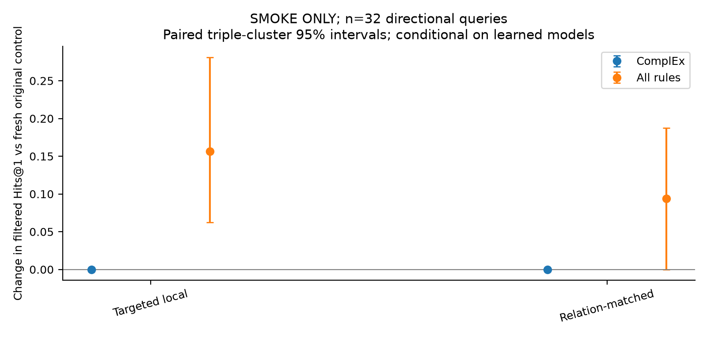
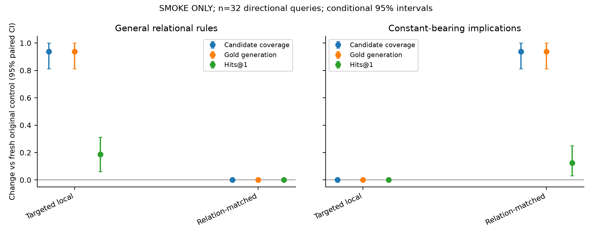
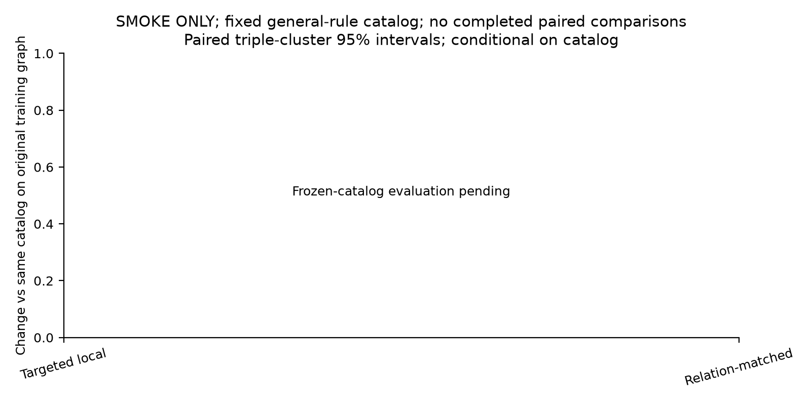

# Phase 5: controlled graph-structure comparison

**SMOKE OUTPUTS ONLY. One training epoch, two seconds of mining, first 16 official test facts. These validate execution and pairing, not the established 40-epoch baselines or scientific robustness.**

The native loader explicitly registers the original training token order before loading modified positive edges. This preserves the candidate vocabulary and internal-ID tie order even when a relation loses every edge; removed and held-out facts are not inserted. The original implicit-index frozen attempt failed on absent relation P840 and is preserved under each condition's attempts directory. Confidence smoothing, weights, maxplus and frequency ties are unchanged.

## Execution

| condition | component | status |
| --- | --- | --- |
| original | neural-0 | complete |
| original | rules-0 | complete |
| targeted_local | neural-0 | complete |
| targeted_local | rules-0 | complete |
| targeted_relation_matched_control | neural-0 | complete |
| targeted_relation_matched_control | rules-0 | complete |

## Overall paired inputs

| condition | backend | replicate | n_queries | hits_metric_status | hits1 | hits10 | mrr_exact | coverage | correct_answer_generation_coverage |
| --- | --- | --- | --- | --- | --- | --- | --- | --- | --- |
| original | ComplEx validation-best | 0 | 32 | exact | 0.0625 | 0.1875 | 0.0981 | 1.0000 | n/a |
| original | ComplEx fixed-updates | 0 | 32 | exact | 0.0625 | 0.1562 | 0.0908 | 1.0000 | n/a |
| original | ComplEx last-epoch | 0 | 32 | exact | 0.0625 | 0.1875 | 0.0981 | 1.0000 | n/a |
| original | AnyBURL all | 0 | 32 | exact | 0.0312 | 0.1250 | n/a | 0.4375 | 0.1562 |
| original | AnyBURL general | 0 | 32 | exact | 0.0000 | 0.0000 | n/a | 0.0000 | 0.0000 |
| original | AnyBURL constants | 0 | 32 | exact | 0.0000 | 0.0000 | n/a | 0.0000 | 0.0000 |
| targeted_local | ComplEx validation-best | 0 | 32 | exact | 0.0625 | 0.1250 | 0.0878 | 1.0000 | n/a |
| targeted_local | ComplEx fixed-updates | 0 | 32 | exact | 0.0625 | 0.1250 | 0.0878 | 1.0000 | n/a |
| targeted_local | ComplEx last-epoch | 0 | 32 | exact | 0.0625 | 0.1250 | 0.0878 | 1.0000 | n/a |
| targeted_local | AnyBURL all | 0 | 32 | exact | 0.1875 | 0.4062 | n/a | 0.9375 | 0.9375 |
| targeted_local | AnyBURL general | 0 | 32 | exact | 0.1875 | 0.4062 | n/a | 0.9375 | 0.9375 |
| targeted_local | AnyBURL constants | 0 | 32 | exact | 0.0000 | 0.0000 | n/a | 0.0000 | 0.0000 |
| targeted_relation_matched_control | ComplEx validation-best | 0 | 32 | exact | 0.0625 | 0.1562 | 0.0878 | 1.0000 | n/a |
| targeted_relation_matched_control | ComplEx fixed-updates | 0 | 32 | exact | 0.0625 | 0.1562 | 0.0878 | 1.0000 | n/a |
| targeted_relation_matched_control | ComplEx last-epoch | 0 | 32 | exact | 0.0625 | 0.1562 | 0.0878 | 1.0000 | n/a |
| targeted_relation_matched_control | AnyBURL all | 0 | 32 | exact | 0.1250 | 0.4062 | n/a | 0.9375 | 0.9375 |
| targeted_relation_matched_control | AnyBURL general | 0 | 32 | exact | 0.0000 | 0.0000 | n/a | 0.0000 | 0.0000 |
| targeted_relation_matched_control | AnyBURL constants | 0 | 32 | exact | 0.1250 | 0.4062 | n/a | 0.9375 | 0.9375 |

Rule Hits use the native supported-candidate order, with abstentions counted as misses. They are not full-universe zero-score tie rankings. If any native family cannot be certified, that row and its paired differences remain retrieved-list outcomes; bootstrap intervals do not resolve censoring. Exact full-universe rule MRR is never reported.

**Some smoke rule inventories are empty.** Two seconds can be insufficient for mining startup and useful learning. Empty inventories correctly abstain; differences between these smoke cells are not model-family or structural-reliability findings.

## Intervention minus matched control

Negative differences indicate degradation.

| treatment | control | backend | difference | ci_low | ci_high | all_rankings_certified | n_unique_queries | n_triples |
| --- | --- | --- | --- | --- | --- | --- | --- | --- |
| targeted_local | original | embedding:validation-best | 0.0000 | 0.0000 | 0.0000 | True | 32 | 16 |
| targeted_local | original | embedding:last-epoch | 0.0000 | 0.0000 | 0.0000 | True | 32 | 16 |
| targeted_local | original | rules:constants | 0.0000 | 0.0000 | 0.0000 | True | 32 | 16 |
| targeted_local | original | embedding:fixed-updates | 0.0000 | 0.0000 | 0.0000 | True | 32 | 16 |
| targeted_local | original | rules:general | 0.1875 | 0.0625 | 0.3125 | True | 32 | 16 |
| targeted_local | original | rules:all | 0.1562 | 0.0625 | 0.2812 | True | 32 | 16 |
| targeted_relation_matched_control | original | embedding:validation-best | 0.0000 | 0.0000 | 0.0000 | True | 32 | 16 |
| targeted_relation_matched_control | original | embedding:last-epoch | 0.0000 | 0.0000 | 0.0000 | True | 32 | 16 |
| targeted_relation_matched_control | original | rules:constants | 0.1250 | 0.0312 | 0.2500 | True | 32 | 16 |
| targeted_relation_matched_control | original | embedding:fixed-updates | 0.0000 | 0.0000 | 0.0000 | True | 32 | 16 |
| targeted_relation_matched_control | original | rules:general | 0.0000 | 0.0000 | 0.0000 | True | 32 | 16 |
| targeted_relation_matched_control | original | rules:all | 0.0938 | 0.0000 | 0.1875 | True | 32 | 16 |
| targeted_local | targeted_relation_matched_control | embedding:validation-best | 0.0000 | 0.0000 | 0.0000 | True | 32 | 16 |
| targeted_local | targeted_relation_matched_control | embedding:last-epoch | 0.0000 | 0.0000 | 0.0000 | True | 32 | 16 |
| targeted_local | targeted_relation_matched_control | rules:constants | -0.1250 | -0.2500 | -0.0312 | True | 32 | 16 |
| targeted_local | targeted_relation_matched_control | embedding:fixed-updates | 0.0000 | 0.0000 | 0.0000 | True | 32 | 16 |
| targeted_local | targeted_relation_matched_control | rules:general | 0.1875 | 0.0625 | 0.3125 | True | 32 | 16 |
| targeted_local | targeted_relation_matched_control | rules:all | 0.0625 | -0.0625 | 0.1875 | True | 32 | 16 |

## Change in relative neural–rule gap

Positive values mean the neural-minus-rule Hits@1 gap increased; negative values mean it decreased. Neither sign alone establishes that either model improved.

| treatment | control | difference | ci_low | ci_high | rule_rankings_certified | n_neural_seeds | n_treatment_miners | n_control_miners |
| --- | --- | --- | --- | --- | --- | --- | --- | --- |
| targeted_local | original | -0.1562 | -0.2812 | -0.0625 | True | 1 | 1 | 1 |
| targeted_relation_matched_control | original | -0.0938 | -0.1875 | 0.0000 | True | 1 | 1 | 1 |
| targeted_local | targeted_relation_matched_control | -0.0625 | -0.1875 | 0.0625 | True | 1 | 1 | 1 |

## Resource and optimization controls

| condition | backend | replicate | training_seconds | training_cpu_seconds | best_epoch | completed_epochs | optimizer_updates | effective_training_facts |
| --- | --- | --- | --- | --- | --- | --- | --- | --- |
| original | ComplEx | 0 | 8.2983 | 8.1669 | 1 | 1 | 65 | 32888 |
| original | AnyBURL | 0 | 4.4813 | 3.9766 | n/a | n/a | n/a | n/a |
| targeted_local | ComplEx | 0 | 8.2248 | 8.0807 | 1 | 1 | 58 | 29599 |
| targeted_local | AnyBURL | 0 | 4.5322 | 4.9973 | n/a | n/a | n/a | n/a |
| targeted_relation_matched_control | ComplEx | 0 | 7.4476 | 7.3132 | 1 | 1 | 58 | 29599 |
| targeted_relation_matched_control | AnyBURL | 0 | 4.5788 | 4.8670 | n/a | n/a | n/a | n/a |

The same 40-epoch ceiling/checkpoints and validation selection apply to each primary graph. Removal changes 65 to 58 optimizer updates per epoch. A predeclared checkpoint at 2,320 updates adds an equal-update diagnostic; last-epoch outputs separate validation stopping effects. Neither diagnostic is tuned on test outcomes. Smoke uses a one-epoch analogue. Training resource counters cover committed epochs, excluding cooling and validation; discarded partial-epoch work is not included. Native application wall times can include cooling and metadata loading.

## Rule inventory and application resources

| condition | backend | replicate | catalog_rule_count | native_loaded_count | application_cpu_seconds | application_seconds_including_loading_and_cooling |
| --- | --- | --- | --- | --- | --- | --- |
| original | AnyBURL all | 0 | 70 | 70 | 0.2093 | 0.2119 |
| original | AnyBURL general | 0 | 0 | 0 | 0.3398 | 8.3475 |
| original | AnyBURL constants | 0 | 0 | 0 | 0.2706 | 8.2762 |
| targeted_local | AnyBURL all | 0 | 890 | 890 | 0.7079 | 0.7139 |
| targeted_local | AnyBURL general | 0 | 890 | 890 | 0.4561 | 8.4814 |
| targeted_local | AnyBURL constants | 0 | 0 | 0 | 0.2251 | 8.2315 |
| targeted_relation_matched_control | AnyBURL all | 0 | 40188 | 40188 | 1.5984 | 33.6273 |
| targeted_relation_matched_control | AnyBURL general | 0 | 0 | 0 | 0.2456 | 0.2490 |
| targeted_relation_matched_control | AnyBURL constants | 0 | 40188 | 40188 | 1.5581 | 49.5928 |

CPU and wall application times include loading/scoring; wall time also includes deliberate cooling. Mining wall budgets do not guarantee identical CPU use, sampling throughput or learned inventories. Parsing/catalog export has no separate end-to-end resource counter.

| condition | native_family | body_length | n_rules | application_complete | median_raw_confidence | median_raw_support |
| --- | --- | --- | --- | --- | --- | --- |
| original | Z | 0 | 70 | True | 0.0307 | 166.5000 |
| targeted_local | B | 3 | 890 | True | 0.1090 | 27.0000 |
| targeted_relation_matched_control | Uc | 1 | 30012 | True | 0.3889 | 8.0000 |
| targeted_relation_matched_control | Ud | 1 | 10176 | True | 0.0571 | 7.0000 |

`rule-statistics.csv` stores full 0/25/50/75/100 percentiles, and `rule-inventory-summary.csv` exposes interquartile statistics. Inventories from completed mining may be shown even when application is incomplete; they carry no claimed prediction result. These are raw learned-rule confidence/support, not calibrated probabilities; native smoothing and family weights remain those recorded in each application. Inventory size alone is not predictive contribution.

## Hypotheses, controls and confounds

| hypothesis | intervention | control | measurement | confounds |
| --- | --- | --- | --- | --- |
| H1 | 90% removal | fresh original graph | paired accuracy/gap/coverage and fixed-update sensitivity | fewer examples, gradient updates, validation selection, mining stochasticity |
| H2 | same frozen B catalog applied to missing-edge graphs | same catalog on original | candidate/gold-support losses, witnessed groundings lost | native frequency ties and binding constraints; raw typed walks are a structural proxy |
| H3 | fresh constant-rule learning/application on each graph | fresh original constant rules | constant versus general coverage/quality and sampled anchored witnesses | changed inventories/confidence, entity-local frequencies; full frozen-constant evaluation deferred |
| H4 | targeted_local | targeted_relation_matched_control | paired outcomes, difference in embedding-rule gap and paths | single target/removal draw; degree/entity distributions intentionally differ; independent miner samples |
| H5 | same removal conditions | same test facts/original-graph strata | original known-node degree/frequency strata and target incidence | observational effect heterogeneity, graph dependence, repeated CoDEx-S inspection |

## Current evidential status

| question | status | boundary |
| --- | --- | --- |
| H1: differential sensitivity to removal | bounded paired matrix complete | one neural seed/miner per graph does not estimate learning variability; fixed-update outputs address only one optimization confound |
| H2: general-rule body evidence | frozen-catalog intervention incomplete | candidate-pair support losses are measured; sampled groundings are separate; ranking also uses graph-frequency ties |
| H3: constant versus general rules | fresh family comparisons available | confidences, learned inventory and mining realization change together; frozen-constant experiment deferred |
| H4: targeted versus relation-matched removal | paired primary comparison available | exact relation totals matched; endpoint frequencies, degrees and paths jointly change; one removal draw |
| H5: query characteristics and robustness | exploratory strata available | strata use original train-observable features; no causal mediation or deployment selector established |

## Evidence intervention versus retraining

Frozen-general results use the established original B catalog with its original confidence/support on modified training facts. It is not re-mining and does not replace the primary rule baseline. Native training-frequency tie breaking changes with the graph, so ranking changes cannot all be attributed to missing bodies. The catalog also differs from the fresh primary original inventory; primary/secondary differences are not an additive causal decomposition. Constant frozen-catalog full-query evaluation is deferred. Gold-support disappearance is inferred only where candidate enumeration is certified; observed witness loss can occur even when redundant support keeps a prediction available.

## Frozen support checks

Here a lost candidate support means one (directional query, candidate entity) pair is no longer generated. These counts are not numbers of rule groundings, learned rules, or the miner's rule-support statistic. Top-1 changes use evaluator-filtered rankings.

| condition | n_queries | candidate_supports_lost | queries_losing_candidate_support | certified_gold_support_disappeared | new_candidate_supports | top1_changed |
| --- | --- | --- | --- | --- | --- | --- |

## Query-level explanations

`query-joins.csv` pairs ranks, coverage, winner changes and original/modified degrees/frequencies for completed fresh-model comparison cells. Forward-directed typed two-/three-hop walk counts follow h → … → t using existing edge directions and permit revisiting entities. They exclude inverse-oriented native rule bodies, such as h ← a → t, and are a restricted structural proxy rather than total relational-path availability or native grounding counts. Truth endpoints/ranks/winner labels are strictly diagnostic. Neural changes are measured sensitivities, not invented explanations of internal representations.

[Fresh-model case studies](cases.md) document sampled training-only witnesses for available completed comparisons; unassessed witness fields remain unknown.

## Observations and evidential boundaries

| evidence_class | comparison | observation | boundary |
| --- | --- | --- | --- |
| Direct paired observation, conditional learned models | targeted_local vs original; embedding:validation-best | Certified Hits@1 change +0.0000, conditional 95% interval [+0.0000, +0.0000] | Fresh-training sensitivity; not a universal structural mechanism or replicated causal effect; any censoring persists |
| Direct paired observation, conditional learned models | targeted_local vs original; rules:all | Certified Hits@1 change +0.1562, conditional 95% interval [+0.0625, +0.2812] | Fresh-training sensitivity; not a universal structural mechanism or replicated causal effect; any censoring persists |
| Direct paired observation, conditional learned models | targeted_relation_matched_control vs original; embedding:validation-best | Certified Hits@1 change +0.0000, conditional 95% interval [+0.0000, +0.0000] | Fresh-training sensitivity; not a universal structural mechanism or replicated causal effect; any censoring persists |
| Direct paired observation, conditional learned models | targeted_relation_matched_control vs original; rules:all | Certified Hits@1 change +0.0938, conditional 95% interval [+0.0000, +0.1875] | Fresh-training sensitivity; not a universal structural mechanism or replicated causal effect; any censoring persists |

## Limitations and research conclusion

Direct observations are the graph/path changes and recorded paired outcomes. Controlled evidence concerns these exact missing-edge protocols and contemporaneous trained systems. A single removal/target draw does not establish population-level structural effects. With one neural seed and one independently learned inventory per graph, intervals reflect test-triple variation conditional on those models; they cannot estimate unreplicated training/mining variation. Neural seed indices are paired across graphs; miner realizations are independently resampled by graph when replicated, never treated as paired deterministic seeds. Shared entities/relations create additional graph dependence.

Targeted versus relation-count-matched removal controls relation totals but still changes endpoint frequencies, local degree and paths together. Retrained-rule changes combine evidence loss, changed learned confidences/inventories and mining stochasticity. Mechanisms behind embedding sensitivity remain hypotheses. Three neural seeds, independently repeated mining and more perturbation draws remain planned; CoDEx-M is a later replication dataset after methodology freeze. No larger retention sweep or expensive published-budget reproduction is automatically launched.

`scenario-effects.csv` reports intervals and sample sizes within original known-node degree, relation-frequency and target-incidence strata. Groups use original training information, not post-removal or answer-dependent features. These are exploratory effect heterogeneity, not causal mediation or a deployment selector. `query-joins-with-witnesses.csv`, when generated by the case command, adds verified sampled witness losses.
