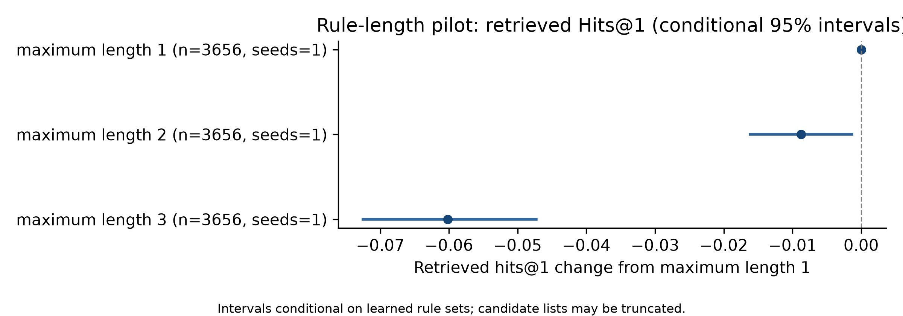
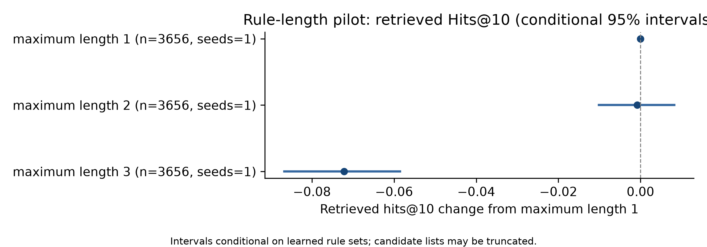
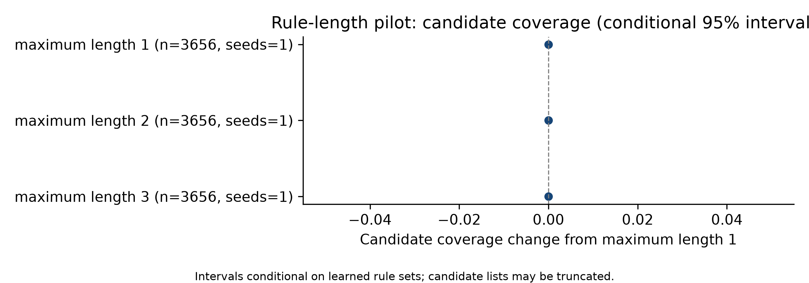

# Experiment D: controlled cyclic rule-length pilot

All configured lengths (1, 2, 3) are reported; test performance does not select a winning setting. Both baselines are retrained for each setting on the same original training graph and unchanged held-out splits. Neural settings are fixed from validation. Cyclic length varies; acyclic and grounded-cyclic limits stay at 1.

## Whole-model outcomes

| max_cyclic_length | training_seed | n_total_rules | n_path_rules | n_constant_rules | n_queries | retrieved_hits1 | retrieved_hits10 | coverage | mrr_exact | classification_auroc | training_seconds | inference_seconds |
| --- | --- | --- | --- | --- | --- | --- | --- | --- | --- | --- | --- | --- |
| 1 | 0 | 111358 | 66 | 111292 | 3656 | 0.3378 | 0.5944 | 0.9989 | unavailable | 0.8757 | 12.6599 | 25.3170 |
| 2 | 0 | 50265 | 457 | 49808 | 3656 | 0.3290 | 0.5935 | 0.9989 | unavailable | 0.8634 | 12.7079 | 18.5431 |
| 3 | 0 | 2929 | 2371 | 558 | 3656 | 0.2776 | 0.5222 | 0.9989 | unavailable | 0.7512 | 12.6578 | 16.7577 |

Symbolic scores are native maxplus scores. Retrieved-list Hits may be censored after evaluator filtering; exact symbolic MRR remains unavailable.

## Learned rule inventory

| max_cyclic_length | training_seed | rule_kind | body_length | n_rules | median_confidence | median_support |
| --- | --- | --- | --- | --- | --- | --- |
| 1 | 0 | constant | 1 | 111292 | 0.3333 | 6.0000 |
| 1 | 0 | relational_path | 1 | 66 | 0.0335 | 3.0000 |
| 2 | 0 | constant | 1 | 49808 | 0.2958 | 8.0000 |
| 2 | 0 | relational_path | 1 | 72 | 0.0313 | 3.5000 |
| 2 | 0 | relational_path | 2 | 385 | 0.1417 | 8.0000 |
| 3 | 0 | constant | 1 | 558 | 0.8750 | 10.0000 |
| 3 | 0 | relational_path | 1 | 69 | 0.0455 | 3.0000 |
| 3 | 0 | relational_path | 2 | 631 | 0.1154 | 4.0000 |
| 3 | 0 | relational_path | 3 | 1671 | 0.0947 | 18.0000 |

Confidence/support are mining statistics, not calibrated probabilities. Whole-model outcomes are not isolated rule-kind effects.

## Paired changes from maximum length 1

| max_cyclic_length | backend | metric | n_queries | n_seeds | difference | ci_low | ci_high |
| --- | --- | --- | --- | --- | --- | --- | --- |
| 1 | embedding | covered | 3656 | 1 | 0.0000 | 0.0000 | 0.0000 |
| 1 | embedding | hits1 | 3656 | 1 | 0.0000 | 0.0000 | 0.0000 |
| 1 | embedding | hits10 | 3656 | 1 | 0.0000 | 0.0000 | 0.0000 |
| 1 | rule | covered | 3656 | 1 | 0.0000 | 0.0000 | 0.0000 |
| 1 | rule | hits1 | 3656 | 1 | 0.0000 | 0.0000 | 0.0000 |
| 1 | rule | hits10 | 3656 | 1 | 0.0000 | 0.0000 | 0.0000 |
| 2 | embedding | covered | 3656 | 1 | 0.0000 | 0.0000 | 0.0000 |
| 2 | embedding | hits1 | 3656 | 1 | 0.0000 | 0.0000 | 0.0000 |
| 2 | embedding | hits10 | 3656 | 1 | 0.0000 | 0.0000 | 0.0000 |
| 2 | rule | covered | 3656 | 1 | 0.0000 | 0.0000 | 0.0000 |
| 2 | rule | hits1 | 3656 | 1 | -0.0088 | -0.0161 | -0.0014 |
| 2 | rule | hits10 | 3656 | 1 | -0.0008 | -0.0101 | 0.0082 |
| 3 | embedding | covered | 3656 | 1 | 0.0000 | 0.0000 | 0.0000 |
| 3 | embedding | hits1 | 3656 | 1 | 0.0000 | 0.0000 | 0.0000 |
| 3 | embedding | hits10 | 3656 | 1 | 0.0000 | 0.0000 | 0.0000 |
| 3 | rule | covered | 3656 | 1 | 0.0000 | 0.0000 | 0.0000 |
| 3 | rule | hits1 | 3656 | 1 | -0.0602 | -0.0725 | -0.0473 |
| 3 | rule | hits10 | 3656 | 1 | -0.0722 | -0.0867 | -0.0585 |

Neural control check: all paired neural metric differences are zero: **True**.

**Rule-inventory confounding:** constant-rule counts vary across settings even though their body-length limit stays fixed. The learned inventories therefore differ beyond the allowed cyclic length. Independent mining repetitions or a further ablation holding the constant-rule inventory fixed are needed to separate these effects.

## Limits

This is a short-budget exploratory pilot. Intervals resample paired triple clusters and available neural seeds, conditional on the particular learned rule sets. With one seed they describe query variation only. Java random-seed control is not verified, and rule mining was not repeated independently. Changing allowed length also changes the learner's search at fixed wall-clock budget; differences cannot establish a pure causal benefit of longer rules. Sparsification and noise interventions are separate unexecuted experiments.
